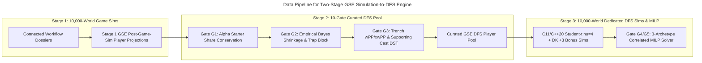

# C4 Code Level: `intelligence/dfs` (Two-Stage GSE Sim-to-DFS Pipeline & 10-Gate Accuracy Engine)

## Overview

- **Name**: GSE DFS Optimizer, Two-Stage Sim-to-DFS Pipeline & 10-Gate Structural Accuracy Engine
- **Description**: Implements the Two-Stage GSE Simulation-to-DFS Pipeline (`Stage 1: 10,000-World Game Sims -> Stage 2: Dedicated Curated GSE DFS Player Pool -> Stage 3: 10,000-World Dedicated DFS Contest Sims`), the 10-Gate Structural Accuracy Engine (`G1..G5`), and the 7-Equation (`EQ-DFS-01..07`) MILP Classic and Showdown portfolio solvers.
- **Location**: [`intelligence/dfs/`](file:///C:/Users/Garrett/Sports/intelligence/dfs) and [`scripts/dfs/`](file:///C:/Users/Garrett/Sports/scripts/dfs)
- **Language**: Python 3.13 (`scipy.optimize.milp`, `numpy`, `pandas`, C11/C++20 `native_bridge`)
- **Purpose**: Produces structurally verified, correlation-aware DraftKings Classic (`QB/2RB/3WR/TE/FLEX/DST`, `$49,900` cap) and Showdown (`1 CPT + 5 FLEX`) GPP portfolios with zero injured/inactive leaks and zero sub-floor WR4/TE3 traps.

## Code Elements

### Functions/Methods

- `run_two_stage_gse_simulation_to_dfs_pipeline(df_scored: pd.DataFrame, dossiers: Dict[str, dict], num_dfs_sims: int = 10000, seed: int = 20261107): Dict[str, Any]`
  - Description: Extracts GSE post-game-sim player projections (`Stage 1`), isolates the curated GSE DFS player pool (`Stage 2`), and runs `10,000` dedicated DFS contest simulations (`Stage 3`) using the C11/C++20 native kernel and Student-$t$ ($\nu=4$) copula.
  - Location: [`intelligence/dfs/two_stage_gse_dfs_pipeline.py:42`](file:///C:/Users/Garrett/Sports/intelligence/dfs/two_stage_gse_dfs_pipeline.py#L42-L276)
  - Dependencies: [`dfs_and_fantasy_accuracy_engine.py`](file:///C:/Users/Garrett/Sports/intelligence/dfs/dfs_and_fantasy_accuracy_engine.py), [`native_bridge.py`](file:///C:/Users/Garrett/Sports/intelligence/native_kernels/native_bridge.py)

- `apply_all_dfs_accuracy_gates_to_main_slate(df: pd.DataFrame, dossiers: Dict[str, dict]): Tuple[pd.DataFrame, Dict[str, Any]]`
  - Description: Applies Gate `G1` (Active Alpha Starter Conservation), Gate `G2` (Empirical Bayes Role-Prior Shrinkage & Sub-Floor Trap Block), and Gate `G3` (Trench `wPP/xwPP` + `QB Supporting Cast` DST Scoring) to the Sunday Main Slate pool.
  - Location: [`intelligence/dfs/dfs_and_fantasy_accuracy_engine.py:135`](file:///C:/Users/Garrett/Sports/intelligence/dfs/dfs_and_fantasy_accuracy_engine.py#L135-L265)
  - Dependencies: `ACTIVE_ALPHA_STARTER_FLOORS`, `VACATED_WORKLOAD_BELLCOW_OVERRIDES`, `DST_WEEK9_TRENCH_AND_MATCHUP_PRIORS`

- `solve_correlated_3_archetype_classic_milp(df: pd.DataFrame, max_salary: int = 49900): List[Dict[str, Any]]`
  - Description: Solves 3 distinct QB-stack archetypes (` QB + >=1 Pass Catcher + >=1 Opposing Bring-Back`) via `scipy.optimize.milp` (`HiGHS`) with `max_overlap <= 5` and zero sub-floor traps (`Gate G4`).
  - Location: [`intelligence/dfs/dfs_and_fantasy_accuracy_engine.py:268`](file:///C:/Users/Garrett/Sports/intelligence/dfs/dfs_and_fantasy_accuracy_engine.py#L268-L410)
  - Dependencies: `scipy.optimize.milp`, `LinearConstraint`, `Bounds`

- `solve_correlated_showdown_milp_and_student_t_sims(show_df: pd.DataFrame, dossiers: Dict[str, dict], num_sims: int = 10000): Dict[str, Any]`
  - Description: Runs 10,000 Student-$t$ ($\nu=4$) correlated Showdown simulations and solves 3 distinct Captain archetypes (`salary >= $7,200`, `max_overlap <= 4`, `CPT QB -> >=2 pass catchers`, `Gate G5`).
  - Location: [`intelligence/dfs/dfs_and_fantasy_accuracy_engine.py:413`](file:///C:/Users/Garrett/Sports/intelligence/dfs/dfs_and_fantasy_accuracy_engine.py#L413-L565)
  - Dependencies: `scipy.optimize.milp`, `scipy.stats.t`

- `run_full_7_equation_dfs_pipeline(players: Sequence[Dict[str, Any]], n_sims: int = 10000, field_size: int = 300, k_portfolio: int = 3, is_showdown: bool = False, seed: int = 42): Dict[str, Any]`
  - Description: Executes all 7 ArXiv/Management-Science DFS equations (`EQ-DFS-01` Dirichlet-Multinomial Field Ownership through `EQ-DFS-07` Adversarial Top-1% Field Dominance Objective).
  - Location: [`intelligence/dfs/dfs_7_equation_full_corpus_engine.py:349`](file:///C:/Users/Garrett/Sports/intelligence/dfs/dfs_7_equation_full_corpus_engine.py#L349-L426)
  - Dependencies: `eq_dfs_01..07`

## Dependencies

### Internal Dependencies
- [`intelligence/native_kernels/native_bridge.py`](file:///C:/Users/Garrett/Sports/intelligence/native_kernels/native_bridge.py)
- [`intelligence/external_charting/morning_sweep_2026_11_07.py`](file:///C:/Users/Garrett/Sports/intelligence/external_charting/morning_sweep_2026_11_07.py)
- [`scripts/ops/run_full_dk_bitemporal_gpp.py`](file:///C:/Users/Garrett/Sports/scripts/ops/run_full_dk_bitemporal_gpp.py)

### External Dependencies
- `numpy`, `pandas`, `scipy` (`HiGHS` MILP solver, `scipy.stats.t`)

## Relationships

