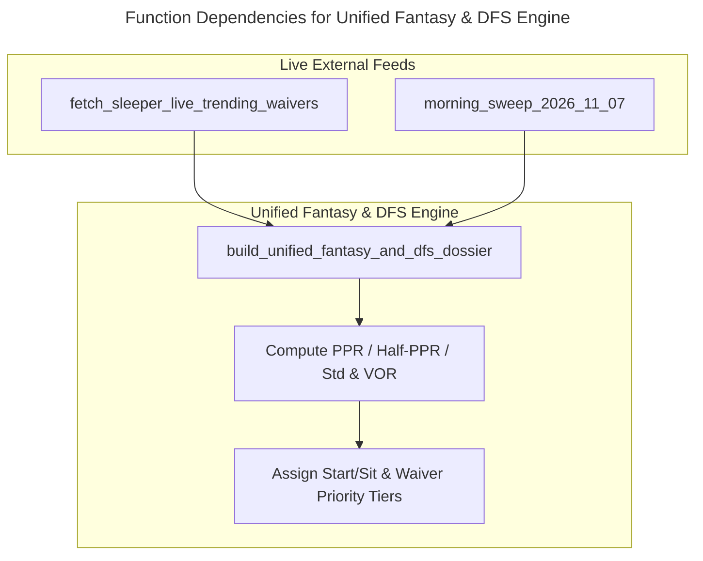

# C4 Code Level: `intelligence/fantasy` (Unified Season-Long Fantasy & DFS Engine)

## Overview

- **Name**: Unified Season-Long Fantasy Football & DFS Engine
- **Description**: Computes Week 9 Season-Long Fantasy Football rankings (`Full-PPR`, `Half-PPR`, `Standard`), Value Over Replacement (`VOR` against `QB12`, `RB24`, `WR30`, `TE12`, `DST12`), Start/Sit tiers (`TIER 1 ELITE MUST-START` through `TIER 5 BENCH / DROP / TRAP`), and live Sleeper 48-hour waiver wire velocity from the same 10,000-world post-sim trajectories and 10-Gate accuracy filters used by DFS.
- **Location**: [`intelligence/fantasy/`](file:///C:/Users/Garrett/Sports/intelligence/fantasy) and [`scripts/research/download_and_ingest_dfs_fantasy_hard_data.py`](file:///C:/Users/Garrett/Sports/scripts/research/download_and_ingest_dfs_fantasy_hard_data.py)
- **Language**: Python 3.13
- **Purpose**: Guarantees 100% mathematical and situational consistency between Season-Long Fantasy Start/Sit/Waiver decisions and DraftKings DFS portfolio selection.

## Code Elements

### Functions/Methods

- `build_unified_fantasy_and_dfs_dossier(): Dict[str, Any]`
  - Description: Loads the 10-Gate post-simulation projections, Morning Sweep (`QB Supporting Cast`, `OL wPP/xwPP`, `FunnelReport+`, `PCVR`), and live Sleeper trending waiver adds/drops, then emits unified `Full-PPR`/`Half-PPR`/`Standard` projections, `VOR`, and Start/Sit tiers.
  - Location: [`intelligence/fantasy/fantasy_and_dfs_unified_engine.py:44`](file:///C:/Users/Garrett/Sports/intelligence/fantasy/fantasy_and_dfs_unified_engine.py#L44-L240)
  - Dependencies: [`morning_sweep_2026_11_07.py`](file:///C:/Users/Garrett/Sports/intelligence/external_charting/morning_sweep_2026_11_07.py), [`sleeper_live_trending_waivers_2026_11_07.json`](file:///C:/Users/Garrett/Sports/data/fantasy/external_datasets/sleeper_live_trending_waivers_2026_11_07.json)

- `fetch_sleeper_live_trending_waivers(): Dict[str, Any]`
  - Description: Pulls live 48-hour waiver add/drop velocity from `https://api.sleeper.app/v1/players/nfl/trending/{add,drop}` and cross-references with `data/nflverse/players.parquet`.
  - Location: [`scripts/research/download_and_ingest_dfs_fantasy_hard_data.py:109`](file:///C:/Users/Garrett/Sports/scripts/research/download_and_ingest_dfs_fantasy_hard_data.py#L109-L171)
  - Dependencies: `urllib.request`, `pandas`, `players.parquet`

## Dependencies

### Internal Dependencies
- [`intelligence/external_charting/morning_sweep_2026_11_07.py`](file:///C:/Users/Garrett/Sports/intelligence/external_charting/morning_sweep_2026_11_07.py)
- [`data/dfs/week9_sunday_main_11_game_packet_2026_11_07.json`](file:///C:/Users/Garrett/Sports/data/dfs/week9_sunday_main_11_game_packet_2026_11_07.json)

### External Dependencies
- Sleeper REST API (`api.sleeper.app`), `nflverse` (`players.parquet`, `player_stats_2025.parquet`)

## Relationships

