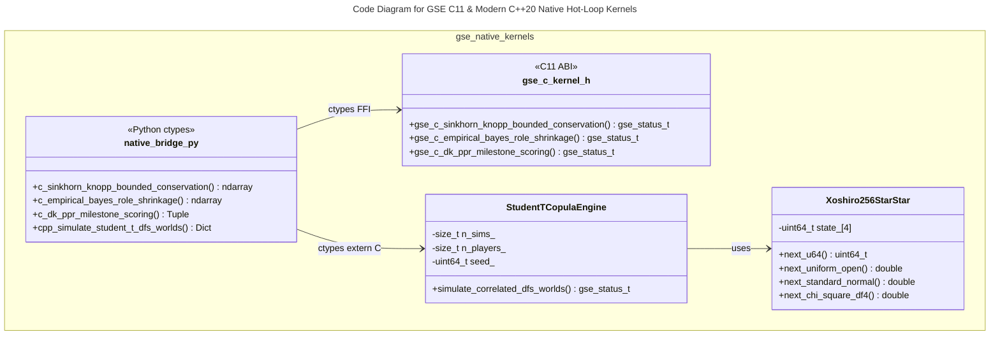

# C4 Code Level: `intelligence/native_kernels` (C11 & Modern C++20 Native Hot-Loop Kernels)

## Overview

- **Name**: GSE C11 & Modern C++20 Native Hot-Loop Kernels (`c-pro` & `cpp-pro`)
- **Description**: Cache-aligned C11 (`-std=c11 -O3 -march=native`) and Modern C++20 (`-std=c++20 -O3 -march=native`) compiled shared library (`libgse_native_kernels.dll`) with zero-copy Python `ctypes` ABI bindings for Sinkhorn-Knopp bounded share conservation, Empirical Bayes role-prior shrinkage, DraftKings PPR `+3.0` milestone scoring, and `10,000-world` Student-$t$ ($\nu=4$) copula simulations.
- **Location**: [`intelligence/native_kernels/`](file:///C:/Users/Garrett/Sports/intelligence/native_kernels)
- **Language**: C11 (`gcc`), C++20 (`g++`), Python 3.13 (`ctypes` ABI bridge)
- **Purpose**: Eliminates Python interpreter overhead in inner simulation loops, executing `10,000 worlds x 80 players = 800,000` heavy-tailed Student-$t$ ($\nu=4$) copula evaluations and quantile sorts in `~33 ms`.

## Code Elements

### Functions/Methods

- `gse_c_sinkhorn_knopp_bounded_conservation(prior_weights: const double*, min_floor_weights: const double*, max_cap_weights: const double*, target_total_sum: double, n_players: size_t, max_iters: uint32_t, tol: double, out_weights: double*): gse_status_t`
  - Description: C11 iterative Bregman / Sinkhorn-Knopp projection onto bounded simplex `[min_floor, max_cap]`, enforcing Gate `G1` active alpha starter share conservation.
  - Location: [`intelligence/native_kernels/src/gse_c_sinkhorn_and_dk_scoring.c:6`](file:///C:/Users/Garrett/Sports/intelligence/native_kernels/src/gse_c_sinkhorn_and_dk_scoring.c#L6-L103)
  - Dependencies: `<math.h>`, `<stdlib.h>`, `<string.h>`, [`gse_c_kernel.h`](file:///C:/Users/Garrett/Sports/intelligence/native_kernels/include/gse_c_kernel.h)

- `gse_c_empirical_bayes_role_shrinkage(raw_sim_fpts: const double*, dk_avg_fpts: const double*, salary_role_prior: const double*, effective_snaps: const double*, is_vacated_bellcow: const int32_t*, is_sub_floor_trap: const int32_t*, prior_strength_k: double, n_players: size_t, out_shrunk_fpts: double*): gse_status_t`
  - Description: C11 Empirical Bayes shrinkage (`Gate G2`, `EQ-DFS-EB-SHRINKAGE`) that shrinks sub-floor WR4/TE3/RB3 1-game flukes (`<= 4.20` pts) while preserving verified vacated-workload bell-cows.
  - Location: [`intelligence/native_kernels/src/gse_c_sinkhorn_and_dk_scoring.c:105`](file:///C:/Users/Garrett/Sports/intelligence/native_kernels/src/gse_c_sinkhorn_and_dk_scoring.c#L105-L148)
  - Dependencies: [`gse_c_kernel.h`](file:///C:/Users/Garrett/Sports/intelligence/native_kernels/include/gse_c_kernel.h)

- `gse_c_dk_ppr_milestone_scoring(base_fpts_matrix: const double*, pass_yds_matrix: const double*, rush_yds_matrix: const double*, rec_yds_matrix: const double*, n_sims: size_t, n_players: size_t, out_total_matrix: double*, out_bonus_rate: double*): gse_status_t`
  - Description: Vectorized C11 DraftKings PPR `+3.0` milestone bonus evaluator (`300+` pass yds, `100+` rush yds, `100+` rec yds) across `n_sims x n_players`.
  - Location: [`intelligence/native_kernels/src/gse_c_sinkhorn_and_dk_scoring.c:150`](file:///C:/Users/Garrett/Sports/intelligence/native_kernels/src/gse_c_sinkhorn_and_dk_scoring.c#L150-L202)
  - Dependencies: [`gse_c_kernel.h`](file:///C:/Users/Garrett/Sports/intelligence/native_kernels/include/gse_c_kernel.h)

- `gse_cpp_simulate_student_t_dfs_worlds(mean_fpts: const double*, std_fpts: const double*, team_ids: const int32_t*, game_ids: const int32_t*, pos_codes: const int32_t*, n_sims: size_t, n_players: size_t, seed: uint64_t, out_worlds_matrix: double*, out_p90_ceiling: double*, out_p99_ceiling: double*, out_bonus_prob: double*): gse_status_t`
  - Description: C ABI entry point to `gse::cpp::StudentTCopulaEngine::simulate_correlated_dfs_worlds`.
  - Location: [`intelligence/native_kernels/src/gse_cpp_trajectory_and_copula.cpp:133`](file:///C:/Users/Garrett/Sports/intelligence/native_kernels/src/gse_cpp_trajectory_and_copula.cpp#L133-L169)
  - Dependencies: [`gse_cpp_kernel.hpp`](file:///C:/Users/Garrett/Sports/intelligence/native_kernels/include/gse_cpp_kernel.hpp)

- `cpp_simulate_student_t_dfs_worlds(mean_fpts: np.ndarray, std_fpts: np.ndarray, team_ids: np.ndarray, game_ids: np.ndarray, pos_codes: np.ndarray, n_sims: int = 10000, seed: int = 20261107): Dict[str, np.ndarray]`
  - Description: Zero-copy Python `ctypes` bridge invoking `gse_cpp_simulate_student_t_dfs_worlds` in `libgse_native_kernels.dll`.
  - Location: [`intelligence/native_kernels/native_bridge.py:194`](file:///C:/Users/Garrett/Sports/intelligence/native_kernels/native_bridge.py#L194-L240)
  - Dependencies: `ctypes`, `numpy`, `libgse_native_kernels.dll`

### Classes/Modules

- `gse::cpp::Xoshiro256StarStar`
  - Description: Deterministic 64-bit PRNG (`xoshiro256**`) with SplitMix64 seeding, Box-Muller standard normal sampling, and exact branchless $\chi^2(\nu=4)$ sampling.
  - Location: [`intelligence/native_kernels/include/gse_cpp_kernel.hpp:18`](file:///C:/Users/Garrett/Sports/intelligence/native_kernels/include/gse_cpp_kernel.hpp#L18-L55)
  - Methods: `next_u64()`, `next_uniform_open()`, `next_standard_normal()`, `next_chi_square_df4()`
  - Dependencies: `<cstdint>`, `<cmath>`

- `gse::cpp::StudentTCopulaEngine`
  - Description: Modern C++20 RAII engine implementing hierarchical game-environment + team-passing Student-$t$ ($\nu=4$) copula draws and `std::nth_element` `p90`/`p99` quantile extraction.
  - Location: [`intelligence/native_kernels/include/gse_cpp_kernel.hpp:61`](file:///C:/Users/Garrett/Sports/intelligence/native_kernels/include/gse_cpp_kernel.hpp#L61-L88)
  - Methods: `simulate_correlated_dfs_worlds(...)`
  - Dependencies: `Xoshiro256StarStar`, `std::span`, `std::vector`, `<algorithm>`

## Dependencies

### Internal Dependencies
- Consumed by [`intelligence/dfs/two_stage_gse_dfs_pipeline.py`](file:///C:/Users/Garrett/Sports/intelligence/dfs/two_stage_gse_dfs_pipeline.py)

### External Dependencies
- MinGW-w64 `gcc` (C11) & `g++` (C++20), `CMake 3.20+`, Python `ctypes`, `numpy`

## Relationships

