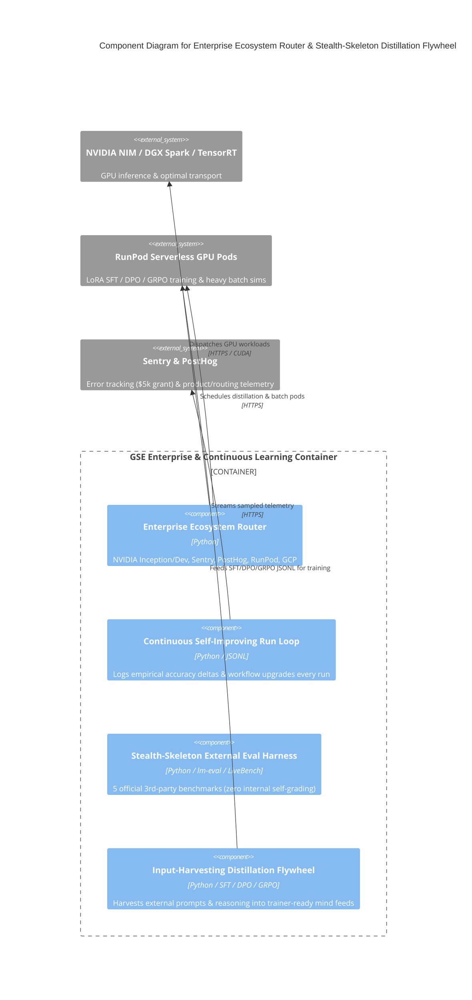

# C4 Component Level: Enterprise Cloud Ecosystem Router & Stealth-Skeleton Distillation Flywheel

## Overview

- **Name**: Enterprise Cloud Ecosystem Router & Stealth-Skeleton Distillation Flywheel Component
- **Description**: Orchestrates all 6 enterprise programs (`NVIDIA Inception`, `NVIDIA Developer` NIM/RAPIDS/TAO/TensorRT, `Sentry`, `PostHog`, `RunPod`, `Google Cloud / Gemini`), executes the Continuous Self-Improving Run Loop, benchmarks `Stealth-Skeleton` on 5 official third-party external harnesses (`EleutherAI lm-eval`, `ICLR 2025 LiveBench`, `LMSYS Arena-Hard-Auto`, `ForecastBench`, `OpenRouter`), and harvests external multi-agent inputs into `SFT / DPO / GRPO` distillation feeds.
- **Type**: Infrastructure, Telemetry & Continuous Learning Component
- **Technology**: Python 3.13, CUDA / TensorRT / NIM, RunPod GraphQL/REST, Sentry & PostHog APIs

## Purpose

Ensures every single engine run leverages our full enterprise compute/telemetry stack, improves workflow intelligence automatically, evaluates `Stealth-Skeleton` on official external leaderboards (`internal_self_grading_allowed: False`), and trains `Stealth-Skeleton` continuously on harvested external inputs.

## Software Features

- **6-Program Enterprise Router**: Verifies and routes across `NVIDIA Inception`, `NVIDIA Developer`, `Sentry` (`tracesSampleRate: 0.1` startup grant guard), `PostHog`, `RunPod` serverless GPU pods, and `Google Cloud / Gemini`.
- **Continuous Self-Improving Run Loop**: Appends run telemetry and structural accuracy deltas to `data/engine/continuous_run_improvement_ledger.jsonl` and `data/mind/feeds/continuous_run_improvement_feed_2026_11_07.jsonl`.
- **Official External Evaluation Harnesses**: Configures `lm-evaluation-harness` (Open LLM Leaderboard v2), `LiveBench`, `Arena-Hard-Auto`, `ForecastBench`, and `OpenRouter`.
- **Input-Harvesting & Reasoning Distillation Flywheel**: Converts external prompts, reasoning chains, and tool-call trajectories into `SFT`, `DPO`, and `GRPO` training examples (`data/mind/feeds/stealth_skeleton_distillation_flywheel_2026_11_07.jsonl`).

## Code Elements

This component contains the following code-level elements:

- [`c4-code-intelligence-providers-and-routing.md`](./c4-code-intelligence-providers-and-routing.md) - Enterprise Ecosystem Router and Stealth-Skeleton External Eval + Distillation Flywheel

## Interfaces

### Enterprise & Distillation Interface

- **Protocol**: HTTPS REST / GraphQL & Local JSONL Mind Feeds
- **Description**: Verifies enterprise providers, logs continuous run improvements, and emits `SFT/DPO/GRPO` distillation pairs.
- **Operations**:
  - `verify_enterprise_ecosystem_and_services(): Dict[str, Any]`
  - `record_continuous_self_improving_run(run_stage, metrics, improvements_applied): Dict[str, Any]`
  - `build_official_external_evaluation_manifest(): Dict[str, Any]`
  - `harvest_and_distill_external_inputs_for_stealth_skeleton(): Dict[str, Any]`

## Component Diagram

