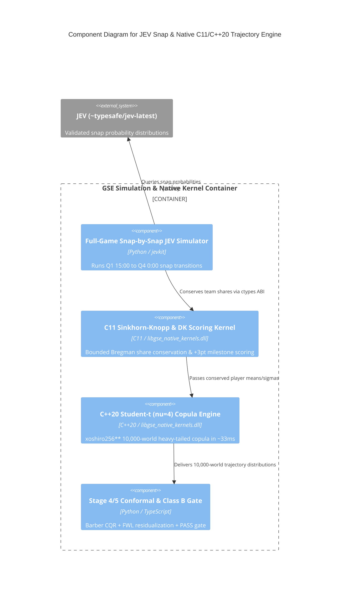

# C4 Component Level: Full-Game JEV Snap Simulator & C11/C++20 Native Trajectory Engine

## Overview

- **Name**: Full-Game JEV Snap Simulator & C11/C++20 Native Trajectory Engine Component
- **Description**: Executes `Stage 3` (`Full-Game Snap-by-Snap JEV Simulation + 10,000-World x 175-Snap PBP Trajectory Engine`), Sinkhorn-Knopp bounded share conservation (`Gate G1`), and `Stage 4/5` Conformal Calibration & Class B Conjunction Gate using compiled C11 (`c-pro`) and C++20 (`cpp-pro`) native hot-loop kernels (`libgse_native_kernels.dll`).
- **Type**: High-Performance Simulation & Calibration Component
- **Technology**: C11 (`gcc -O3 -march=native`), Modern C++20 (`g++ -O3 -march=native`), Python 3.13 (`ctypes`, `numpy`)

## Purpose

Runs the entire game from Snap 1 (`Q1 15:00`) through `Q4 0:00` conditioned on Stage 2 situational priors, enforces conserved team target/carry shares via C11 Sinkhorn-Knopp optimal transport, and produces Stage 1 GSE Post-Game-Sim Player Projections (`data/dfs/gse_post_game_sim_player_projections_week9_2026_11_07.json`) plus 360-degree 77+ market prop evaluations.

## Software Features

- **Full-Game Snap-by-Snap JEV Evaluation**: Queries `jevkit.client.ask()` (`~typesafe/jev-latest`) across every snap state (`off_play_call`, `def_shell_call`, `target_carrier`, `snap_outcome`, `pressure_disruption`).
- **C11 Sinkhorn-Knopp Bounded Conservation (`gse_c_sinkhorn_knopp_bounded_conservation`)**: Enforces team target/rush share conservation while preserving active alpha starter floors (`Gate G1`).
- **C++20 Student-$t$ ($\nu=4$) Heavy-Tailed Copula (`StudentTCopulaEngine`)**: Simulates `10,000 worlds x N players` in `~33 ms` using deterministic `xoshiro256**` PRNG.
- **Stage 4/5 Conformal Calibration & Class B Gate**: Applies Romano/Barber weighted conformal intervals and marks any negative/sub-threshold edge as `PASS`.

## Code Elements

This component contains the following code-level elements:

- [`c4-code-intelligence-native-kernels.md`](./c4-code-intelligence-native-kernels.md) - C11 & Modern C++20 native shared library (`libgse_native_kernels.dll`) and Python `ctypes` bridge
- [`c4-code-packages-mcp-equations-and-prediction-engine.md`](./c4-code-packages-mcp-equations-and-prediction-engine.md) - Conformal calibration and Class B Conjunction Gate

## Interfaces

### Native Kernel & Trajectory Simulation Interface

- **Protocol**: C11 / `extern "C"` Shared Library ABI (`ctypes`) & Python API
- **Description**: Exposes sub-millisecond/millisecond C11 and C++20 numerical kernels to Python simulation pipelines.
- **Operations**:
  - `c_sinkhorn_knopp_bounded_conservation(prior_weights, min_floor_weights, max_cap_weights, target_total_sum): np.ndarray`
  - `c_empirical_bayes_role_shrinkage(raw_sim_fpts, dk_avg_fpts, salary_role_prior, effective_snaps, is_vacated_bellcow, is_sub_floor_trap): np.ndarray`
  - `c_dk_ppr_milestone_scoring(base_fpts_matrix, pass_yds_matrix, rush_yds_matrix, rec_yds_matrix): Tuple[np.ndarray, np.ndarray]`
  - `cpp_simulate_student_t_dfs_worlds(mean_fpts, std_fpts, team_ids, game_ids, pos_codes, n_sims, seed): Dict[str, np.ndarray]`

## Dependencies

### Components Used
- Consumes Stage 2 priors from [`c4-component-situational-reasoning-and-equation-router.md`](./c4-component-situational-reasoning-and-equation-router.md)
- Emits Stage 1 post-game-sim player projections to [`c4-component-two-stage-dfs-and-fantasy-engine.md`](./c4-component-two-stage-dfs-and-fantasy-engine.md)

### External Systems
- `jevkit.client.ask` (`~typesafe/jev-latest`)

## Component Diagram

