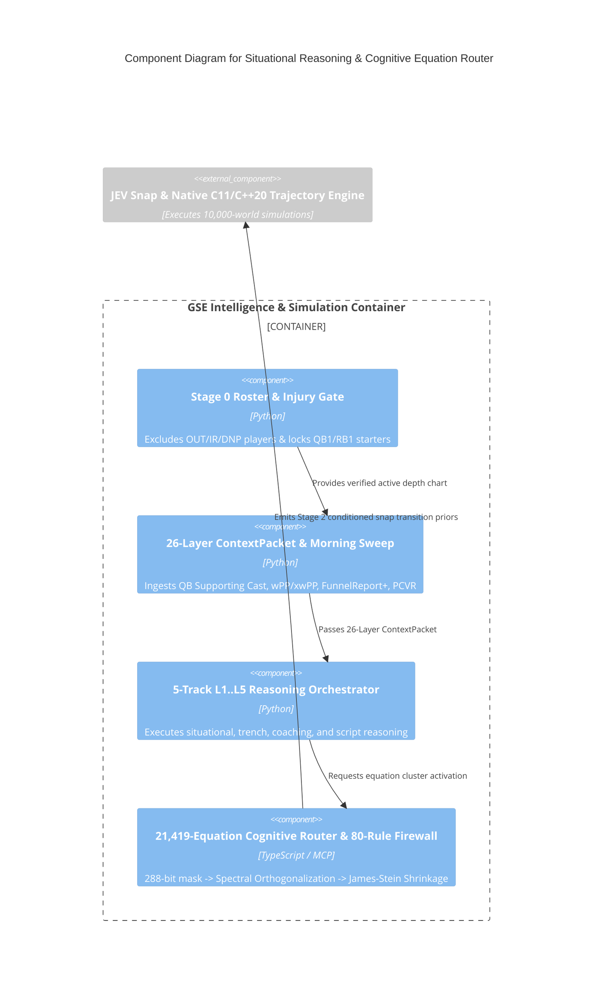

# C4 Component Level: Situational Reasoning & `21,419`-Equation Cognitive Router

## Overview

- **Name**: Situational Reasoning & `21,419`-Equation Cognitive Router Component
- **Description**: Synthesizes the 26-Layer `ContextPacket` (`L01..L26`), 5-Track `L1..L5` `ReasoningTrace`, Morning Sweep charting (`QB Supporting Cast`, `OL wPP/xwPP`, `FunnelReport+`, `PCVR`, `Seattle Red-Zone Inversion`), 80-Rule Misleading-Stat Firewall, and 4-Stage `21,419`-Equation Cognitive Router into conditioned snap transition priors before any simulation runs.
- **Type**: Core Intelligence & Mathematical Routing Component
- **Technology**: Python 3.13 + TypeScript 5.x (`MCP Equations Server`)

## Purpose

Implements `Stage 1` and `Stage 2` (`Situational First`) of the GSE Engine Gate Doctrine so zero simulations ever run on unconditioned season averages.

## Software Features

- **Stage 0 Live Roster & Injury Gate**: Hard-blocks `OUT`/`IR`/`DNP`/inactive players (`TreVeyon Henderson`, `De'Von Achane`, `Jaylen Wright`, `Tanner McKee`, `Lamar Jackson`, `Isaiah Likely`) and enforces verified Week 9 starters (`Joe Milton III` for `PHI`, `Ollie Gordon II` for `MIA`, `Rhamondre Stevenson` for `NE`, `Malik Davis` for `DAL`).
- **26-Layer `ContextPacket` & Morning Sweep Integration**: Incorporates `QB Supporting Cast Score`, `wPP/xwPP` pass protection, `FunnelReport+`, and `PCVR`.
- **4-Stage Cognitive Equation Router (`21,419` Equations)**: Computes the 288-bit context mask, runs spectral cluster orthogonalization (`Stage C`), and applies cross-equation Jacobian coupling & positive-part James-Stein shrinkage capped at $|\Delta\text{log-odds}| \le 0.35$ (`Stage D`).

## Code Elements

This component contains the following code-level elements:

- [`c4-code-intelligence-coaching-and-reasoning.md`](./c4-code-intelligence-coaching-and-reasoning.md) - 26-Layer `ContextPacket`, Morning Sweep charting, and 5-Track `L1..L5` `ReasoningTrace`
- [`c4-code-packages-mcp-equations-and-prediction-engine.md`](./c4-code-packages-mcp-equations-and-prediction-engine.md) - `21,419`-Equation Cognitive Router, 80-Rule Firewall, and Conjunction Gate

## Interfaces

### Cognitive Router & Situational Prior Interface

- **Protocol**: In-Process Python/TypeScript Bridge & MCP JSON-RPC
- **Description**: Produces conditioned snap priors, trench disruption probabilities, and log-odds adjustments for the trajectory simulator.
- **Operations**:
  - `compute_morning_sweep_situational_adjustment(off_team, def_team, is_red_zone): Dict[str, Any]`
  - `buildContextMask(context: SituationalContext): BigInt`
  - `aggregateSituationalReasoning(input: MasterSituationalInput): SituationalOverlayOutput`

## Dependencies

### Components Used
- Feeds conditioned priors into [`c4-component-jev-snap-and-native-trajectory-engine.md`](./c4-component-jev-snap-and-native-trajectory-engine.md)

### External Systems
- `nflverse` play-by-play & injury feeds (`data/nflverse/`)
- Morning Sweep external charting CSVs (`data/external_charting/2026-11-07/`)

## Component Diagram

