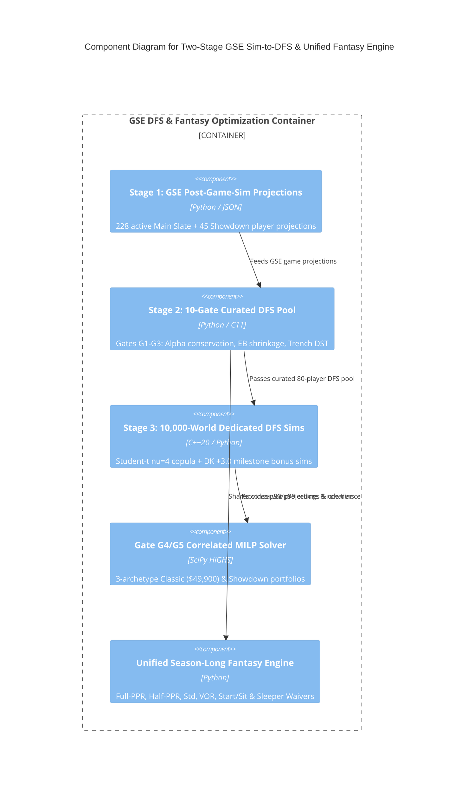

# C4 Component Level: Two-Stage GSE Simulation-to-DFS & Unified Season-Long Fantasy Engine

## Overview

- **Name**: Two-Stage GSE Simulation-to-DFS & Unified Season-Long Fantasy Engine Component
- **Description**: Consumes `Stage 1` GSE Post-Game-Sim Player Projections, applies the 10-Gate Structural Accuracy Filter (`G1..G5`) to isolate `Stage 2` GSE's Dedicated Curated DFS Player Pool, runs `Stage 3` Dedicated `10,000-World` Second-Stage DFS Contest Simulations (`C11/C++20` kernel + `EQ-DFS-01..07`), solves 3-archetype correlated Classic and Showdown MILP portfolios, and builds Unified Season-Long Fantasy (`Full-PPR`/`Half-PPR`/`Standard`, `VOR`, Start/Sit tiers, Sleeper waiver velocity) rankings.
- **Type**: Optimization & Decision Engine Component
- **Technology**: Python 3.13, `scipy.optimize.milp` (`HiGHS`), C11/C++20 `libgse_native_kernels.dll`

## Purpose

Eliminates every structural flaw that previously degraded DFS performance (alpha omissions, `$3,000` WR4 fluke traps, road-dog punt DSTs, Showdown greedy clones) by separating game simulation (`Stage 1`), curated DFS pool selection (`Stage 2`), and dedicated DFS contest simulation (`Stage 3`).

## Software Features

- **Stage 1 $\to$ Stage 2 Curated DFS Pool Selection**: Rejects `148` sub-floor/trap candidates on the Sunday Main Slate (`Isaac TeSlaa $3,100`, `KeAndre Lambert-Smith $3,000`, `Omar Cooper Jr. $4,900`, `Xavier Hutchinson $4,000`, `Foster Moreau $2,500`, `Brock Wright $2,500`, `Jets DST @ KC`, `Raiders DST @ SF`) while retaining `80` verified high-floor/high-ceiling playmakers (`Ollie Gordon II $5,600`, `Rhamondre Stevenson $6,100`, `Malik Davis $4,000`, `Greg Dulcich $3,100`, `Joe Milton III $4,100`).
- **Stage 3 Dedicated 10,000-World DFS Contest Simulation**: Evaluates `p50`, `p75`, `p90`, `p99` slate-breaker ceilings and `+3.0` (`300-yd pass` / `100-yd rush` / `100-yd rec`) bonus rates via C11/C++20 native kernels.
- **Gate `G4` & `G5` Correlated 3-Archetype MILP Solvers**: Builds 3 distinct QB-stack Classic lineups (`$49,900` cap) and 3 distinct Captain Showdown lineups (`max_overlap <= 4`).
- **Unified Season-Long Fantasy Rankings**: Outputs `Full-PPR`, `Half-PPR`, `Standard`, `VOR`, and live Sleeper 48-hour trending waiver tiers.

## Code Elements

This component contains the following code-level elements:

- [`c4-code-intelligence-dfs.md`](./c4-code-intelligence-dfs.md) - Two-Stage GSE Sim-to-DFS Pipeline, 10-Gate Accuracy Engine, and 7-Equation MILP Optimizer
- [`c4-code-intelligence-fantasy.md`](./c4-code-intelligence-fantasy.md) - Unified Season-Long Fantasy & DFS Engine and Sleeper live waiver integration
- [`c4-code-intelligence-native-kernels.md`](./c4-code-intelligence-native-kernels.md) - C11/C++20 native scoring and Student-$t$ copula kernels

## Interfaces

### DFS & Fantasy Packet Generation Interface

- **Protocol**: Python Module API & JSON/Markdown Artifact Output
- **Description**: Produces verified DraftKings Classic/Showdown packets and unified Season-Long Fantasy rankings.
- **Operations**:
  - `run_two_stage_gse_simulation_to_dfs_pipeline(df_scored, dossiers, num_dfs_sims=10000): Dict[str, Any]`
  - `solve_correlated_3_archetype_classic_milp(df, max_salary=49900): List[Dict[str, Any]]`
  - `solve_correlated_showdown_milp_and_student_t_sims(show_df, dossiers, num_sims=10000): Dict[str, Any]`
  - `build_unified_fantasy_and_dfs_dossier(): Dict[str, Any]`

## Dependencies

### Components Used
- [`c4-component-jev-snap-and-native-trajectory-engine.md`](./c4-component-jev-snap-and-native-trajectory-engine.md)

### External Systems
- DraftKings Salary Exports (`data/dfs/dk_salaries_*.csv`)
- Sleeper Trending Waivers API (`https://api.sleeper.app/v1/players/nfl/trending/add`)

## Component Diagram

