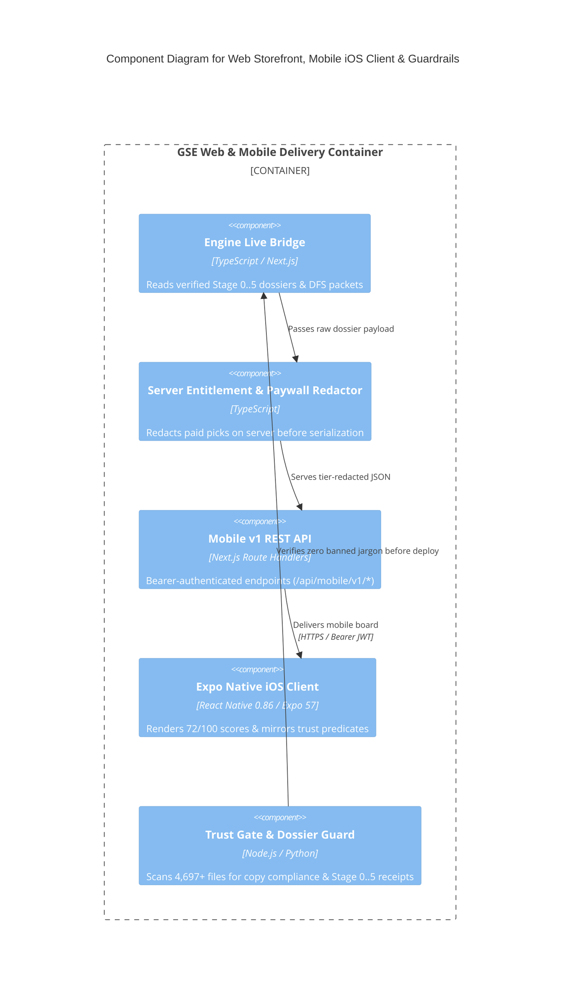

# C4 Component Level: Web Storefront, Mobile iOS Client & Public Copy Guardrails

## Overview

- **Name**: Web Storefront, Mobile iOS Client & Public Copy Guardrails Component
- **Description**: Serves natural football-film & matchup analysis on `https://www.galaxysportsedge.com` (`apps/web`) and the native iOS app (`apps/mobile`), enforces server-side paywall redaction, renders confidence strictly as `72/100`, and blocks internal math jargon or unverified claims via `scripts/trust-gate.mjs`.
- **Type**: Customer-Facing Presentation & API Delivery Component
- **Technology**: Next.js 14 (React 18.3), Expo SDK 57 / React Native 0.86.3 (React 19.2.3), Stripe, Neon PostgreSQL 17

## Purpose

Delivers verified game-environment analytics to public visitors and full authenticated pick/prop/DFS/fantasy portfolios to paid members while protecting proprietary engine IP and maintaining strict compliance guardrails.

## Software Features

- **Engine Live Bridge (`engine-live-bridge.ts`)**: Hydrates web and mobile views from verified Stage 0..5 dossiers.
- **Server-Side Paywall Redaction & Entitlements**: Redacts official sides, totals, player prop tickets, and SGP legs on the server before payload serialization.
- **Defensive Mobile Trust Mirror (`trust.ts`)**: Mirrors `adverse-edge-suppression` and stale-pick filtering on iOS (`72/100` score format enforced by `apps/mobile/scripts/lint-rules.js`).
- **Pre-Deploy Guardrails (`trust-gate.mjs` & `connected-workflow-dossier-guard.py`)**: Scans `4,697+` repository files to prevent math-jargon leaks or banned phrases.

## Code Elements

This component contains the following code-level elements:

- [`c4-code-apps-web-and-mobile.md`](./c4-code-apps-web-and-mobile.md) - Web Storefront, Mobile v1 API, iOS Client, and Trust Gate

## Component Diagram

