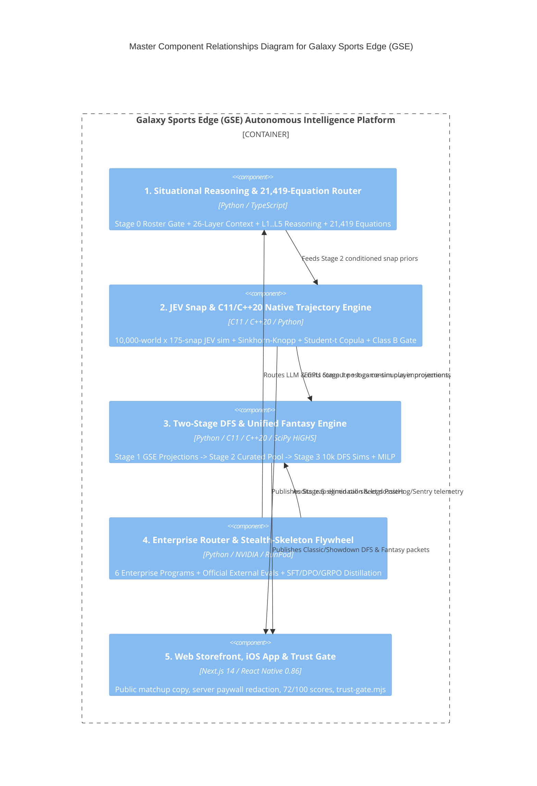

# C4 Component Level: System Overview (Master Component Index)

## System Components

### 1. Situational Reasoning & `21,419`-Equation Cognitive Router
- **Name**: Situational Reasoning & `21,419`-Equation Cognitive Router Component
- **Description**: Executes Stage 0 active roster/injury filtering, builds the 26-Layer `ContextPacket` (including Morning Sweep `QB Supporting Cast`, `OL wPP/xwPP`, `FunnelReport+`, `PCVR`), runs the 5-Track `L1..L5` `ReasoningTrace`, and routes through the `21,419`-equation registry (`288-bit` mask $\to$ Spectral Orthogonalization $\to$ James-Stein Shrinkage).
- **Documentation**: [`c4-component-situational-reasoning-and-equation-router.md`](./c4-component-situational-reasoning-and-equation-router.md)

### 2. Full-Game JEV Snap Simulator & C11/C++20 Native Trajectory Engine
- **Name**: Full-Game JEV Snap Simulator & C11/C++20 Native Trajectory Engine Component
- **Description**: Runs sequential full-game snap simulations (`Q1 15:00` to `Q4 0:00`) via `jevkit.client.ask`, enforces C11 Sinkhorn-Knopp bounded share conservation (`libgse_native_kernels.dll`), executes C++20 `10,000-world` Student-$t$ ($\nu=4$) copula simulations in `~33 ms`, and applies Conformal Calibration & the Class B Conjunction Gate.
- **Documentation**: [`c4-component-jev-snap-and-native-trajectory-engine.md`](./c4-component-jev-snap-and-native-trajectory-engine.md)

### 3. Two-Stage GSE Simulation-to-DFS & Unified Season-Long Fantasy Engine
- **Name**: Two-Stage GSE Simulation-to-DFS & Unified Season-Long Fantasy Engine Component
- **Description**: Separates Stage 1 GSE Post-Game-Sim Projections, Stage 2 Dedicated Curated GSE DFS Player Pool (`10-Gate` filter eliminating WR4/TE3 traps and road-dog punt DSTs), and Stage 3 Dedicated `10,000-World` DFS Contest Simulations + 3-Archetype Correlated MILP Classic/Showdown solvers + Unified Season-Long Fantasy rankings.
- **Documentation**: [`c4-component-two-stage-dfs-and-fantasy-engine.md`](./c4-component-two-stage-dfs-and-fantasy-engine.md)

### 4. Enterprise Cloud Ecosystem Router & Stealth-Skeleton Distillation Flywheel
- **Name**: Enterprise Cloud Ecosystem Router & Stealth-Skeleton Distillation Flywheel Component
- **Description**: Orchestrates `NVIDIA Inception`, `NVIDIA Developer`, `Sentry`, `PostHog`, `RunPod`, and `Google Cloud / Gemini`, runs the Continuous Self-Improving Run Loop, benchmarks `Stealth-Skeleton` on 5 official external harnesses (`lm-eval`, `LiveBench`, `Arena-Hard-Auto`, `ForecastBench`, `OpenRouter`), and distills external inputs into `SFT / DPO / GRPO` mind feeds.
- **Documentation**: [`c4-component-enterprise-cloud-and-stealth-distillation.md`](./c4-component-enterprise-cloud-and-stealth-distillation.md)

### 5. Web Storefront, Mobile iOS Client & Public Copy Guardrails
- **Name**: Web Storefront, Mobile iOS Client & Public Copy Guardrails Component
- **Description**: Delivers natural football-film analysis and server-redacted premium cards across `apps/web` (`Next.js 14`) and `apps/mobile` (`Expo SDK 57 / React Native 0.86`), protected by `scripts/trust-gate.mjs`.
- **Documentation**: [`c4-component-web-and-mobile-delivery.md`](./c4-component-web-and-mobile-delivery.md)

## Component Relationships

