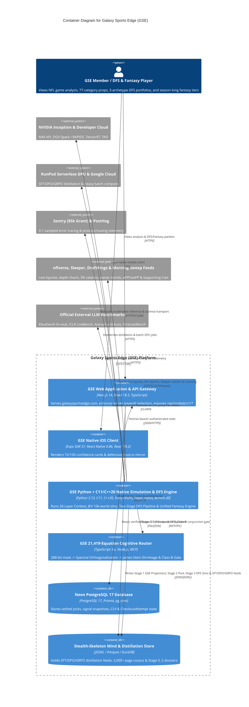

# C4 Container Level: System Deployment Architecture

## Containers

### 1. GSE Web Application & API Gateway (`apps/web`)
- **Name**: GSE Web Storefront & Next.js API Gateway
- **Description**: Hosts `https://www.galaxysportsedge.com`, serves public game-environment analytics, enforces server-side Stripe entitlement redaction, and exposes `/api/mobile/v1/*` endpoints.
- **Type**: Web Application & REST API Gateway
- **Technology**: Next.js 14, React 18.3, TypeScript 5.x, `@sentry/nextjs` (`tracesSampleRate: 0.1`), PostHog
- **Deployment**: Vercel Production Edge & Serverless Node Functions (`origin/main`)

### 2. GSE Autonomous Intelligence, Simulation & C11/C++20 Native Kernel Container (`intelligence/` & `scripts/`)
- **Name**: GSE Python + C11/C++20 Native Simulation, DFS & Fantasy Engine
- **Description**: Executes Stage 0..5 game prep, the 26-Layer `ContextPacket`, 5-Track `L1..L5` `ReasoningTrace`, Full-Game Snap-by-Snap JEV simulation (`10,000 worlds x 175 snaps`), C11/C++20 native hot-loop kernels (`libgse_native_kernels.dll`), the Two-Stage GSE Sim-to-DFS Pipeline, and the Unified Season-Long Fantasy Engine.
- **Type**: High-Performance Compute & Optimization Worker
- **Technology**: Python 3.13, C11 (`gcc -O3 -march=native`), Modern C++20 (`g++ -O3 -march=native`), SciPy `HiGHS` MILP, DuckDB, NumPy, NVIDIA RTX 5070 / RunPod GPU Pods
- **Deployment**: Local Workstation (`NVIDIA RTX 5070 12GB`) + RunPod Serverless GPU Pods + Git-backed Artifact Pipeline

### 3. GSE MCP Equations & Cognitive Router Server (`packages/mcp-equations-server` & `packages/prediction-engine`)
- **Name**: `21,419`-Equation Cognitive Router & Conjunction Gate Container
- **Description**: Evaluates the `288-bit` context mask across `21,419` equations, performs Spectral Cluster Orthogonalization and Positive-Part James-Stein Shrinkage, runs the 80-Rule Misleading-Stat Firewall, and signs tickets via the Class B Market De-Vig Conjunction Gate.
- **Type**: Mathematical Routing Service / Package
- **Technology**: TypeScript 5.x, Node.js, Model Context Protocol (`MCP`)
- **Deployment**: Embedded Node/TypeScript runtime & MCP server

### 4. GSE Primary Relational & Telemetry Database (`Neon PostgreSQL 17`)
- **Name**: Neon Serverless PostgreSQL 17 Database
- **Description**: Stores `picks`, `pick_signal_snapshots`, `CheckoutAttempt` idempotency state, closing line values, and automated `pg_cron` maintenance jobs (`weekly-vacuum-analyze`, `weekly-odds-analyze`).
- **Type**: Relational Database (`ContainerDb`)
- **Technology**: PostgreSQL 17, Prisma ORM, `pg_cron`
- **Deployment**: Managed Neon Serverless (`4.2 GB` heap, `0%` dead tuples)

### 5. GSE Native iOS Client (`apps/mobile`)
- **Name**: GSE Native iOS Mobile Application
- **Description**: Native mobile client rendering tier-gated cards, `72/100` integer scores, and defensive `trust.ts` stale-pick/adverse-edge filtering.
- **Type**: Mobile Application
- **Technology**: Expo SDK 57, React Native 0.86.3, React 19.2.3, TypeScript
- **Deployment**: Apple App Store / TestFlight (`isolated lockfile outside root npm workspaces`)

### 6. Stealth-Skeleton Distillation & Mind Feed Store (`data/mind/feeds/` & `brain/mind.jsonl`)
- **Name**: Stealth-Skeleton Distillation Flywheel & Mind Corpus Store
- **Description**: Stores trainer-ready `SFT / DPO / GRPO` JSONL feeds harvested from external multi-agent inputs, the `5,000+` page DFS/Fantasy scientific corpus, and official external benchmark manifests.
- **Type**: Append-Only JSONL Data Store & Training Pipeline
- **Technology**: JSONL, HuggingFace / `lm-evaluation-harness`, RunPod LoRA/GRPO Trainer
- **Deployment**: Repository-tracked `data/mind/feeds/*.jsonl` + Windows Single-Writer Mind Trainer

## Interfaces

### 1. GSE Engine & Two-Stage DFS API
- **Protocol**: HTTPS / JSON
- **Description**: Delivers Stage 0..5 game dossiers and Two-Stage DFS/Fantasy packets.
- **Specification**: [`apis/gse-engine-and-dfs-api.yaml`](./apis/gse-engine-and-dfs-api.yaml)
- **Endpoints**:
  - `GET /api/engine/live-board` - Verified NFL game board with server-side paywall redaction
  - `GET /api/dfs/two-stage-packet` - Stage 1 GSE Projections, Stage 2 Curated Pool, and Stage 3 3-Archetype MILP Lineups

### 2. GSE Mobile v1 API
- **Protocol**: HTTPS / Bearer JWT
- **Description**: Serves the Expo iOS client with redacted cards and `72/100` score formatting.
- **Specification**: [`apis/gse-mobile-v1-api.yaml`](./apis/gse-mobile-v1-api.yaml)
- **Endpoints**:
  - `GET /api/mobile/v1/slate` - Active mobile slate payload

## Components Mapped to Containers

- **GSE Autonomous Intelligence & C11/C++20 Container**:
  - [`c4-component-situational-reasoning-and-equation-router.md`](./c4-component-situational-reasoning-and-equation-router.md)
  - [`c4-component-jev-snap-and-native-trajectory-engine.md`](./c4-component-jev-snap-and-native-trajectory-engine.md)
  - [`c4-component-two-stage-dfs-and-fantasy-engine.md`](./c4-component-two-stage-dfs-and-fantasy-engine.md)
  - [`c4-component-enterprise-cloud-and-stealth-distillation.md`](./c4-component-enterprise-cloud-and-stealth-distillation.md)
- **GSE Web & Mobile Delivery Containers**:
  - [`c4-component-web-and-mobile-delivery.md`](./c4-component-web-and-mobile-delivery.md)

## Container Diagram

