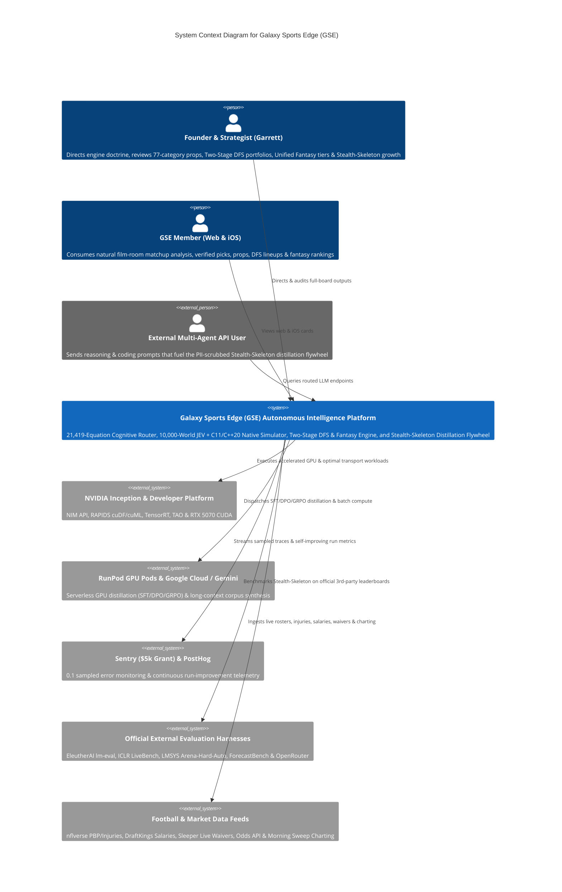

# C4 Context Level: Galaxy Sports Edge (GSE) System Context

## System Overview

### Short Description

Galaxy Sports Edge (GSE) is an autonomous football intelligence, full-game snap-by-snap simulation, 360-degree prop evaluation, Two-Stage DraftKings DFS optimization, Unified Season-Long Fantasy, and continuous LLM distillation platform.

### Long Description

Galaxy Sports Edge (GSE) combines a `21,419`-equation mathematical corpus, a 26-Layer situational `ContextPacket` (incorporating play-by-play tendencies, active injuries, weather, trench `wPP/xwPP` pass protection, and `QB Supporting Cast Score`), a 5-Track (`L1..L5`) `ReasoningTrace`, and a Full-Game Snap-by-Snap JEV + C11/C++20 Native Trajectory Engine (`10,000 worlds x 175 snaps = 1,750,000 snaps`) to understand football games at the snap level before comparing against market prices or building DFS/Fantasy lineups.

For DraftKings DFS and Season-Long Fantasy, GSE executes a dedicated **Two-Stage GSE Simulation-to-DFS Pipeline**:
1. **Stage 1 (`GSE Post-Game-Sim Player Projections`)**: Runs the 10,000-world game simulations first to establish GSE's own independent player stat projections.
2. **Stage 2 (`Curated GSE DFS Player Pool`)**: Applies the 10-Gate Structural Accuracy Engine (`G1..G5`) to conserve active alpha starter shares, shrink sub-floor WR4/TE3 1-game flukes via Empirical Bayes, score DSTs on trench mismatches, and isolate GSE's dedicated DFS player pool.
3. **Stage 3 (`Dedicated 10,000-World DFS Contest Simulations & MILP`)**: Runs a second 10,000-world simulation specifically on the curated DFS pool using compiled C11/C++20 native kernels (`libgse_native_kernels.dll`) to model exact DraftKings `+3` (`300-yd pass` / `100-yd rush` / `100-yd rec`) milestone bonuses and heavy-tailed Student-$t$ ($\nu=4$) stack correlation, solving 3 distinct GPP lineup archetypes.

Simultaneously, GSE operates the **Stealth-Skeleton Input-Harvesting & Reasoning Distillation Flywheel**, benchmarking on 5 official external third-party harnesses (`EleutherAI lm-evaluation-harness`, `ICLR 2025 LiveBench`, `LMSYS Arena-Hard-Auto`, `ForecastBench`, `OpenRouter`) and distilling multi-agent inputs into `SFT / DPO / GRPO` training feeds across our enterprise cloud stack (`NVIDIA Inception`, `NVIDIA Developer`, `RunPod`, `Google Cloud`, `Sentry`, `PostHog`).

## Personas

### 1. Founder & Principal Strategist (Garrett)
- **Type**: Human User (Executive / Operator)
- **Description**: Demands zero-waste, uncompressed intelligence across all 77+ prop categories, game sides/totals, DraftKings Classic & Showdown portfolios, Season-Long Fantasy tiers, and Stealth-Skeleton model training.
- **Goals**: Achieve structural perfection in DFS/Fantasy and game/prop evaluations, eliminate stale roster leaks or sub-floor WR4 traps, leverage all enterprise programs (`NVIDIA Inception/Developer`, `Sentry`, `PostHog`, `RunPod`, `Google Cloud`), and grow Stealth-Skeleton via external benchmarks and input distillation.
- **Key Features Used**: Two-Stage GSE Sim-to-DFS Packets, Top-10 77-Category Prop Call Sheets, Unified Fantasy Dossiers, Enterprise & Continuous Improvement Ledgers.

### 2. Paid GSE Subscriber (`Web & iOS App Member`)
- **Type**: Human User (Customer)
- **Description**: Accesses `https://www.galaxysportsedge.com` or the native iOS app for sharp, natural football-film analysis, verified game picks, player props, DFS lineups, and fantasy rankings.
- **Goals**: Read actionable, jargon-free football breakdowns and high-conviction plays backed by rigorous situational and simulation gates.
- **Key Features Used**: Web Storefront Game Dossiers, Mobile v1 Slate (`72/100` integer scores), Premium Pick/Prop/DFS Cards.

### 3. External API / Multi-Agent Consumer (`Stealth-Skeleton Flywheel Source`)
- **Type**: Programmatic User
- **Description**: External coding, reasoning, and forecasting agents interacting with routed model endpoints.
- **Goals**: Low-latency, high-accuracy reasoning responses.
- **Key Features Used**: OmniRoute / Stealth-Skeleton inference endpoints (which feed the PII-scrubbed `SFT/DPO/GRPO` distillation flywheel).

## System Features

### 1. Full-Game Snap-by-Snap 5-Stage Game & 77-Category Prop Engine
- **Description**: Runs Stage 0 Roster Gate $\to$ Stage 1/2 Situational & `21,419`-Equation Router $\to$ Stage 3 `10,000-World` JEV Snap Simulation $\to$ Stage 4 Conformal Calibration $\to$ Stage 5 Class B Market De-Vig Conjunction Gate.
- **Users**: Founder, Paid Subscribers.

### 2. Two-Stage GSE Simulation-to-DFS Pipeline (`Classic & Showdown`)
- **Description**: Generates Stage 1 GSE Post-Game-Sim Projections, filters to Stage 2 Curated GSE DFS Player Pool via `Gates G1..G3`, and runs Stage 3 Dedicated `10,000-World` C11/C++20 DFS Contest Simulations + 3-Archetype Correlated MILP optimization (`Gates G4..G5`).
- **Users**: Founder, Paid Subscribers.

### 3. Unified Season-Long Fantasy Football Engine
- **Description**: Computes `Full-PPR`, `Half-PPR`, `Standard`, `VOR`, Start/Sit tiers, and live Sleeper 48-hour trending waiver priorities from the same conserved simulation trajectories.
- **Users**: Founder, Paid Subscribers.

### 4. Enterprise Ecosystem Router & Stealth-Skeleton Distillation Flywheel
- **Description**: Coordinates `NVIDIA Inception`, `NVIDIA Developer`, `Sentry`, `PostHog`, `RunPod`, and `Google Cloud`, logs Continuous Self-Improving Run telemetry, evaluates on 5 official external benchmarks, and distills external inputs into `SFT/DPO/GRPO` training feeds.
- **Users**: Founder, External API Consumers.

## User Journeys

### Two-Stage GSE Simulation-to-DFS Journey
1. **Stage 0 Pre-Flight Gate**: System ingests `data/nflverse/injuries_2026.csv`, depth charts, and live DraftKings CSV exports, hard-blocking `OUT`/`IR`/`DNP` players (`TreVeyon Henderson`, `De'Von Achane`, `Jaylen Wright`, `Tanner McKee`, `Lamar Jackson`, `Isaiah Likely`) and locking verified starters (`Joe Milton III`, `Ollie Gordon II`, `Rhamondre Stevenson`, `Malik Davis`).
2. **Stage 1 Game Simulation**: System runs 10,000 full-game snap-by-snap simulations conditioned on the 26-Layer `ContextPacket` and Morning Sweep charting (`QB Supporting Cast`, `wPP/xwPP`), outputting `gse_post_game_sim_player_projections_week9_2026_11_07.json`.
3. **Stage 2 Curated DFS Pool Selection**: Gates `G1..G3` conserve active alpha starter shares (`Amon-Ra St. Brown`, `Jahmyr Gibbs`, `Garrett Wilson`), shrink sub-floor WR4/TE3 traps (`Isaac TeSlaa`, `KeAndre Lambert-Smith`, `Chris Moore`), and score DSTs on trench mismatches (`Saints DST`, `Packers DST`), writing `gse_dedicated_curated_dfs_player_pool_week9_2026_11_07.json`.
4. **Stage 3 Dedicated DFS Contest Simulation & MILP**: Compiled C11/C++20 native kernels (`libgse_native_kernels.dll`) simulate `10,000` correlated DFS worlds (`~33 ms`) with exact `+3.0` (`300/100-yd`) bonuses, and the HiGHS MILP solver outputs 3 distinct QB-stack Classic lineups (`$49,900` cap) and 3 distinct Showdown Captain archetypes.

## External Systems and Dependencies

### 1. NVIDIA Inception & NVIDIA Developer Program (`NIM, DGX Spark / RAPIDS, TensorRT, TAO`)
- **Type**: GPU Compute & Accelerated AI Ecosystem
- **Purpose**: Provides local RTX 5070 CUDA/TensorRT acceleration, NIM inference APIs, and RAPIDS/Sinkhorn-Knopp optimal transport.

### 2. RunPod Serverless GPU Pods & Google Cloud (`Vertex AI / Colab / Gemini`)
- **Type**: Cloud GPU Training & Long-Context Compute
- **Purpose**: Executes `Stealth-Skeleton` LoRA `SFT / DPO / GRPO` distillation runs and `5,000+` page scientific corpus synthesis.

### 3. Sentry (`$5,000` Startup Credit Grant) & PostHog
- **Type**: Observability, Error Tracing & Product/Routing Telemetry
- **Purpose**: Tracks production health (`tracesSampleRate: 0.1` to preserve grant credits) and logs continuous run-by-run accuracy improvements.

### 4. Official External LLM Evaluation Harnesses (`EleutherAI lm-eval, LiveBench, Arena-Hard-Auto, ForecastBench, OpenRouter`)
- **Type**: Third-Party Contamination-Free Benchmarks
- **Purpose**: Provides objective, external intelligence reads for `Stealth-Skeleton` (`internal_self_grading_allowed: False`).

### 5. Football Data & Market Feeds (`nflverse, DraftKings, Sleeper, The Odds API, Morning Sweep Charting`)
- **Type**: Sports Data & Market Microstructure Feeds
- **Purpose**: Supplies play-by-play tendencies, official injury statuses, DraftKings salary slates, live 48-hour Sleeper waiver velocity, and trench/supporting-cast charting.

## System Context Diagram

## Related Documentation

- [Container Documentation (`c4-container.md`)](./c4-container.md)
- [Master Component Index (`c4-component.md`)](./c4-component.md)
- [Code-Level Native C11/C++20 Kernels (`c4-code-intelligence-native-kernels.md`)](./c4-code-intelligence-native-kernels.md)
- [Code-Level Two-Stage DFS Engine (`c4-code-intelligence-dfs.md`)](./c4-code-intelligence-dfs.md)
