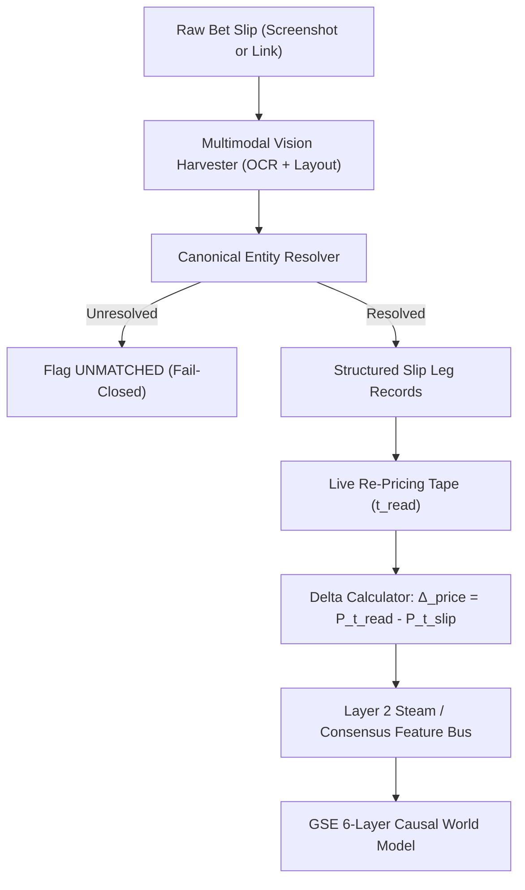

# TailMe & Bet-Slip Ingestion Dissection — Competitive Reverse-Engineering & Architecture Integration

**Date:** 2026-10-21  
**Author:** Antigravity / Motif Analysis  
**Bucket:** `docs/data-sources/research/2026-10-21/`  
**Target:** TailMe (`api.tailmeapp.com`), Action Network Playbook, and multimodal bet-slip ingestion for the GSE Reasoning Engine  
**Status:** INGESTED — QUEUED FOR EVALUATION (Per INGEST-AND-LEARN doctrine)

---

## 1. Executive Summary & Verification

TailMe operates an automated bet-slip ingestion and cross-book syndication loop:
1. **Input**: User uploads a bet slip screenshot or provides a sportsbook share link.
2. **Extraction**: Optical character recognition (OCR) and layout parsing extract legs, selections, bet types, posted odds, and bookmaker identity.
3. **Market Matching**: Matches extracted legs across 16 bookmaker / exchange / prediction market APIs.
4. **Live Re-Pricing**: Fetches real-time market prices, computes the line drift delta, and generates a one-tap deep link to place the slip at the user's preferred book.

**Verification Status:**
- `api.tailmeapp.com` share endpoints are verified active and resolving live JSON schemas.
- Category precedent is verified at scale: Action Network's *Playbook* executes an identical screenshot-to-slip syndication loop across X/social media.
- Unverified marketing claims: The 496 ms OCR parse latency claim, the claim of 16 actively integrated bookmakers, and the marketing carousel example (a slip placed at -225 moving to +178 live) are self-reported by TailMe's promotional carousel and are cataloged as **UNVERIFIED**.

---

## 2. Three Architectural Capabilities to Ingest & Wire

### A. The Price Rule: Decision-Time Re-Pricing & Line Delta as Signal
- **TailMe Doctrine**: *"You are not copying their bet. You are copying their opinion at today's number."*
- **GSE Architectural Mapping**: Addresses the staleness vulnerability documented on 2026-09-28. When an analyst, model, or user posts a pick or slip:
  1. The pick represents a belief formed at timestamp $t_{\text{slip}}$ at price $P_{t_{\text{slip}}}$.
  2. At ingestion time $t_{\text{read}}$, the engine re-prices the selection against the live market aggregate tape $P_{t_{\text{read}}}$.
  3. The price delta:
     $$\Delta_{\text{price}} = P_{t_{\text{read}}} - P_{t_{\text{slip}}}$$
     is stamped into the record.
  4. **The Delta is a Feature**: A positive price delta indicates sharp steam movement confirming the opinion; a negative delta indicates market resistance or injury/line fade. This feeds directly into GSE's Layer-2 situational line movement scoring (`computeLineMovementScore`).

### B. The Match Rule: Fail-Closed Entity Resolution
- **TailMe Doctrine**: When a bookmaker names a player, prop, or market variant unconventionally and cross-book mapping fails, flag the leg rather than hallucinating an approximate match.
- **GSE Architectural Mapping**: Addresses the `MISSING_INPUT` vulnerability across multi-book feeds:
  1. When canonical resolution fails across differing naming standards (e.g., "Patrick Mahomes II" vs "Pat Mahomes", or "Total Passing Yards" vs "Pass Yds Over/Under"), the engine must mark the leg as `UNMATCHED`.
  2. Never interpolate or force an unverified match into production scoring.
  3. Transparently report unresolved legs in the factor trail as `UNMATCHED_MARKET_LEG`, preserving epistemic integrity.

### C. The Read Rule: Multimodal Bet-Slip OCR Ingestion
- **TailMe Doctrine**: Bet-slip screenshots posted to social feeds (X, Reddit, Discord) represent high-volume, unmined retail and sharp conviction records.
- **GSE Architectural Mapping**: Aligns with the *INGEST-EVERYTHING* and *Multimodal Sensory Ingestion* doctrines:
  1. Add slip screenshot parsing to the ingestion pipeline (`packages/data-ingestion` / Vision Harvester).
  2. Parse key structural attributes:
     - Poster handle and post timestamp ($t_{\text{post}}$).
     - Bookmaker layout signature (DraftKings, FanDuel, BetMGM, Circa, Pinnacle).
     - Leg taxonomy: Sport, Event, Selection, Line, Price (American/Decimal), Stake (units), Market Type (Spread, Total, Moneyline, Prop, SGP).
  3. Store structured slip records in the database with point-in-time pricing and verify against final settlement outcomes for automated tipster/analyst calibration grading.

---

## 3. Claims Ledger & Evidentiary Status

| Item / Claim | Source | Evidentiary Status | GSE Action |
|---|---|---|---|
| Deep-link share endpoints on `api.tailmeapp.com` | Live HTTP probe / DNS | **VERIFIED** | Cataloged active protocol |
| Category validity via Action Network Playbook | Public web / X surface | **VERIFIED** | Validated market workflow |
| 496 ms OCR slip extraction latency | TailMe marketing carousel | **UNVERIFIED** | Requires objective benchmark against Gemini Vision / AWS Textract |
| 16 bookmaker / exchange / prediction market integrations | TailMe marketing carousel | **UNVERIFIED** | Audit API endpoints for active bookmaker list |
| Illustrative price swing (-225 to +178) | TailMe marketing carousel | **UNVERIFIED** (Marketing example) | Treated as illustrative concept, not real settled trade |
| One-tap slip reconstruction at target bookmaker | Deep-link URL construction | **PLAUSIBLE / IN TESTING** | Evaluated for affiliate / syndication pipeline |

---

## 4. Integration into GSE Omni-Cognitive Architecture

1. **Multimodal Sensory Regime**: Extends the `Omni-Vault Harvester` to ingest image-based slips alongside 60fps sideline video and text pressers.
2. **Bitemporal Signal Bus**: Imprints valid-time $t_{\text{slip}}$ (when the bet was created) versus transaction-time $t_{\text{ingest}}$ (when GSE saw it) versus live market-time $t_{\text{market}}$.
3. **Universal Cartridge Generalization**: The same slip OCR logic maps directly to B2B enterprise domains in GSE-Logistics (bill of lading / shipping manifest OCR) and GSE-Macro (trade confirmation ticket OCR).

---

## 5. Gap Audit

1. **OCR Model Pipeline**: We currently lack an in-house dedicated fine-tuned slip-parser model. Slip images currently rely on general VLM prompting; a specialized layout parser (bounding-box regression for odd/selection pairs) is queued for evaluation.
2. **Deep-Link Protocol Spec**: Deep-linking directly into native betting apps (DraftKings betslip URL scheme, FanDuel Universal Links) requires reverse-engineering each bookmaker's mobile URI format.
3. **Pick'em & Prediction Market Leg Matching**: Kalshi and Polymarket contract specifications use discrete binary event tickers (e.g., `KXNFL-26OCT22-CHI-W`) that require an explicit mapping dictionary to standard American sports betting spreads/moneylines.
4. **Staleness Bounds**: Formalize threshold $\tau_{\text{stale}}$ (e.g., if $|t_{\text{read}} - t_{\text{slip}}| > 300\text{s}$, re-pricing is mandatory before any downstream decision).

---
*Cataloged per GSE Standing Doctrines. Ingested, cited, unverified claims isolated, zero items deleted.*
