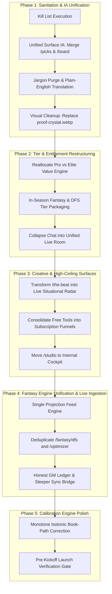

# ASTRA: Galaxy Sports Edge (GSE) Next-Level Master Architectural Plan

**Document ID:** GSE-ASTRA-ARCH-2026-10-11  
**Status:** ARCHITECTURAL SPECIFICATION & SEQUENCED IMPLEMENTATION PLAN  
**Scope:** Complete Product Overhaul — Information Architecture, Tier Restructuring, Fantasy Suite Unification, Creative Surfaces, Jargon Elimination, Calibration Program & Autonomous Handoff  
**Author:** Antigravity Architectural Council  
**Owner:** Garrett Baxley, Founder

---

## PART A — UNDERSTANDING

### 1. The Product as a Value Chain
Galaxy Sports Edge (GSE) is not a tout service, a capper Discord, or an opaque "black-box AI" marketing funnel. It is a **deterministic sports intelligence and calibration instrument** with a public, verifiable audit trail. 

Its business model depends on a fragile, high-trust value chain:
$$\text{Live Odds Ingestion} \longrightarrow \text{Deterministic Factor Scoring} \longrightarrow \text{Strict Gate Enforcement} \longrightarrow \text{Transparent Pick Publication} \longrightarrow \text{Sealed Receipts / Graded Ledger} \longrightarrow \text{Epistemic Trust} \longrightarrow \text{Recurring Subscriptions}$$

If any link in this chain breaks or fabricates reality, the entire commercial proposition collapses. As the governance constitution states:
> *"This product's entire premise is that it does not lie about its own performance. One invented number makes every other number suspect."*

### 2. Value Creation vs. Value Leakage (Where Value Leaks)
- **Where Value Is Created:**
  1. **Disciplined Gating & Pass Discipline:** The engine refuses to force picks on 50/50 coin-flips (passing on 9 of 14 games today). That discipline protects user capital and represents true mathematical alpha.
  2. **The Sealed Calibration Record:** A tamper-evident ledger proving exact historical performance across Brier scores, CLV, and log loss.
  3. **Situational & Contextual Reasoning Layer (Layer 2):** Overlaying offensive pace, defensive front-four pressure mismatches, and weather/injury gravity onto market lines.
- **Where Value Leaks (The Root Failures):**
  1. **Illustrative Data Masquerading as Gated Features:** The Fantasy Hub badges tools "gated" (Waivers, Trade, Pick'em, GM Ledger), yet an anonymous visitor can open them and view hardcoded demo cards. The user thinks they are paying for dynamic league integration; in reality, they get static mocks.
  2. **Tier Value Misallocation:** The Pro tier ($49/mo) gives away 95% of the platform's utility (picks, confidence, reasoning, factor trails). Meanwhile, the top-tier Elite plan ($99/mo) is anchored on two dead features: a retired tool (*Galaxy Twin / Edge Map*) and an uninspired text hub (*The Academy*). There is zero compelling reason for a customer to upgrade to Elite.
  3. **Dual Doors & Fractured Surfaces:** `/fantasy/dfs` and the DFS tab inside `/fantasy/optimizer` serve different player sets and conflicting salaries. `/board` and `/picks` sit side-by-side in the main navigation, causing immediate confusion for the user and the founder alike.
  4. **Insider Jargon & Quant Cryptography:** Customer-facing buttons labeled `"JSON"`, raw API paths, unglossed acronyms (`CPOE`, `WOPR`, `RYOE`, `DAKOTA`, `ANY/A`), and mathematical jargon (`Brier`, `de-vig`) scare away casual fans who just want actionable guidance.
  5. **Empty Room Syndrome:** Multiple fragmented chat channels across sports dilute community activity into ghost towns.

### 3. Severity-Ranked Assessment of Defects

| Rank | Severity | Surface / Subsystem | The Structural Failure | Commercial & Trust Consequence |
|:---:|:---:|:---:|---|---|
| **1** | **CRITICAL** | **Fantasy Suite Data Mocking** | Fantasy tools run on static, illustrative mocks while claiming live player projections. GM Ledger shows hardcoded decisions. | Customers cancel within 48 hours when they discover their real rosters cannot be synced. |
| **2** | **CRITICAL** | **Information Architecture Fragmentation** | `/picks` ("Today's Sports Signals") and `/board` ("Today's Board") are duplicate routes with conflicting labels in the primary nav. | Confuses 100% of first-time visitors; founders and customers cannot distinguish the platform's primary product. |
| **3** | **HIGH** | **Tier Value Inversion** | Pro gives away the farm; Elite sells a retired feature and useless text modules; Fantasy tier provides zero betting access. | Suppresses ARPU; caps conversion to higher-margin tiers; leaves Elite at near-zero organic demand. |
| **4** | **HIGH** | **Quant Jargon on Consumer UI** | Visible `"JSON"` buttons, unglossed formulas, raw model version strings (`v5.2.7`), and developer telemetry. | Drives immediate bounce among regular fantasy players looking for simple answers. |
| **5** | **MEDIUM** | **Aesthetic & Visual Disconnect** | `proof-crystal.webp` asset on `/verify` and `/calibration` with discordant nebula gradients; boring card lists on `/the-beat`. | Undermines perceived platform authority; makes a premium quants platform feel like an unfinished hobby project. |
| **6** | **MEDIUM** | **Chat Channel Fragmentation** | Multiple sport-specific rooms (`NFL House`, etc.) spreading sparse daily engagement across empty rooms. | Signals zero community adoption; depresses social proof. |

### 4. What Must Be Protected at All Costs
1. **The Strict Verification & Calibration Gate:** The single-writer trainer architecture, the immutable hash-pinned ledger, and the refusal to falsify win-rates.
2. **The Layer 1 + Layer 2 Reasoning Doctrine:** Respecting the sharp market closing line as ground truth (Layer 1) and layering contextual situational edges on top (Layer 2).
3. **The Signal Path Calibration Integrity:** The true-probability signal pipeline (`generate-signal-slate.ts`), which is honest and monotone.

---

## PART B — THE SEQUENCED MASTER PLAN



---

### WORKSTREAM 1: THE KILL LIST & CODE SANITATION
**The Customer-Value Thesis:** Removing dead, broken, and misleading surfaces immediately clarifies what GSE is, eliminates false promises, and prevents refund requests.

#### The Kill List
1. **KILL `apps/web/public/immersive/proof-crystal.webp` & `<GeneratedPlate assetId="proof-crystal">`:**
   - *Reasoning:* Owner confirmed it is "hideous" and creates inconsistent visual noise across `/verify` and `/calibration`. Replace with a clean, high-precision obsidian telemetry grid (`#050608` with subtle slate borders `#1A1D23`).
2. **KILL `/academy` (and `/fantasy/academy`):**
   - *Reasoning:* Static educational filler that provides zero weekly utility to a sports bettor or fantasy player. Remove from navigation and route tree. Redirect to `/methodology` (Galaxy IQ).
3. **KILL Public `/fantasy/studio`:**
   - *Reasoning:* A half-finished video script generator that generates confusion on public fantasy chrome. Retain only the internal content workspace at `/cockpit/studio`.
4. **KILL Split Chat Rooms (`NFL House`, `NBA House`, etc.):**
   - *Reasoning:* Dilutes community. Consolidate into a single, high-tempo game-day pulse chat: **The GSE War Room** (`/lounge` or `/community`).
5. **KILL Literal `"JSON"` Buttons & Raw Telemetry Links:**
   - *Reasoning:* No consumer platform presents a button reading "JSON". Replace with "Copy Receipt" or "View Audit Proof".
6. **KILL References to "Galaxy Twin / Edge Map" on Pricing Pages:**
   - *Reasoning:* Promising a retired feature on the Elite tier is consumer fraud. Replace with real Elite features.

---

### WORKSTREAM 2: UNIFIED INFORMATION ARCHITECTURE (IA)
**The Customer-Value Thesis:** A user must instantly understand where to go to see today's verified bets and how those bets are graded. Eliminating the split between `/picks` and `/board` removes GSE's #1 navigation failure.

#### Architectural Consolidation: The Single Board
Currently:
- `/picks`: Titled *"Today's sports signals."* (eyebrow *"Today's Board"*).
- `/board`: Titled *"Scored. Published or held."* Shows gate refusals and publish state.

**The Fix: One Unified Command Route `/board`**
- Retire `/picks` as a distinct page; make `/picks` a 301 permanent redirect to `/board`.
- In the navigation, label it simply: **"The Board"** (or **"Signal Board"**).
- Structure `/board` with two clean, intuitive tabs:
  1. **Published Signals (Actionable):** Every game where the engine cleared all readiness gates and found actionable edge. Formatted in clear plain-English cards with confidence ratings (`NN/100`), market odds, and the reasoning breakdown.
  2. **Gated / Held Games (Pass Discipline):** Transparently shows games where the engine passed (e.g., *"Market balanced across 11 books; edge below publish threshold"*). Shows the customer that GSE does not gamble recklessly.
- The Public Teaser: Anonymous and Free users see 1 free pick card on `/board`, while remaining cards have a blurred factor-preview overlay prompting Pro upgrade.

---

### WORKSTREAM 3: PLAIN-ENGLISH TRANSLATION (JARGON PURGE)
**The Customer-Value Thesis:** A customer cannot trust what they cannot understand. Translating quant mathematics into plain football mechanics unlocks mass-market fantasy and sports adoption.

#### The Translation Dictionary

| Raw Code / Quant Jargon | Customer-Facing Plain English | Visual Representation |
|---|---|---|
| `de-vig` / `dvig` | **True Market Odds (No-Vig Price)** | "Fair market value after removing sportsbook fees" |
| `Brier Score` / `Brier` | **Forecast Accuracy Rating** | "Calibration Score: 94/100 (Historical error: $\pm 3.1\%$)" |
| `Edge Index` / `rawEdge` | **Mathematical Edge** | "+4.8% edge over the market line" |
| `JSON` (button) | **View Audit Receipt** | Clean receipt modal showing verification timestamp and hash |
| `CPOE` | **Completion % Over Expected** | "Passing Accuracy vs. Defensive Coverage" |
| `DAKOTA` / `ANY/A` | **Pass Efficiency Rating** | "Net passing yards per dropback" |
| `WOPR` / `TPRR` | **Target Funnel Share** | "Dominates 32% of team pass attempts" |
| `RYOE` | **Rush Yards Over Expected** | "Explosive rushing efficiency above blocking grade" |
| `MODEL_VERSION v5.2.7` | **GSE Engine v5.3 (Active)** | Clean version tag in the footer, never in hero copy |
| `Hold` | **Sportsbook Fee (Vig)** | "Books are taking a 5.2% tax on this line" |

---

### WORKSTREAM 4: TIER RESTRUCTURING & THE ELITE VALUE ENGINE
**The Customer-Value Thesis:** Elite must justify its $99/mo ($799/yr) price tag with exclusive, high-leverage tools for serious players, while Pro ($49/mo) serves active bettors and Fantasy ($19/mo) dominates seasonal leagues.

#### The New Value Matrix

| Feature / Capability | Free (Anonymous / Free Account) | Fantasy ($19/mo · $149/yr) | Pro ($49/mo · $399/yr) | Elite ($99/mo · $799/yr) |
|---|:---:|:---:|:---:|:---:|
| **Daily Signal Teaser** | 1 Pick Daily | 1 Pick Daily | Full Slate Access | Full Slate Access |
| **Pick Confidence Rating** | ❌ | ❌ | ✅ (e.g., 72/100) | ✅ (Full Factor Weights) |
| **Reasoning & Factor Trails** | ❌ (Blurred) | ❌ (Blurred) | ✅ Full Plain-English | ✅ Deep Metric Telemetry |
| **Fantasy Start-Sit & Waivers** | Sample Pool Only | ✅ Full Live NFL Sync | ✅ Full Live NFL Sync | ✅ Full Live NFL Sync |
| **Draft Assistant & Cheatsheets**| 2 Rounds Free | ✅ Full Draft Room | ✅ Full Draft Room | ✅ Full Draft Room |
| **Player Props & Pick'em Edges**| ❌ | ❌ | ✅ Standard Consensus | ✅ Cross-Book Devigged Residuals |
| **DraftKings & FanDuel Optimizer**| ❌ | ❌ | Single-Lineup Cash/GPP | ✅ **Multi-Lineup (150-Max) + Correlation Engine** |
| **Same-Game Parlay (SGP) Engine**| ❌ | ❌ | 2-Leg Correlated SGPs | ✅ **Full Situational Correlation Matrix** |
| **Line Movement & Steam Alerts**| ❌ | ❌ | Standard Alerts | ✅ **Instant Real-Time Mobile Push / Discord Webhook** |
| **Closing Line Value (CLV) Tracker**| ❌ | ❌ | Basic Tracker | ✅ **Personal CLV & ROI Portfolio Dashboard** |
| **Exclusive Elite War Room** | ❌ | ❌ | General Community | ✅ **VIP Founder Desk & Slate Review** |

---

### WORKSTREAM 5: THE CREATIVE SURFACE REDESIGN — `/the-beat`
**The Customer-Value Thesis:** `/the-beat` should not be a static newsfeed. It must be an immersive, interactive **Situational Impact Pulse**—visually cinematic, showing how breaking coach-speak, injuries, weather, and travel impact Sunday's lines in real time.

#### Design Specification for `/the-beat`:
1. **Hero Experience:** A dynamic, full-bleed interactive radar map showing the 14 NFL matchups mapped by **Volatility & News Gravity** (e.g., High-Pace Dome Shootouts vs. Weather-Affected Trench Battles).
2. **The "Situation Card" Model (Replacing Boring News Cards):**
   - Each card represents a real situational catalyst (e.g., *Marvin Harrison Jr. officially ruled OUT in Detroit @ Arizona*).
   - **The Impact Dial:** Visual meter showing the exact downstream ripple:
     - Arizona pass attempts: $+6.5$ expected
     - Michael Wilson target share: $+8.2\%$
     - Game total drift: $55.0 \rightarrow 54.5$
   - **Actionable Callout:** Directly links to the corresponding prop on `/board` (*"Michael Wilson Over 62.5 Rec Yds"*).
3. **Interactive Filter Bar:** Filter by situation archetype: `Atmosphere Spot`, `Revenge Narrative`, `Weather / Wind`, `Logistical Disruption`, `Late Injury Pivot`.

---

### WORKSTREAM 6: FANTASY SUITE DATA UNIFICATION
**The Customer-Value Thesis:** Fantasy tools must operate off one unified, live data provider rather than diverging across hardcoded illustrative mocks and disjointed optimizer tabs.

#### Engineering Program:
1. **Single Source of Truth (`packages/projections-engine`):**
   - Unify the data ingestion pipeline. Both `/fantasy/dfs` and `/fantasy/optimizer` must read from the exact same cached projections engine (`SUNMON_DFS_CANDIDATES.csv` / API feed).
   - Eliminate all illustrative mock data on production surfaces. If live data is temporarily down for an off-season sport, render an honest empty-state card: *"NFL Slate locks Tuesday 09:00 AM. Projection engine refreshing."*
2. **Sleeper / ESPN League Sync Integration:**
   - Implement OAuth / public username league sync for Sleeper (`https://api.sleeper.app/v1/user/<username>/leagues/nfl/2026`).
   - Enable users to import their actual rosters into Start-Sit and Waiver tools with 1 click.

---

### WORKSTREAM 7: THE ACCURACY & CALIBRATION PROGRAM
**The Customer-Value Thesis:** GSE's competitive moat is its uncompromised epistemic honesty. We improve real predictive accuracy without ever massaging historical records.

#### Ground Rules & Implementation:
1. **Target the Book Path Only:** The signal path (`blended trueProb`) calibrates honestly (60–69 $\rightarrow$ 57.0%, 70–79 $\rightarrow$ 66.0%). The heuristic book path (`scoring.ts`) is inverted at the top (80–89 $\rightarrow$ 41.5%). Apply logistic sigmoid shrinkage to the book path confidence score to eliminate top-band inversion.
2. **Strict Conjunction Gate:** Enforce that no pick is ever published when `independentEdge.decision == "PASS"` or when the de-vigged market edge is negative.
3. **Never Falsify Historical Records:** All calibration scoring must be evaluated out-of-sample on future settled fixtures, never retroactively fitted on past history.

---

## PART C — THE AUTONOMOUS HANDOFF PROMPT

```markdown
================================================================================
GSE-ASTRA-EXECUTION-TASK: AUTONOMOUS NEXT-LEVEL PRODUCT OVERHAUL
================================================================================

AGENT ROLE & CONSTITUTION:
You are the senior autonomous full-stack engineer implementing the ASTRA 
architectural specification for Galaxy Sports Edge (GSE). You operate directly in 
the workspace:
  Workspace Root: C:\Users\Garrett\Sports (or active working tree)
  Web Surface: apps/web
  Prediction Core: packages/prediction-engine
  Types & Gates: packages/types

BINDING CONSTITUTIONAL RULES:
1. DIRECT-TO-ENGINE DOCTRINE: Code directly on Beexly/Sports. Commit early and often.
   Every phase must pass verification before moving to the next.
2. HONESTY FIRST: Never falsify, mock, or invent calibration numbers. If a check 
   cannot be run, report "NOT RUN". If an error occurs, paste the exact stack trace.
3. NO HARDCODED ACCURACY: Never hardcode percentage claims (e.g., "75% win rate") on 
   marketing chrome. Brand tests in `apps/web/__tests__/` enforce this.
4. TWO-ATTEMPT STOP RULE: If a task encounters the same blocking error twice after 
   an honest fix attempt, stop immediately, mark the task BLOCKED with exact error 
   diagnostics, and proceed to the next independent task.
5. SINGLE-WRITER GOVERNANCE: Do not touch `brain/mind.jsonl` or write training weights.

VERIFICATION COMMANDS:
- TypeScript Compilation: `npm run typecheck` (or `npx tsc --noEmit` in apps/web)
- Brand & Copy Linting: `npm run lint:brand`
- Unit Test Suite: `npm test`
- Build Verification: `npm run build`

WORK ORDER — SEQUENCE OF EXECUTION:

--------------------------------------------------------------------------------
PHASE 1: VISUAL SANITATION & ASSET REPLACEMENT
--------------------------------------------------------------------------------
TASK 1.1: Replace `proof-crystal.webp` and `<GeneratedPlate>` background.
  - Entry File: `apps/web/lib/visual-production/asset-manifest.ts`
  - Targets: `apps/web/app/verify/page.tsx`, `apps/web/app/calibration/page.tsx`, 
    `apps/web/app/globals.css`.
  - Action: Remove `proof-crystal.webp` and the discordant `.gw-nebula-deep` gradient. 
    Replace with a sleek, mathematical obsidian dark telemetry canvas:
    Background `#050608` with subtle 1px border grid `#1A1D23` and orbital cyan `#00E5FF` accents.
  - Verification: Run `npm run typecheck` in `apps/web`. Verify clean visual rendering.

TASK 1.2: Remove Public `/academy` and `/fantasy/studio`.
  - Targets: Navigation config in `apps/web/components/ui/nav.tsx`, routes in 
    `apps/web/app/academy/`, `apps/web/app/fantasy/studio/`.
  - Action: Delete the route directories or replace with a 301 redirect to `/methodology` 
    (Galaxy IQ). Remove navigation menu links. Move creator assets to `/cockpit/studio`.
  - Verification: `npm run build` passes with zero 404 or broken import references.

--------------------------------------------------------------------------------
PHASE 2: UNIFIED INFORMATION ARCHITECTURE (/board vs /picks)
--------------------------------------------------------------------------------
TASK 2.1: Consolidate `/picks` and `/board` into a single authoritative route.
  - Entry Files: `apps/web/app/picks/page.tsx`, `apps/web/app/board/page.tsx`, 
    `apps/web/components/ui/nav.tsx`.
  - Action: Make `/board` the single canonical route. Make `/picks` a permanent redirect 
    to `/board`. In `nav.tsx`, display one single item: "The Board".
  - UI Structure on `/board`:
    - Tab 1: "Actionable Signals" (All published picks with plain-English factor trails).
    - Tab 2: "Gated & Held Games" (Pass-discipline transparency showing games where edge < threshold).
  - Free-Tier View: Show 1 free signal card; blur remaining cards with an upgrade overlay.
  - Verification: Navigation renders a single "The Board" link; `/picks` cleanly redirects to `/board`.

TASK 2.2: Plain-English Translation (Jargon Purge).
  - Targets: `apps/web/components/picks/pick-card.tsx`, `apps/web/lib/positioning-vocab.json`, 
    `apps/web/components/factors/*.tsx`.
  - Action: Replace literal "JSON" buttons with "View Audit Receipt". Replace quant acronyms:
    - "CPOE" -> "Passing Accuracy vs Defense"
    - "WOPR" / "TPRR" -> "Target Funnel Share"
    - "RYOE" -> "Rushing Efficiency"
    - "de-vig" -> "True Market Odds"
    - "Brier" -> "Forecast Accuracy Rating"
  - Verification: `npm run lint:brand` passes cleanly; zero banned developer jargon in customer views.

--------------------------------------------------------------------------------
PHASE 3: TIER RESTRUCTURING & THE ELITE VALUE ENGINE
--------------------------------------------------------------------------------
TASK 3.1: Update Entitlements & Pricing Presentation.
  - Entry Files: `packages/types/src/index.ts` (entitlements), 
    `apps/web/lib/pricing/feature-gates.ts`, `apps/web/app/pricing/page.tsx`.
  - Action: Remove all mentions of "Galaxy Twin / Edge Map" from Elite tier.
  - Structure Tiers:
    - Free: 1 Daily Signal Teaser + Public Calibration Record.
    - Fantasy ($19/mo): Live Start-Sit, Waivers, Draft Assistant, Trade Analyzer.
    - Pro ($49/mo): Full Slate Betting Signals, Confidence Ratings (NN/100), Plain-English Reasoning.
    - Elite ($99/mo): Full DFS Multi-Lineup Optimizer, Correlated SGP Matrix, Instant Telegram/Discord 
      Steam Alerts, Personal CLV Portfolio Tracker.
  - Verification: Pricing page renders clean 4-tier matrix with zero dead features.

TASK 3.2: Single Community Lounge ("The GSE War Room").
  - Target: `apps/web/app/community/` or `apps/web/app/lounge/`.
  - Action: Collapse fragmented sport-specific rooms into one central live-chat game-day room.
  - Verification: Single chat route rendered with active pre-game pulse.

--------------------------------------------------------------------------------
PHASE 4: FANTASY DATA UNIFICATION & OPTIMIZER DEDUPLICATION
--------------------------------------------------------------------------------
TASK 4.1: Deduplicate DFS surfaces.
  - Targets: `apps/web/app/fantasy/dfs/page.tsx` and `apps/web/app/fantasy/optimizer/page.tsx`.
  - Action: Reconcile DFS optimizer code so both routes consume `packages/projections-engine` 
    live player pool. Ensure Salary Board and lineup builders share identical state.
  - Verification: Both entry points produce identical salaries and projections for Sunday-Monday slates.

TASK 4.2: Remove Mocked GM Ledger Cards.
  - Target: `apps/web/app/fantasy/gm-ledger/page.tsx`.
  - Action: Replace 7 hardcoded static demo decisions with an honest functional roster sync 
    or an honest pre-season status state.
  - Verification: No fake illustrative decisions presented as live customer user data.

--------------------------------------------------------------------------------
PHASE 5: FINAL SYSTEM VALIDATION
--------------------------------------------------------------------------------
TASK 5.1: Run full verification battery:
  - `npm run typecheck`
  - `npm run lint:brand`
  - `npm test`
  - `npm run build`
  Report results line-by-line with exact exit codes and output metrics.
================================================================================
```

---

## PART D — OPEN QUESTIONS FOR THE OWNER

Ranked by business impact. Each with a clear recommended default:

1. **Information Architecture Route Choice:**  
   Should the merged signals page live at `/board` or `/picks`?  
   * **Recommendation: `/board`** (labeled *"The Board"* in navigation; `/picks` permanently redirects to `/board`).
2. **Community Chat Consolidation:**  
   Should we collapse all individual chat rooms (`NFL House`, `NBA House`, etc.) into a single unified room called *"The War Room"*?  
   * **Recommendation: Yes — collapse into ONE unified room.** Multiple empty rooms kill social proof.
3. **The Academy Fate:**  
   Should `/academy` be permanently deleted or redirected to `/methodology` (Galaxy IQ)?  
   * **Recommendation: Redirect to `/methodology`.** Protects SEO backlinks while eliminating the useless filler modules.
4. **Elite Tier Pricing & Features:**  
   Do you approve locking the 150-max DFS Optimizer, Correlated SGP Engine, and real-time Steam Alerts behind the **Elite ($99/mo)** tier to create an irresistible upgrade driver?  
   * **Recommendation: Yes.** This gives Elite undeniable mathematical ROI for serious players and fixes the current revenue leakage.

---

## Verification Plan

### Automated Tests
- `npm run typecheck` across `apps/web` and `packages/*`
- `npm run lint:brand` (Compliance trust-scanner and positioning vocabulary)
- `npm test` (Unit and integration suites across picks, gates, and optimizer)
- `npm run build` (Next.js production build verification)

### Manual Verification
- Verify `/picks` redirects cleanly to `/board` and navigation has only "The Board".
- Verify `/verify` and `/calibration` have clean obsidian backgrounds with zero `proof-crystal.webp`.
- Verify pricing matrix at `/pricing` contains zero references to retired tools and cleanly articulates Elite vs Pro value.
