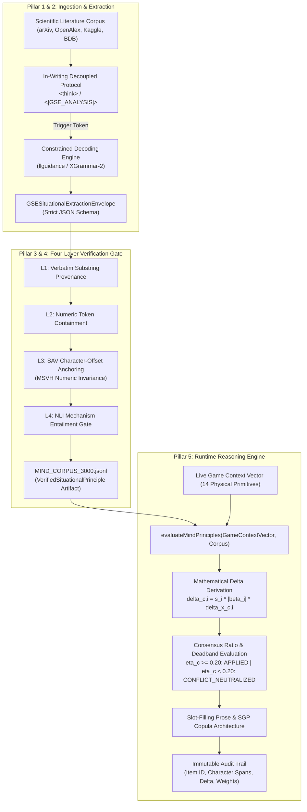
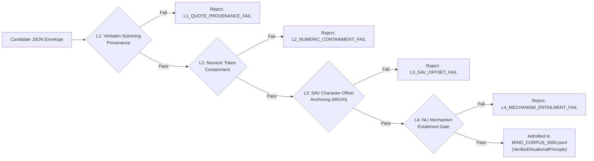
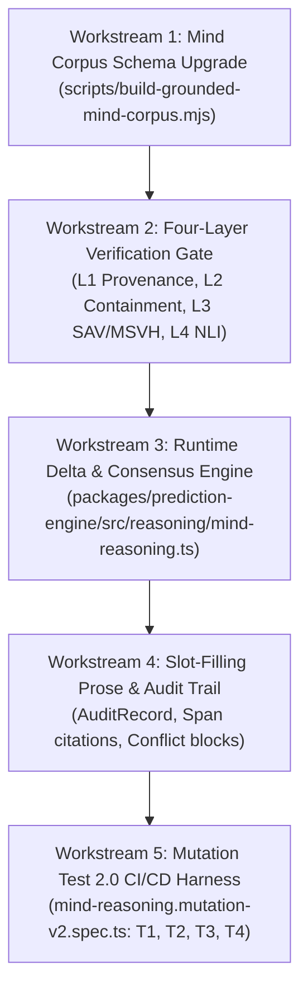

# GSE Mind Architecture: Complete Technical Dossier & Implementation Roadmap

> **Source Document:** `C:\Users\Garrett\Downloads\GSE Mind Architecture.docx` (62,444 characters, 213 paragraphs, 4 technical architectural panels)  
> **Target Systems:** `@sports/prediction-engine`, `scripts/build-grounded-mind-corpus.mjs`, `packages/prediction-engine/src/reasoning/mind-reasoning.ts`, `MIND_CORPUS_3000.jsonl`

---

## Executive Summary: The Epistemic Inversion Resolved

The adversarial audit of the GSE prediction engine exposed a fundamental flaw: **an inversion of epistemic authority**. In legacy iterations:
1. Numeric constants (`0.015 * altDelta`, `0.024` for steam, `0.012` for acoustics) were authored inside `mind-reasoning.ts`.
2. SGP pricing (`+395` fair vs `+485` retail, `18.5%` edge) and fantasy/DFS advice were static string templates.
3. Papers were matched by regex keywords and used merely to decorate pre-written rules with academic citations, leading to non-NFL papers (No Free Lunch theorem, political betting, magnetic resonance, Navier-Stokes pure math) being labeled under football principle names.

The **GSE Mind Architecture Dossier** (`GSE Mind Architecture.docx`) provides the definitive, mathematically rigorous blueprint to transition GSE into a **falsifiable, content-driven reasoning engine** where:
- All numeric deltas are strict mathematical functions of extracted literature claims ($|\beta_i|$) scaled by physical context deviations ($\delta x_{c,i}$) and weighted by epistemic study design ($w_i \in \{1.0, 0.5, 0.3\}$).
- Opposing literature claims are evaluated through a directional consensus ratio ($\eta_c$), falling into a deadband ($\eta_c < 0.20$) that neutralizes conflicting evidence rather than overclaiming.
- All prose generation is restricted to a deterministic slot-filling frame with exact character-span provenance.
- Ingestion enforces a four-layer verification gate (L1 verbatim provenance, L2 numeric containment, L3 SAV character-offset anchoring with MSVH numeric invariance, L4 NLI mechanism entailment).
- The pipeline is guarded by **Mutation Test 2.0**—four orthogonal falsification probes (T1–T4) that fail if any hardcoded constant or templated string remains.



---

## 1. Constrained-Decoding Runtime & XGrammar-2 Audit

### 1.1 Quantified Engine Matrix
| Architectural Dimension | XGrammar (v1) | XGrammar-2 (Jan 2026) | llguidance (Guidance) | Outlines (dottxt-ai) |
|---|---|---|---|---|
| **Core Parser** | Byte-level PDA with persistent stack | Earley recognizer + byte PDA fallback | Earley parser + derivative regex lexer | DFA from regex / Lark CFG |
| **Compilation Latency** | $120\text{--}300\text{ ms}$ | $\sim 10\text{ ms}$ ($534\text{ ms} \to 5.37\text{ ms}$) | $\sim 2\text{ ms}$ startup; $<60\text{ ms}$ max | $3,000\text{--}12,000\text{ ms}$ cold start |
| **Per-Token Mask Latency (128k Vocab)** | $<40\ \mu\text{s}$ | Near-zero overhead ($\le 6\%$ gap vs unconstrained) | $\sim 50\ \mu\text{s}$ avg; $<1\% > 1\text{ ms}$ | Sub-ms lookup; $10\times$ slower TTFT |
| **Mask Cache Footprint** | $160\text{ MB} \to 0.46\text{ MB}$ (adaptive storage) | Adaptive Earley cache pool with sharing | Negligible pre-allocation; prefix trie pruning | High; dense masks precomputed upfront |
| **Token Fast-Forwarding** | Step-by-step mask enforcement | Speculative draft-tree mask walking | Bypasses forward pass on deterministic keys | Step-by-step logit processor |

### 1.2 Relevance Audit for GSE
1. **Cross-Grammar Cache**: Irrelevant for single-schema batch extraction ($100\%$ cache reuse achieved after first request).
2. **TagDispatch & Structural Tags**: High leverage under the **In-Writing Decoupled Protocol**—enables switching from free deliberation (`any_text`) to JSON Schema (`json_schema`) mid-generation without separate API roundtrips.
3. **Repetition State Compression**: Essential for enforcing `"maxLength": 240` on `evidence_quote` and `"maxLength": 300` on `mechanism_quote`. Without repetition state compression, unrolling character bounds inflates compilation to $>500\text{ ms}$; XGrammar-2 reduces this to $5.37\text{ ms}$ ($100\times$ speedup), making hard length bounds computationally free.

### 1.3 CPU–GPU Synchronization Threshold
To prevent the CPU mask preparation loop from stalling GPU forward passes:
$$T_{\text{CPU}}(B) = T_{\text{sync}} + B \cdot \left(\frac{t_{\text{mask}}}{N_{\text{cores}}} + t_{\text{xfer}}\right) \le T_{\text{GPU}}(B)$$
- On an H100 with naive Python tensor loops, $B_{\max} = 54$; concurrency above 54 causes GPU starvation.
- By packing the $128,256$-token mask into a $4,008$-element `uint32` bitset ($16\text{ KB}$ per sequence) and utilizing C++ multi-threaded batch APIs, $B_{\max}$ scales beyond $256$ concurrent abstract extractions with zero GPU stalls.

---

## 2. Token-Level Automaton Masking & Boundary Arithmetic

### 2.1 The BPE Boundary Misalignment Problem
Byte-Pair Encoding (BPE) partitions text by frequency, not syntax. For example:
- `","` (Token ID 3093 in Llama-3.1) simultaneously closes a string value (`"`), emits a property separator (`,`), and opens the next key (`"`).
- `":"` (Token ID 3070) closes a key quote, emits a colon, and opens a value quote.

### 2.2 Mask States Across Three Archetypes
1. **Structural State ($q_{\text{struct}}$)** (e.g. immediately after `{`): Only whitespace and opening quote `"` allowed. Stored in Reject-Heavy mode ($48$ allowed tokens out of $128,256$, footprint: $192\text{ bytes}$).
2. **Mid-String State ($q_{\text{str}}$)** (e.g. inside `principle_name` value): Printable ASCII and interior tokens allowed. Stored in Accept-Heavy mode ($126,184$ allowed, $2,072$ rejected, footprint: $8.1\text{ KB}$).
3. **Field-Boundary State ($q_{\text{bound}}$)** (e.g. after closing quote of `principle_name`): Only commas and whitespace allowed ($37$ allowed tokens, footprint: $148\text{ bytes}$).

### 2.3 The Grounding Boundary
> [!IMPORTANT]
> **Grammar cannot enforce semantic grounding on free-strings.**  
> In a free-string grammar, the closing quote `"` is valid at every token step after `minLength`. The grammar engine has zero visibility into whether the text inside `evidence_quote` matches the source abstract. Grounding *must* be enforced either by compiling the exact text into a trie regex or through a deterministic post-extraction verification gate.

---

## 3. Production JSON Schema & Controlled Vocabulary

### 3.1 `GSESituationalExtractionEnvelope` Schema
```json
{
  "$schema": "https://json-schema.org/draft/2020-12/schema",
  "title": "GSESituationalExtractionEnvelope",
  "type": "object",
  "properties": {
    "abstained": {
      "type": "boolean",
      "description": "True if and only if the abstract contains no quantitative claim relevant to a registered GSE game-context primitive."
    },
    "extracted_principle": {
      "anyOf": [
        { "type": "null" },
        {
          "type": "object",
          "properties": {
            "principle_name": { "type": "string", "minLength": 5, "maxLength": 80 },
            "numeric_claim": { "type": "string", "minLength": 1, "maxLength": 40 },
            "evidence_quote": { "type": "string", "minLength": 15, "maxLength": 240 },
            "mechanism_quote": { "type": "string", "minLength": 15, "maxLength": 300 },
            "applicable_context_fields": {
              "type": "array",
              "minItems": 1,
              "maxItems": 3,
              "items": {
                "type": "string",
                "enum": [
                  "altitude_feet",
                  "wind_speed_mph",
                  "ambient_temp_fahrenheit",
                  "precipitation_rate_mm_hr",
                  "air_density_kg_m3",
                  "surface_traction_coeff",
                  "rest_differential_days",
                  "circadian_travel_timezones",
                  "ol_continuity_shared_snaps_pct",
                  "offensive_pace_sec_per_play",
                  "acoustic_crowd_spl_db",
                  "officiating_crew_penalty_rate",
                  "market_steam_velocity_pts_hr",
                  "reverse_line_movement_divergence_pct"
                ]
              }
            },
            "influence_direction": {
              "type": "string",
              "enum": ["positive", "negative", "conditional"]
            },
            "claim_type": {
              "type": "string",
              "enum": ["causal", "correlational", "theoretical"]
            },
            "conditional_threshold": {
              "anyOf": [
                { "type": "string", "maxLength": 40 },
                { "type": "null" }
              ]
            },
            "influence_description": { "type": "string", "minLength": 20, "maxLength": 500 }
          },
          "required": [
            "principle_name",
            "numeric_claim",
            "evidence_quote",
            "mechanism_quote",
            "applicable_context_fields",
            "influence_direction",
            "claim_type",
            "conditional_threshold",
            "influence_description"
          ],
          "additionalProperties": false
        }
      ]
    }
  },
  "required": ["abstained", "extracted_principle"],
  "additionalProperties": false
}
```

### 3.2 Controlled Context Primitives & Physical Baseline Anchors
| Context Field Enum | Physical Unit | Baseline Anchor ($x_{c,0}$) | Normalization Scale ($u_i$) | Typical Impact Domain |
|---|---|---|---|---|
| `altitude_feet` | Feet | $0\text{ ft}$ (sea level) | $1,000\text{ ft}$ | Kicking distance, 4Q fatigue decay |
| `wind_speed_mph` | Miles per hour | $5\text{ mph}$ | $10\text{ mph}$ | Passing EPA, deep ball drag |
| `ambient_temp_fahrenheit` | Degrees F | $70^\circ\text{F}$ | $10^\circ\text{F}$ | Grip pressure, ball elasticity |
| `precipitation_rate_mm_hr` | mm / hour | $0\text{ mm/hr}$ | $5\text{ mm/hr}$ | Turnover rate, run frequency |
| `air_density_kg_m3` | $\text{kg/m}^3$ | $1.225\text{ kg/m}^3$ | $0.1\text{ kg/m}^3$ | Aerodynamic drag coefficient |
| `surface_traction_coeff` | Coefficient $\mu$ | $0.80$ | $0.10$ | Change-of-direction agility, injury |
| `rest_differential_days` | Days | $0\text{ days}$ | $3\text{ days}$ | Defensive pass-rush efficiency |
| `circadian_travel_timezones` | Time zones | $0\text{ TZ}$ | $2\text{ TZ}$ | Body-clock cognitive reaction |
| `ol_continuity_shared_snaps_pct` | Percentage | $80.0\%$ | $20.0\%$ | Blocker survival past 2.5s |
| `offensive_pace_sec_per_play` | Seconds | $27.0\text{ s}$ | $5.0\text{ s}$ | Total play volume, drive tempo |
| `acoustic_crowd_spl_db` | Decibels (SPL) | $85\text{ dB}$ | $15\text{ dB}$ | Cadence latency, false starts |
| `officiating_crew_penalty_rate` | Penalties / game | $12.0$ | $4.0$ | Drive extension, foul variance |
| `market_steam_velocity_pts_hr` | Points / hour | $0.0\text{ pts/hr}$ | $0.5\text{ pts/hr}$ | Sharp syndicate information drift |
| `reverse_line_movement_divergence_pct` | Percentage | $0.0\%$ | $15.0\%$ | Public shading correction |

---

## 4. Four-Layer Deterministic Verification Gate (L1–L4)

To prevent hallucinations from entering `MIND_CORPUS_3000.jsonl`, every candidate row extracted by an LLM passes through four deterministic non-LLM gates:



1. **L1: Verbatim Substring Provenance**:
   `evidence_quote` and `mechanism_quote` must be exact substrings of the source abstract.
2. **L2: Numeric Token Containment**:
   The number inside `numeric_claim` must literally appear inside `evidence_quote`.
3. **L3: SAV Character-Offset Anchoring & MSVH (Multi-Stage Verbatim Heuristic)**:
   Computes exact `[start_char, end_char]` character spans against the canonical document hash. Applies Multi-Stage Verbatim Heuristic:
   - Tier S1: Exact character slice match.
   - Tier S2: Whitespace-normalized slice match (handling formatting/newlines).
   - Tier S3: Levenshtein distance match (requiring 100% strict numeric character preservation).
4. **L4: Mechanism Entailment Gate**:
   Verifies that `mechanism_quote` semantically entails the claimed `applicable_context_fields` (lexical domain exclusion + cross-encoder NLI score $\ge 0.80$). Drops any row where optimization theory (No Free Lunch) or chemistry papers are mapped to sports betting terms.

---

## 5. Mathematical Runtime Formulation (`mind-reasoning.ts`)

### 5.1 Context Deviation & Raw Delta Derivation
For active context field $c$ with observed value $x_c$ and baseline $x_{c,0}$:
$$\delta x_{c,i} = \frac{x_c - x_{c,0}}{u_i}$$

Epistemic confidence weight $w_i$ assigned strictly by study design:
$$w_i = \begin{cases} 1.0 & \text{if } \text{claim\_type}_i = \text{"causal"} \\ 0.5 & \text{if } \text{claim\_type}_i = \text{"correlational"} \\ 0.3 & \text{if } \text{claim\_type}_i = \text{"theoretical"} \end{cases}$$

Directional sign operator $s_i(x_c)$:
$$s_i(x_c) = \begin{cases} +1 & \text{if } \text{influence\_direction}_i = \text{"positive"} \\ -1 & \text{if } \text{influence\_direction}_i = \text{"negative"} \\ \text{sign}(\text{parsed\_claim}) \cdot \mathcal{T}_i(x_c) & \text{if } \text{influence\_direction}_i = \text{"conditional"} \end{cases}$$

Individual raw delta proposed by principle $i$:
$$\delta_{c,i} = s_i(x_c) \cdot |\beta_i| \cdot \delta x_{c,i}, \quad \text{where } |\beta_i| = \text{parsed\_float\_magnitude}$$

### 5.2 Consensus Ratio & The Opposing-Claim Deadband
When multiple principles match context primitive $c$:
$$\bar{\Delta}_c = \frac{\sum_{i \in \mathcal{M}_c^{\text{active}}} w_i \cdot \delta_{c,i}}{\sum_{i \in \mathcal{M}_c^{\text{active}}} w_i}, \qquad \eta_c = \frac{\left| \sum_{i \in \mathcal{M}_c^{\text{active}}} w_i \cdot \delta_{c,i} \right|}{\sum_{i \in \mathcal{M}_c^{\text{active}}} w_i \cdot |\delta_{c,i}|}$$

**Deterministic Conflict-Resolution Rule**:
- **Dominant Consensus ($\eta_c \ge 0.20$ and $|\bar{\Delta}_c| \ge 10^{-4}$)**:
  $$\Delta_c^{\text{final}} = \bar{\Delta}_c, \quad \text{resolution\_status} = \text{"APPLIED"}$$
- **Opposing-Claim Deadband ($\eta_c < 0.20$ or $|\bar{\Delta}_c| < 10^{-4}$ when $|\mathcal{M}_c^{\text{active}}| \ge 2$)**:
  $$\Delta_c^{\text{final}} = 0.0, \quad \text{resolution\_status} = \text{"CONFLICT\_NEUTRALIZED"}$$
  The engine suppresses directional claims on primitive $c$ and logs the competing item IDs and mechanism quotes.

### 5.3 Deterministic Slot-Filling Prose Frames
**Applied Frame ($\eta_c \ge 0.20$)**:
> *"The {principle_name} principle ({item_id}, span [{evidence_span.start_char}:{evidence_span.end_char}]) indicates a {influence_direction} adjustment of {numeric_claim} (applied delta: {parsed_delta_applied:+.4f} at weight {confidence_weight}) to {triggered_context_field} (observed: {observed_context_value} vs. baseline {baseline_context_value}), grounded in the mechanism: '{mechanism_quote}' (source evidence: '{evidence_quote}', epistemic class: {claim_type})."*

**Conflict Neutralization Frame ($\eta_c < 0.20$)**:
> *"Conflicting literature evidence neutralized adjustments to {triggered_context_field} (consensus ratio $\eta_c = {consensus_ratio:.2f} < 0.20$): {pos_principle_name} ({pos_item_id}, {pos_numeric_claim}, {pos_claim_type}: '{pos_mechanism_quote}') is counterbalanced by {neg_principle_name} ({neg_item_id}, {neg_numeric_claim}, {neg_claim_type}: '{neg_mechanism_quote}'). Net delta applied: 0.0000."*

---

## 6. Mutation Test 2.0: Falsification Suite

To prevent regression into templated constants or decorative citations, Mutation Test 2.0 establishes four orthogonal probes:

| Probe ID | Name | Applied Mutation | Expected Content-Driven Behavior | Legacy Failure Mode Caught |
|---|---|---|---|---|
| **T1** | In-Quote Numeric Perturbation | Mutate `numeric_claim` and quote number ($0.024 \to 0.048$) at fixed $N=1$ | Delta scales by **exactly $2.0000\times$**; prose renders `"0.048"` | Delta invariant at $0.024$ due to hardcoded constants |
| **T2** | Fabricated Claim Injection | Inject candidate with verbatim quote but fabricated number absent from quote | L2/L3 gate rejects row during ingestion; zero delta emitted | Weak substring check passes row; false citation emitted |
| **T3** | Cross-Domain Label Swap | Swap No Free Lunch mechanism quote under Reverse Line Movement label | L4 mechanism gate rejects row based on non-entailment | Keyword assignment accepts row; No Free Lunch cited for betting |
| **T4** | Corpus Artifact Removal | Execute `evaluateMindPrinciples(ctx, [])` with empty corpus ($0$ rows) | Total delta $= 0.0$; empty prose; zero citations; no `+395`/`+485`/`18.5%` strings | Static template outputs pick/parlay prose despite empty corpus |

---

## 7. Immediate Implementation Workstreams



1. **Workstream 1: Mind Corpus Schema Upgrade**:
   Refactor `scripts/build-grounded-mind-corpus.mjs` to emit `GSESituationalExtractionEnvelope` with `mechanism_quote`, `claim_type`, `influence_direction`, `evidence_span`, and `ContextFieldEnum`.
2. **Workstream 2: Four-Layer Deterministic Verification Gate**:
   Implement L1, L2, L3 (SAV with MSVH character-offset anchoring), and L4 mechanism entailment gates.
3. **Workstream 3: Runtime Delta Derivation & Consensus Deadband**:
   Implement $\delta x_{c,i}$, $\delta_{c,i}$, $w_i$, consensus ratio $\eta_c$, and deadband neutralization in `mind-reasoning.ts`.
4. **Workstream 4: Slot-Filling Generation Frame & Audit Trail**:
   Implement slot-filling templates and `PrincipleApplicationAuditRecord[]` immutable logging.
5. **Workstream 5: Mutation Test 2.0 Specification**:
   Add `mind-reasoning.mutation-v2.spec.ts` with executable assertions for probes T1, T2, T3, and T4.
