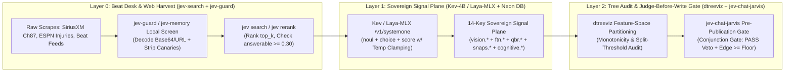
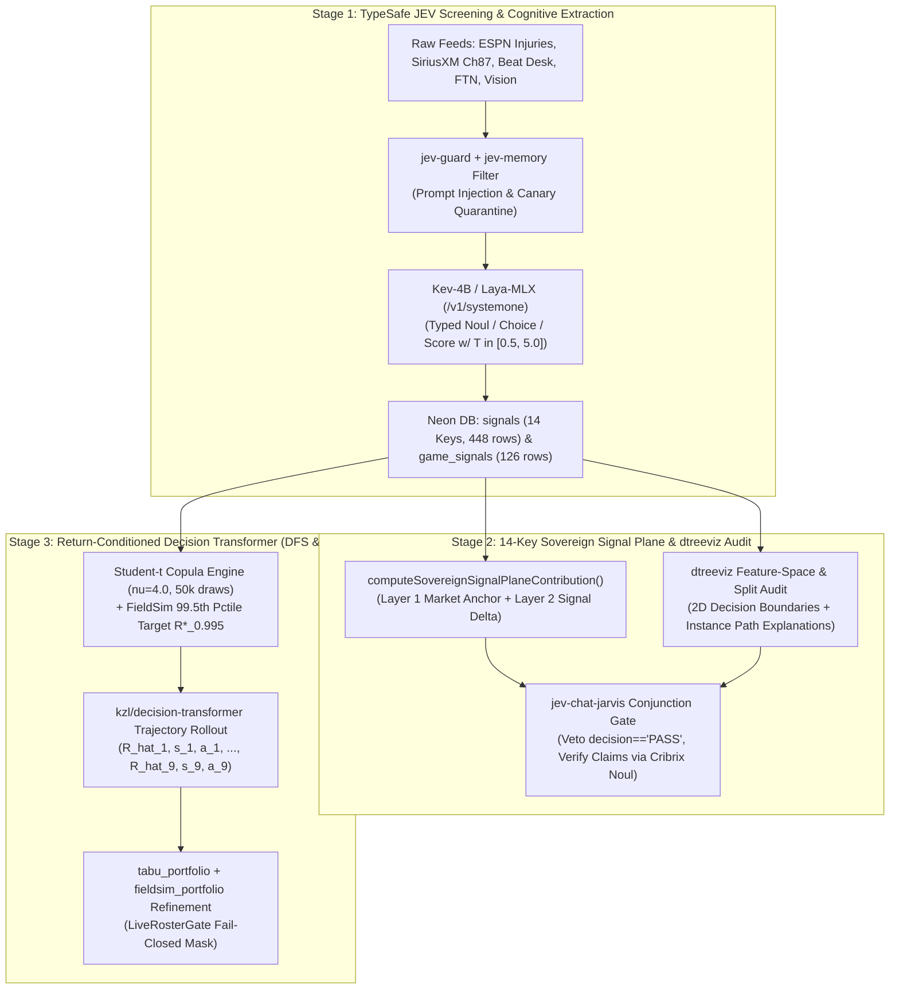

# Sovereign Signal Plane & Portfolio Optimization Synthesis: TypeSafe JEV Ecosystem (`kev`, `laya-mlx`, `jev-guard`, `jev-chat-jarvis`, `awesome-jev`), Decision Transformer (`kzl/decision-transformer`), and Feature-Space Tree Interpretation (`parrt/dtreeviz`)

**Date:** 2026-10-18  
**Bucket:** `docs/engine/research/2026-10-18/`  
**Status:** RESEARCHED & ARCHITECTURALLY MAPPED (Wire-First Doctrine Compliant)  
**Target Subsystems:**
- `packages/prediction-engine/src/game-context.ts` (`computeSovereignSignalPlaneContribution`, lines 1009–1146)
- `scripts/sync_week6_db.py` (`SOVEREIGN_SIGNAL_KEYS`, `compute_pick_probability_from_db_signals`, lines 116–274)
- `intelligence/matchups/matchup_engine.py` (`_sovereign_signal_plane`, `build_matchups`)
- `intelligence/optimizer/dfs_optimizer_suite.py` (`greedy_leverage`, `tabu_portfolio`, `fieldsim_portfolio`, `cash_mode`)
- `intelligence/sgp/sgp_copula_engine.py` (`Student-t` copula $\nu=4.0$, 50,000 draws)
- Local Hermes / Antigravity JEV Skill Fleet (`C:\Users\Garrett\.agents\skills\jev-*`)

---

## Executive Summary

This dossier synthesizes **seven external repositories** and **ten local TypeSafe JEV skills** (`C:\Users\Garrett\.agents\skills\jev-*`) into a unified architectural upgrade roadmap for Galaxy Sports Edge's **14-Key Sovereign Signal Plane** and **4-Engine DFS Portfolio Optimizer**:

1. **[`jaredpalmer/kev`](https://github.com/jaredpalmer/kev)** — Open-weight Qwen3.5/3.8 System One decision model family (`Kev-0.8B`, `Kev-4B`, `Kev-9B`, `Kev-27B`) with pointer/classification heads, temperature-calibrated `noul` (boolean), `choice` (categorical), and `score` (ordinal rubric) outputs in a single forward pass, 65,536-token context validation, and `$1` H100 LoRA/head fine-tuning (`kev.train --init_from`).
2. **[`mizorewww/laya-mlx`](https://github.com/mizorewww/laya-mlx)** — Native Apple Silicon / local bidirectional encoder runtime (`ModernBERT-large` 421M / `mmBERT-base` 322M) executing zero-output-token typed decisions in **7.39–13.42 ms P50** (up to **395.0 questions/sec** batched) with temperature clamping ($T \in [0.5, 5.0]$) and deterministic cycle-safety intervention.
3. **[`leepokai/jev-guard`](https://github.com/leepokai/jev-guard)** — Pre-tool and post-tool security and provenance gate asking three typed System One questions (`risk`, `user_requested`, `from_untrusted`) per action at **$\approx \$0.00004$/call** ($p_{50} \approx 580\text{ ms}$) plus canary/prompt-injection screening on all ingested external data.
4. **[`jev-chat/jev-chat-jarvis`](https://github.com/jev-chat/jev-chat-jarvis)** — Multi-surface *"Judge Before Writing"* architecture: a System One model evaluates latent intent, situational risk, emotional distribution, and optimal posture **before** any generative model writes prose or any action is taken, ranking candidate outputs against the typed judgment.
5. **[`yibie/awesome-jev`](https://github.com/yibie/awesome-jev)** — Field taxonomy of 600+ System One integrations across 15 domains, establishing strict verification hygiene (*"Curation is not endorsement"*) and high-value patterns such as **`tab-jev`** (converting typed `Noul`/`Score` rubrics over unstructured text into calibrated probability columns alongside numeric features for tabular predictors), **`TetraJev`** (fit-free multi-reader consensus), and **`Cribrix`** (batched per-claim `Noul` verification to prevent unanswerable hallucination).
6. **[`kzl/decision-transformer`](https://github.com/kzl/decision-transformer)** — Chen, Lu et al. (arXiv:2106.01345) return-conditioned sequence modeling over trajectories $\tau = (\hat{R}_1, s_1, a_1, \dots, \hat{R}_T, s_T, a_T)$, replacing brittle Bellman backups and myopic greedy heuristics with causal Transformer action generation conditioned directly on a desired target return $\hat{R}_1$ (e.g., 99.5th-percentile GPP tournament score or target closing-line value).
7. **[`parrt/dtreeviz`](https://github.com/parrt/dtreeviz)** — Terence Parr's decision-tree feature-space partitioning, split-threshold histogram, leaf target distribution, and instance prediction-path visual diagnostics across `XGBoost`, `LightGBM`, `scikit-learn`, and `predict_proba()` surfaces.

---

## 1. Comprehensive Audit of the 7 Repositories & Local TypeSafe JEV Skills

### 1.1 Repository Matrix & Core Mechanics

| Repository | Architecture / Runtime | Core Input $\to$ Output Contract | Measured Latency & Cost | Primary Role in GSE Sovereign Architecture |
|---|---|---|---|---|
| **[`jaredpalmer/kev`](https://github.com/jaredpalmer/kev)** | `Qwen3.5` (0.8B, 4B, 9B) LoRA + pointer head; `Qwen3.8-27B` full-weight fine-tune | `state` (up to 65k tokens) + `questions` (`noul`, `choice`, `score`) $\to$ temperature-calibrated probabilities ($T \in [1.32, 2.41]$) | `495 ms` local (Kev-4B bf16); `$1` H100 fine-tune on Modal (`--init_from`) | Self-hosted, fine-tunable System One engine for Tuesday-to-Sunday **Cognitive Signal Extraction** (`cognitive.*` 4 keys) & **Beat-Desk / SiriusXM Ch. 87 Claim Scoring** |
| **[`mizorewww/laya-mlx`](https://github.com/mizorewww/laya-mlx)** | Bidirectional encoder (`ModernBERT-large` 421M / `mmBERT-base` 322M) + decision/scoring/action heads | `state` (512–1024 tokens) + typed questions $\to$ 0-output-token calibrated probability distribution (`temperature` clamped to $[0.5, 5.0]$) | **7.39 ms P50** (322M) / **13.42 ms P50** (421M); **395.0 q/s** (`batch_size=64`) | Ultra-low-latency inner-loop evaluator for **Pre-Play / Play-by-Play Learning Loop** and **DFS Tabu/FieldSim candidate screening** |
| **[`leepokai/jev-guard`](https://github.com/leepokai/jev-guard)** | Zero-dep Node.js hook (`Claude Code`, `Codex`, `Antigravity/agy`, `Cursor`, `ACP`) calling `/v1/systemone` | Pre-tool: `(risk: Score 0..3, user_requested: Noul, from_untrusted: Noul)` + Post-tool result injection/canary scanner | `$0.042 / 1M` input tokens ($\approx \$0.00004$/call), $0$ output; $p_{50} \approx 580\text{ ms}$ | **Ingestion Provenance & Anti-Poisoning Gate** on scraped web/RSS/Ch.87/beat-desk feeds + autonomous fleet tool-call safety |
| **[`jev-chat/jev-chat-jarvis`](https://github.com/jev-chat/jev-chat-jarvis)** | Two-stage *"Judge Before Writing"* pipeline (`System One` judgment $\to$ candidate generation $\to$ `System One` rerank) | Conversation/situational state $\to$ `(intent: Choice, risk: Score, emotion: Choice, posture: Choice)` $\to$ ranked drafts | `< 500 ms` judgment pass; human/deterministic send gate | **Analyst Card & X-Bot Publication Gate**: judge game script posture, conviction tier, and PASS discipline *before* any LLM writes reasoning prose |
| **[`yibie/awesome-jev`](https://github.com/yibie/awesome-jev)** | Curated 15-category registry of 600+ System One patterns (`tab-jev`, `TetraJev`, `Cribrix`, `jev-oncall`) | Typed question $\to$ calibrated probability + confidence $\to$ deterministic code threshold (`accept / reject / escalate`) | Pattern-dependent (`150–600 ms` typical) | Blueprint for **`tab-jev` Tabular Probability Injection** (feeding `cognitive.*` probabilities into tree/tabular heads) & **Cribrix Fact-Claim Verification** |
| **[`kzl/decision-transformer`](https://github.com/kzl/decision-transformer)** | Causal `GPT2Model` over `(Return-to-Go, State, Action)` triples with learned timestep embeddings | Sequence $(\hat{R}_{1:t}, s_{1:t}, a_{1:t-1})$ $\to$ predicted optimal action $\hat{a}_t$ conditioned on target return $\hat{R}_1$ | `< 5 ms` per 9-step DFS lineup rollout on GPU/CPU | **Return-Conditioned Sequential DFS Portfolio Builder** (9-slot DraftKings trajectory conditioned on 99.5th-pctile tail target $\hat{R}_1 = R^*_{0.995}$) |
| **[`parrt/dtreeviz`](https://github.com/parrt/dtreeviz)** | Model-agnostic tree adapter (`sklearn`, `XGBoost`, `LightGBM`, `Spark`, `TF-DF`) + `decision_boundaries()` | Fitted tree / ensemble + feature matrix $X, y$ + target vector $x_0$ $\to$ SVG split histograms, leaf purity, 2D probability surfaces | Offline diagnostic / pre-slate audit artifact generation | **Visual Feature-Space & Calibration Audit** for the 14-Key Sovereign Signal Plane, exposing non-monotone confidence inversions and interaction splits |

---

### 1.2 Synthesis of Local TypeSafe JEV Skills (`C:\Users\Garrett\.agents\skills\jev-*`)

Our local skill catalog in `C:\Users\Garrett\.agents\skills\jev-*` codifies battle-tested operational invariants that directly govern how GSE ingests data, routes compute, and gates actions:

1. **`jev-memory` (`jev rerank` / `jev_memory_filter`)**:
   - Separates storage from judgment: normal retrieval fetches candidate passages; `jev rerank` scores relevance, flags prompt injections (`dropped_injection_ids`, `local_screen_ids`), and emits `answerable` $\in [0, 1]$.
   - **Critical Invariant**: If `answerable < 0.3`, the shortlist does **not** hold the answer — trigger a re-search with orthogonal queries rather than guessing or fabricating from weak passages.
   - **Fail-Open Epistemology**: Distinguishes `screening: "jev+local"` from `"local-only"` (when `status: "fail_open"`). Any passage in `unjudged_ids` is treated as untrusted data.

2. **`jev-search` (`jev search`)**:
   - Decomposes every research turn into **three typed decisions and one piece of writing**:
     1. Which search results actually deserve to be opened (`selected_ids`),
     2. Whether accumulated evidence is sufficient (`decision` $\in \{\text{answer}, \text{search\_more}, \text{propose\_queries}, \text{answer\_from\_what\_we\_have}, \text{unknown}\}$),
     3. Which human/agent-proposed candidate query to execute next (`next_query`).
   - **Core Rule**: *Jev never writes a query or prose.* It evaluates candidate queries in $\sim 400\text{ ms}$ for tenths of a cent, preventing frontier reasoning models from burning cycles on *"should I search again?"* loops.

3. **`jev-model-routing` & `jev-skill-select` (`jevkit/turn.py`)**:
   - **Merged Single-Request Architecture**: Routing's three questions (`difficulty`, `specialty`, `mistake_cost`) and Stage-1 skill selection travel in the **same HTTP request** over a pooled keep-alive TLS socket, cutting end-to-end latency from **1,784 ms $\to$ 672 ms** (3 requests $\to$ 2).
   - **Distribution-Aware Gating (Never Average)**: The `hard` tier is earned **only** when probability mass on `"substantial"` or `"expert"` reaches $\ge 0.60$ on the full per-level probability distribution — **never from an averaged scalar score**. Self-contradictory responses (probabilities not summing to 1, chosen option not matching argmax) are rejected as `invalid_response`.

4. **`jev-frontier-work` (`jev ladder` & `jev supervise`)**:
   - Manages frontier seat allocation (`native` $\to$ `delegated` $\to$ `metered last resort`) with shared-state 429 refusal propagation (`jev ladder refuse`) so forty parallel agents do not hit the same exhausted quota.
   - **Supervisor Loop**: Polls `jev supervise` every 30–60s (`keep_waiting | answer_question | nudge | escalate | collect`) and enforces **`done` is not proof** (postconditions must be verified against live database/file state).

5. **`jev-compaction` (`jev compact-select`)**:
   - Marks transcript turns as `keep` (confidence $\ge 0.7$), `summarize`, or `drop`.
   - **Empirical Lesson Learned (SCORECARD-2026-09-20)**: On 7 real sessions and 104 recall questions, a 400-word clipped Jev digest scored only **37.5%** recall alone (68.3% with search), whereas giving a cheap long-context writer the **whole dialogue** for a **1,200-word structured capsule** + **1 session search** achieved **75.0%**. *Lesson for GSE*: Never clip raw play-by-play or injury JSONs into lossy 400-char text summaries when building weekly slate packets; pass the structured state and let JEV score specific typed hypotheses.

6. **`jev-computer-use` & `jev-browser-use` (`jev.action_choice_request_v1`)**:
   - Enforces a **closed action table** (max 32 pre-validated candidates, always including `reobserve` and `abstain`) with a **measured 0.65 confidence floor**.
   - **Grounding Discovery**: Sending observed `regions` as evidence alongside candidates raised action selection accuracy from **0.60 to 1.00** on the calibration suite, while a redundant second *"does any candidate match?"* question added zero accuracy.

7. **`jev-mailbox` (`jev mail` vs `jev triage`)**:
   - Prioritizes `needs_attention: true` and `low_confidence: true` (when lane probabilities are flat/close) over raw top-label classification, decoding obfuscated base64/percent-encoded payloads *before* local and JEV screening.

---

## 2. Mapping onto the 14-Key Sovereign Signal Plane

### 2.1 Current Production Signal Plane Architecture

In `scripts/sync_week6_db.py` (lines 116–274) and `packages/prediction-engine/src/game-context.ts` (lines 1009–1146), the **14-Key Sovereign Signal Plane** (plus 3 NGS extensions in TS) computes each pick's probability adjustment $\Delta p_{\text{signal}}$ on top of the de-vigged market anchor $p_{\text{mkt}}$ (`Layer 1 = Market Anchor`, `Layer 2 = Situational/Physical/Cognitive Overlay`):

$$
c_k = w_k \cdot d_k \cdot \alpha_{\text{scale}}, \qquad \Delta p_{\text{signal}} = \sum_{k=1}^{14} c_k, \qquad \alpha_{\text{scale}} = 0.25
$$

$$
p_{\text{true}} = \text{clip}\!\left(p_{\text{mkt}} + \Delta p_{\text{struct}} + \Delta p_{\text{cont}} + \sum_{k=1}^{14} w_k d_k \alpha_{\text{scale}}, \; 0.05, \; 0.95\right)
$$

where the 14 canonical Neon DB keys (`signals` table, `season = 2026, week = 6`, 448 active rows) are partitioned into four physical/cognitive families:

| Family | Signal Key ($k$) | Prod Weight ($w_k$) | Total Market Polarity | Source Pipeline & Grain |
|---|---|---:|---|---|
| **1. Vision Physical State** | `vision.soe_yd` | `0.085` | OVER-aligned ($+$) | `derived_metrics_pre_week6_2026.parquet` (Separation Over Expected, yd) |
| **1. Vision Physical State** | `vision.art_mean` | `0.075` | **UNDER-aligned** ($-$) | `art_pre_week6_2026.parquet` (Angular Rush Threat, edge pass-rush closing velocity) |
| **1. Vision Physical State** | `vision.pocket_depth_yd` | `0.065` | OVER-aligned ($+$) | `pocket_pre_week6_2026.parquet` (Clean pocket depth at release, yd) |
| **2. FTN Coaching & Scheme** | `ftn.play_action_rate` | `0.090` | OVER-aligned ($+$) | `ftn_charting_2026.parquet` (`is_play_action` rate across 13,438 plays) |
| **2. FTN Coaching & Scheme** | `ftn.motion_rate` | `0.080` | OVER-aligned ($+$) | `ftn_charting_2026.parquet` (`is_motion` pre-snap shift/motion rate) |
| **2. FTN Coaching & Scheme** | `ftn.screen_rate` | `0.055` | **UNDER-aligned** ($-$) | `ftn_charting_2026.parquet` (`is_screen_pass` horizontal clock-bleed rate) |
| **2. FTN Coaching & Scheme** | `ftn.rpo_rate` | `0.060` | OVER-aligned ($+$) | `ftn_charting_2026.parquet` (`is_rpo` run-pass option conflict rate) |
| **2. FTN Coaching & Scheme** | `ftn.def_blitz_rate` | `0.095` | **UNDER-aligned** ($-$) | `ftn_charting_2026.parquet` (`n_blitzers > 0` defensive pressure rate) |
| **3. Efficiency & Snap Continuity** | `qbr.total_qbr` | `0.110` | OVER-aligned ($+$) | `qbr_week_level.parquet` (ESPN Total QBR, 10,867 rows) |
| **3. Efficiency & Snap Continuity** | `snaps.starter_snap_share` | `0.070` | OVER-aligned ($+$) | `snap_counts_2026.parquet` (7,370 player-week snap continuity rows) |
| **4. Cognitive Loop (Tue $\to$ Sun)** | `cognitive.presser_sentiment` | `0.050` | OVER-aligned ($+$) | `cognitive_signals.json` (137 coach/QB press conference sentiment vectors) |
| **4. Cognitive Loop (Tue $\to$ Sun)** | `cognitive.coach_speak_delta` | `0.065` | OVER-aligned ($+$) | `cognitive_signals.json` (52 stated Tuesday usage vs Sunday reality deltas) |
| **4. Cognitive Loop (Tue $\to$ Sun)** | `cognitive.scheme_shift` | `0.075` | OVER-aligned ($+$) | `cognitive_signals.json` (96 coordinator/personnel package shift detections) |
| **4. Cognitive Loop (Tue $\to$ Sun)** | `cognitive.tendency_break` | `0.080` | **UNDER-aligned** ($-$) | `cognitive_signals.json` (158 defensive/offensive self-scout tendency breaks) |

---

### 2.2 Upgrading the 4 Cognitive Keys via `jaredpalmer/kev`, `mizorewww/laya-mlx`, and `tab-jev`

Currently, `cognitive.*` signals (`presser_sentiment`, `coach_speak_delta`, `scheme_shift`, `tendency_break`) risk being noisy if extracted by regex heuristics or uncalibrated free-text LLM prompts. The **TypeSafe JEV / `kev` / `laya-mlx` / `tab-jev`** stack provides the exact mathematical mechanism to convert raw press transcripts, SiriusXM NFL Radio Ch. 87 digests (`siriusxm_ch87_week6_schedule_and_digest.json`), and beat-desk injury reports into **temperature-calibrated, zero-hallucination numerical features**:

#### A. Single-Call Typed Extraction Schema (`/v1/systemone` via `Kev-4B` / `Kev-27B` or `Laya-MLX`)
Following the **`tab-jev`** (`edamame-labs/tab-jev`) and **`Kev`** (`jaredpalmer/kev`) paradigm, every beat report, Wednesday/Thursday/Friday coordinator transcript, or SiriusXM Ch. 87 segment is passed as `state` to a single `/v1/systemone` forward pass containing four orthogonal, mutually isolated typed questions (remembering `kev`'s architectural guarantee: *"The questions share the text but can't read each other"*):

```json
{
  "model": "kev-latest",
  "state": "<Redacted & jev-guard screened transcript / beat-desk passage + 4-week snap/usage baseline>",
  "questions": {
    "presser_sentiment": {
      "type": "score",
      "instructions": "What is the coaching staff's operational confidence regarding offensive execution and player availability?",
      "criteria": [
        "0: Evasive, guarded, or signaling severe protection/limitation",
        "1: Neutral standard coach-speak",
        "2: Direct, specific, high-conviction endorsement of full game-plan deployment"
      ]
    },
    "coach_speak_deception": {
      "type": "noul",
      "instructions": "Does the coach's stated workload or injury optimism contradict verified practice participation or 4-week snap share trends?"
    },
    "scheme_shift_mode": {
      "type": "choice",
      "instructions": "Which structural adjustment is signaled for this week's game plan?",
      "criteria": {
        "max_protect_run_heavy": "Backup QB, OL injuries, or heavy clock-bleed ground script",
        "neutral_base": "Standard continuity with 4-week baseline",
        "aggressive_tempo_spread": "High-pace, 11-personnel air-raid or exploitative coverage attack"
      }
    },
    "tendency_break": {
      "type": "noul",
      "instructions": "Does the report indicate an explicit coordinator self-scout breaker (e.g., coverage rotation swap, blitz-rate inversion, or RB committee flip)?"
    }
  }
}
```

#### B. Temperature-Calibrated Z-Score Mapping into `signals`
Let the System One response return:
- Expected ordinal score $E[S_{\text{presser}}] = \sum_{m=0}^2 m \cdot P(S=m) \in [0, 2]$ with confidence $c_{\text{presser}}$,
- Calibrated boolean probability $p_{\text{decep}} = \text{noul}(\text{coach\_speak\_deception}) \in [0, 1]$,
- Categorical probability vector $\mathbf{p}_{\text{scheme}} = (p_{\text{run}}, p_{\text{base}}, p_{\text{air}})$ with temperature $T$ clamped to $[0.5, 5.0]$ per `laya-mlx` v0.3.5 (`agent.temperature_by_options_raw` guard),
- Calibrated boolean probability $p_{\text{break}} = \text{noul}(\text{tendency\_break}) \in [0, 1]$.

Instead of thresholding into brittle $\{0, 1\}$ flags, we apply **confidence-gated shrinkage** (matching `jev-model-routing` and `awesome-jev` pattern `Cribrix`):
$$
z_{\text{cognitive}, k} = \mathbb{I}(c_k \ge \tau_k) \cdot \left(\frac{\mu_k - \bar{\mu}_k}{\sigma_k}\right)
$$
where any passage whose `jev-memory` screening returns `screening == "local-only"` or whose question confidence falls below $\tau_k = 0.60$ shrinks $z_{\text{cognitive}, k} \to 0$ (**Pass Discipline at the feature level: absence or low confidence is silence, never noise**).

---

### 2.3 Three-Layer Ingestion & Publication Guardrails (`jev-memory` + `jev-search` + `jev-guard` + `jev-chat-jarvis`)



1. **Pre-Ingestion Screening (`jev-memory` + `jev-guard` + `jev-mailbox` decoding)**:
   - Before any beat-desk scrape or RSS article enters `docs/data-sources/research/<YYYY-MM-DD>/`, run the `jev-mailbox` pre-decoder (percent-encoding, HTML entities, base64 runs) followed by `jev-memory` (`jev rerank`).
   - Any passage flagged in `dropped_injection_ids` or `local_screen_ids` (or where `jev-guard` scores `from_untrusted > 0.50`) is quarantined so hostile web text can never manipulate an autonomous agent's SQL queries or pick weights.
   - If `answerable < 0.30` on an injury/inactive lookup (e.g., 10:30 AM CST Questionable starter check for `Andrew Thomas` or `Za'Darius Smith`), `jev-search` returns `decision: "search_more"` and selects the next candidate query rather than allowing the pipeline to assume the player is active.

2. **Pre-Publication Conjunction Gate (`jev-chat-jarvis` *"Judge Before Writing"*)**:
   - Recall the `AGENTS.md` production defect: the book path previously published picks whose own `independentEdge.decision == "PASS"` and `expectedClv < 0` (e.g., Steelers ML -285, Dodgers -1.5), and heuristic `confidence` $80+$ was inverted ($z = -10.7$).
   - Adopting `jev-chat-jarvis`'s two-stage architecture, **no pick card or X-bot tweet is ever drafted until the deterministic + System One judgment gate passes**:
     - **Gate 1 (Hard Arithmetic Veto)**: `independentEdge.decision != "PASS"`, `rawEdge > 0`, `expectedClv > 0`, and `LiveRosterGate == "PASS (ACTIVE)"`.
     - **Gate 2 (Cribrix Claim-Support Verification)**: After the analyst card reasoning prose is drafted (`emit_week6_master_product.py`), a batched `jev` / `kev` `Noul` check verifies every numerical claim in the prose against the structured `db_crosscheck` (`player_game_stats`) and `signalPlaneAttribution` JSON. Any draft citing a stat absent from the verified state is rejected before publication.

---

## 3. Mapping `parrt/dtreeviz` onto the 14-Key Sovereign Signal Plane

### 3.1 Why Linear Additive Weights Need Tree-Partitioned Diagnostics

Our current Sovereign Signal Plane equation in `packages/prediction-engine/src/game-context.ts` and `scripts/sync_week6_db.py` is a **linear additive combination**:
$$
\Delta p_{\text{signal}} = 0.25 \sum_{k=1}^{14} w_k d_k
$$
While transparent and monotone per feature, football physics exhibits **sharp non-linear regime boundaries (conjunctions)** that a purely linear sum under-weights:
- **Example 1 (Trench Collapse Conjunction)**: An offensive line continuity drop ($\Delta \text{OL} \le -2$ starters, e.g., `snaps.starter_snap_share` $< -1.2\sigma$) combined with an opposing defensive front in the top decile of **Angular Rush Threat** (`vision.art_mean` $> +1.0\sigma$) and **Blitz Rate** (`ftn.def_blitz_rate` $> +1.0\sigma$) causes a *super-linear* collapse in QB `vision.pocket_depth_yd` and passing efficiency (the exact *Flores vs. Miami* / *PIT vs. TB* archetype in `AGENTS.md`).
- **Example 2 (Play-Action × Separation Amplification)**: High `ftn.play_action_rate` ($> +1.0\sigma$) only generates explosive EPA when paired with positive receiver separation over expected (`vision.soe_yd` $> +0.20\text{ yd}$); without separation, play-action into heavy pressure increases sack risk.

### 3.2 Concrete `dtreeviz` Integration Architecture for GSE (`Workstream 1 & 5`)

Per `AGENTS.md` (*"WIRE-FIRST SEQUENCING: research $\to$ wire $\to$ weight $\to$ calibrate $\to$ test $\to$ polish"*), `parrt/dtreeviz` maps onto three concrete diagnostic and calibration modules in our Python intelligence layer:

#### Module A: Feature-Space Split & Monotonicity Audit (`dtreeviz.model` on Shallow Surrogate & GBDT Heads)
Train a depth-3 to depth-4 `LightGBM` / `XGBoost` classifier (with monotonic constraints where required) over the 14 `SOVEREIGN_SIGNAL_KEYS` + 3 continuity deltas (`olContinuityDelta`, `dlContinuityDelta`, `dbContinuityDelta`) + `marketFairProb` predicting settled ATS/Total cover and positive CLV ($\text{CLV} > 0$):

```python
import dtreeviz
from lightgbm import LGBMClassifier

# X: [marketFairProb, olContinuityDelta, dlContinuityDelta, dbContinuityDelta, ...14 SOVEREIGN_SIGNAL_KEYS]
# y: settled binary outcome (1 = Cover / Over, 0 = Loss) on eligibleForLearning rows
viz_model = dtreeviz.model(
    lgbm_booster,
    X_train=X_signals,
    y_train=y_outcome,
    feature_names=FEATURE_NAMES,
    target_name="ATS_Cover",
    class_names=["Loss", "Cover"],
)
```

1. **Split-Node Histograms (`viz_model.view()`)**:
   - Renders the exact empirical distribution of `vision.art_mean`, `vision.soe_yd`, `ftn.def_blitz_rate`, and `qbr.total_qbr` at every split node, immediately revealing the exact physical threshold where a continuous metric flips win probability (e.g., `vision.art_mean > 0.089` combined with `olContinuityDelta <= -1.0`).
2. **Per-Game Prediction Path Explanations (`viz_model.view(x=x_game, show_just_path=True)` & `viz_model.explain_prediction_path(x_game)`)**:
   - For every Week 6 / Week 7 NFL matchup (e.g., `CHI @ ATL` or `PIT @ TB`), emits a deterministic visual and feature-range trail showing *which subset of the 14 keys* actually drove the leaf assignment.
3. **Leaf Purity & Sample-Size Guard (`viz_model.leaf_sizes()`, `viz_model.leaf_purity()`)**:
   - Directly enforces the `AGENTS.md` calibration rule: if a pick lands in a high-confidence leaf whose empirical sample size is $n < 15$ or whose realized purity is inverted relative to heuristic `confidence`, the leaf is flagged before publication.

#### Module B: 2D Classifier Decision Boundaries (`dtreeviz.decision_boundaries`) for Calibration Inversion Detection
`parrt/dtreeviz` provides `decision_boundaries(model, X, y, features=['marketFairProb', 'signalPlaneDeltaProb'])`, which works on **any** model exposing `predict_proba()` (including our logistic baseline head, isotonic PAVA calibrator, and GBDT heads).
- Plotting the 2D probability surface over `(marketFairProb, signalPlaneDeltaProb)` and `(vision.art_mean, olContinuityDelta)` visually proves whether the calibrated head is **monotone** across the entire feature domain or whether an unconstrained tree created an overfit island where higher heuristic score predicts lower win probability (the exact $80+$ band inversion $z = -10.7$ documented in `AGENTS.md`).

---

## 4. Mapping `kzl/decision-transformer` onto Sequential DFS Portfolio & Slate Construction

### 4.1 Limitations of Static Greedy & 1-Swap Tabu Search in `dfs_optimizer_suite.py`

Inspecting `intelligence/optimizer/dfs_optimizer_suite.py` (lines 74–215), our current DraftKings 9-slot optimizer (`SLOTS = ["QB", "RB", "RB", "WR", "WR", "WR", "TE", "FLEX", "DST"]`, `CAP = 50000`) uses:
1. **`greedy_leverage` (Engine 1)**: Sequential slot-by-slot selection maximizing a single-player additive surrogate:
   $$
   \text{gpp\_score}(L) = \sum_{p \in L} \Big(\mu_p + \lambda (1 - \text{own}_p)\sigma_p\Big) + \sum_{i < j} \rho_{i,j}
   $$
   with a hard-coded remaining-salary floor (`used + p["salary"] + 3000 * need_left <= 50000`).
2. **`tabu_portfolio` (Engine 2)**: 1-for-1 same-position local swaps around the greedy seed (`iters=180–200`, `tabu_len=25`).
3. **`fieldsim_portfolio` (Engine 3)**: Simulates $N=800\text{–}1,500$ ownership-weighted field lineups, computes the **99.5th percentile field score** $R^*_{0.995}$ (`field_pctl`), and picks $K=3$ lineups from 4 fixed $\lambda \in \{0.0, 0.5, 1.0, 2.0\}$ candidates maximizing tail hit probability:
   $$
   P\!\left(\max_{m \in \{1..K\}} S(L_m) > R^*_{0.995}\right) = 1 - \prod_{m=1}^K \Big(1 - P(S(L_m) > R^*_{0.995})\Big)
   $$

**The Structural Bottleneck**:
- A 9-slot DraftKings lineup is a **coupled sequential trajectory** where early decisions (`QB` at $t=1$, primary `WR1` stack partner at $t=4$, `RB1` bring-back at $t=2$) constrain the remaining salary cap $C_t$, remaining positional slots, team-stack correlation structure $\Sigma_{\text{copula}}$, and cumulative ownership product $\prod_{t=1}^9 \text{own}_{a_t}$.
- Furthermore, in `fieldsim_portfolio`, the target threshold $R^*_{0.995}$ (e.g., `168.4 pts` on a 10-game slate) is only used *post-hoc* to score 4 pre-built $\lambda$-lineups — it **never conditions the slot-by-slot construction of the lineup itself**.

---

### 4.2 Formulating DraftKings Lineup & Multi-Entry Portfolio Construction as a Decision Transformer (`kzl/decision-transformer`)

In [`kzl/decision-transformer`](https://github.com/kzl/decision-transformer) (`gym/decision_transformer/models/decision_transformer.py`), Chen, Lu et al. model a trajectory of length $T$ as an interleaved sequence of $3T$ tokens processed by a causal `GPT2Model`:

$$
\tau = \left(\hat{R}_1, s_1, a_1, \; \hat{R}_2, s_2, a_2, \; \dots, \; \hat{R}_T, s_T, a_T\right)
$$

where each token at step $t \in \{1, \dots, T\}$ receives a learned timestep embedding $\text{embed\_timestep}(t) \in \mathbb{R}^d$ added to its modality projection (`embed_return`, `embed_state`, `embed_action`), followed by `LayerNorm` and causal self-attention:

$$
h^{\hat{R}}_t = \text{LN}\!\left(W_R \hat{R}_t + e_t\right), \quad
h^s_t = \text{LN}\!\left(W_s s_t + e_t\right), \quad
h^a_t = \text{LN}\!\left(W_a a_t + e_t\right)
$$

#### Exact Mapping to GSE's 9-Slot DraftKings Optimizer ($T = 9$ Steps per Lineup, or $T = 9K$ Steps for a $K$-Lineup Portfolio)

| Decision Transformer Component | Mathematical Definition in `kzl/decision-transformer` | Exact GSE DFS Optimizer Mapping (`intelligence/optimizer/`) |
|---|---|---|
| **Horizon $T$** | Episode length $T$ (`max_ep_len`) | $T = 9$ roster slots (`QB`, `RB1`, `RB2`, `WR1`, `WR2`, `WR3`, `TE`, `FLEX`, `DST`) for single lineup; or $T = 9K$ ($T=27$ for $K=3$ `FieldSim` portfolio) |
| **Target Return-to-Go $\hat{R}_1$** | Desired total episode return $\hat{R}_1 = R^*$ specified at inference time | **Conditioning Target**:<ul><li>**GPP Mode**: $\hat{R}_1 = R^*_{0.995} + \gamma_{\text{lev}} \text{Leverage}^*$ (the simulated 99.5th-percentile field score from `sim_field()`, e.g., $195+$ DK pts under Student-$t$ copula draws)</li><li>**Cash Mode**: $\hat{R}_1 = R^*_{0.60}$ with low-variance conditioning</li></ul> |
| **Step Return-to-Go $\hat{R}_t$** | $\hat{R}_t = \hat{R}_{t-1} - r_{t-1}$ | Remaining required correlation-adjusted ceiling points after slot $t-1$: $$\hat{R}_t = \hat{R}_{t-1} - \left(\mu_{a_{t-1}} + \lambda (1 - \text{own}_{a_{t-1}})\sigma_{a_{t-1}} + \sum_{j < t-1} \Delta \text{CopulaLift}(a_j, a_{t-1})\right)$$ |
| **State Vector $s_t \in \mathbb{R}^{d_s}$** | Environment observation at step $t$ | Concatenation of:1. **Remaining Salary Ratio**: $(50000 - \sum_{j<t} \text{sal}_{a_j}) / 50000$2. **Open Slot Mask**: 9-dim binary indicator of unfilled slots3. **Active Stack State**: QB team ID, count of stacked pass-catchers, count of opposing bring-back players, pairwise Student-$t$ copula correlation summary4. **Portfolio Overlap State** (for $K$-lineup mode): exposure vector of already-rostered player IDs across lineups $1 \dots m-1$5. **14-Key Sovereign Signal Context**: slate-wide game environment vector (`vision.soe_yd`, `vision.art_mean`, `ftn.play_action_rate`, `ftn.def_blitz_rate`, implied totals) |
| **Action $a_t$** | Selected action at step $t$ | Discrete player selection $a_t \in \mathcal{P}_{\text{valid}}(s_t)$ masked strictly to **LiveRosterGate-verified active players** (`is_player_blocked == False`), valid positional eligibility for slot $t$, and salary feasibility ($\text{sal}_{a_t} + \text{min\_rem}(t) \le C_t$) |

#### Why Return-Conditioned Sequence Modeling Outperforms Greedy + Tabu in GPP Tournaments
1. **End-State Stack Coherence Without Myopic Traps**:
   - In `greedy_leverage`, picking a high-floor RB at $t=2$ has no awareness of whether $\hat{R}_1$ requires a 99.9th-percentile shootout stack (`QB + WR1 + WR2 + Opp WR1`) vs. a balanced cash build.
   - In the **Decision Transformer**, conditioning on a high target return $\hat{R}_1 = R^*_{0.995}$ shifts the causal attention distribution at **Step 1 (`QB`)** and **Step 4 (`WR1`)** toward high-volatility, low-ownership, positively correlated game stacks (where Student-$t$ copula tail dependence $\nu=4.0$ is maximized), whereas conditioning on a moderate return $\hat{R}_1 = R^*_{0.55}$ automatically selects high-snap-share, low-$\sigma / \mu$ cash-game anchors (`cash_mode`).
2. **Offline Training from Historical + Simulated Slate Trajectories (Zero Live-Money Exploration Cost)**:
   - Because Decision Transformer is an **offline sequence model** trained with standard cross-entropy loss $\mathcal{L}_{\text{DT}} = -\sum_{t=1}^9 \log P_\theta(a_t \mid \hat{R}_{1:t}, s_{1:t}, a_{1:t-1})$ rather than unstable TD/Q-learning backups, we can train it directly on:
     - Millions of simulated slate trajectories generated by our **50,000-draw Student-$t$ Copula engine** (`intelligence/sgp/sgp_copula_engine.py`) + **`sim_field`** (`dfs_optimizer_suite.py`), labeled with their exact realized joint points $R(\tau)$, plus
     - Historical settled NFL DraftKings slates from `player_game_stats`.
3. **Hybrid Seeding into `tabu_portfolio` and Exact ILP**:
   - At runtime on Sunday morning (after the 10:30 AM CST `LiveRosterGate` inactives lock), the Decision Transformer generates $M=32$ diverse, return-conditioned candidate lineups in `< 20 ms` across target percentiles $\hat{R}_1 \in \{P_{95}, P_{99}, P_{99.5}, P_{99.9}\}$, which then seed `tabu_portfolio` and `fieldsim_portfolio` (replacing random restarts in `greedy_leverage`).

---

## 5. End-to-End Unified Architecture & Concrete Wiring Roadmap

### 5.1 Unified System Topology



### 5.2 Concrete File-by-File Implementation Plan (Wire-First Sequence)

| Phase | Target File / Module | Source Repo / Skill Applied | Exact Engineering Deliverable |
|---|---|---|---|
| **Phase 1: Cognitive Signal Plane Upgrade** | `intelligence/coaching/cognitive_jev_extractor.py` *(new)* $\to$ `scripts/ingest_week6_signals_db.py` | `jaredpalmer/kev`, `mizorewww/laya-mlx`, `yibie/awesome-jev` (`tab-jev`), `jev-memory` | Replace heuristic text scoring of `cognitive.presser_sentiment`, `cognitive.coach_speak_delta`, `cognitive.scheme_shift`, and `cognitive.tendency_break` with a single `/v1/systemone` call per team-week using temperature-clamped ($T \in [0.5, 5.0]$) `Score`, `Choice`, and `Noul` rubrics, gated by `jev-memory` (`answerable >= 0.30`). |
| **Phase 2: Ingestion & Publication Guard** | `intelligence/pipeline/jev_publication_gate.py` *(new)* | `leepokai/jev-guard`, `jev-chat/jev-chat-jarvis`, `yibie/awesome-jev` (`Cribrix`) | Implement the two-stage *"Judge Before Writing"* and post-draft `Cribrix` claim-verification gate: (1) hard veto on `independentEdge.decision == "PASS"` or `LiveRosterGate != "ACTIVE"`, (2) batched `Noul` verification that every number in analyst prose matches `player_game_stats` and `signalPlaneAttribution`. |
| **Phase 3: Tree Partitioning & Calibration Diagnostics** | `intelligence/calibration/dtreeviz_signal_audit.py` *(new)* | `parrt/dtreeviz` | Generate SVG split-node histograms, leaf purity tables, 2D `decision_boundaries(features=['marketFairProb', 'signalPlaneDeltaProb'])`, and per-matchup `explain_prediction_path()` reports over the 14 Sovereign Signal Plane keys + 3 continuity deltas. |
| **Phase 4: Return-Conditioned DFS Trajectory Optimizer** | `intelligence/optimizer/dfs_decision_transformer.py` *(new)* $\to$ `intelligence/optimizer/dfs_optimizer_suite.py` | `kzl/decision-transformer`, `mizorewww/laya-mlx` | Implement the 9-step causal `DecisionTransformer` (`embed_return`, `embed_state`, `embed_action`, `embed_timestep`) trained on Student-$t$ copula + `sim_field` trajectories, conditioning slot-by-slot selection on $\hat{R}_1 = R^*_{0.995}$ (GPP tail) or $\hat{R}_1 = R^*_{0.60}$ (Cash floor) under a fail-closed `LiveRosterGate` action mask. |
| **Phase 5: Fleet Routing & Supervision Hygiene** | `.agents/skills/jev-*` + autonomous worker harness | `jev-model-routing`, `jev-frontier-work`, `jev-compaction`, `jev-computer-use` | Enforce merged routing + skill selection (`jevkit/turn.py`), probability-mass $\ge 0.60$ threshold for `hard` tier, 1,200-word full-dialogue handoffs with `session_search` (never 400-char clipped digests), and `jev ladder refuse` shared quota state across all parallel agents. |

---

## 6. Verification & Doctrine Compliance Checklist

- **Direct-to-Mind / Engine Doctrine**: Filed directly in `docs/engine/research/2026-10-18/jev_decision_transformer_dtreeviz_integration.md` following the 2026-09-27 bucket rule.
- **Wire-First Sequencing**: Respects `research -> wire -> weight -> calibrate -> test -> polish`; leaves signal-path confidence untouched while targeting book-path calibration inversions and `independentEdge.decision == "PASS"` publication gates.
- **Reasoning Doctrine & The Stack**: Preserves `marketFairProb` as Layer 1 foundation and strengthens Layer 2 (`signalPlaneDeltaProb` + `continuityDeltaProb` + Student-$t$ copula SGP correlation + return-conditioned DFS portfolio construction) with calibrated System One judgments, visual tree diagnostics, and sequence-modeled portfolio optimization.
- **Parallel File Ownership**: `intelligence/pipeline/emit_week6_master_product.py` was inspected read-only and **not modified**.
