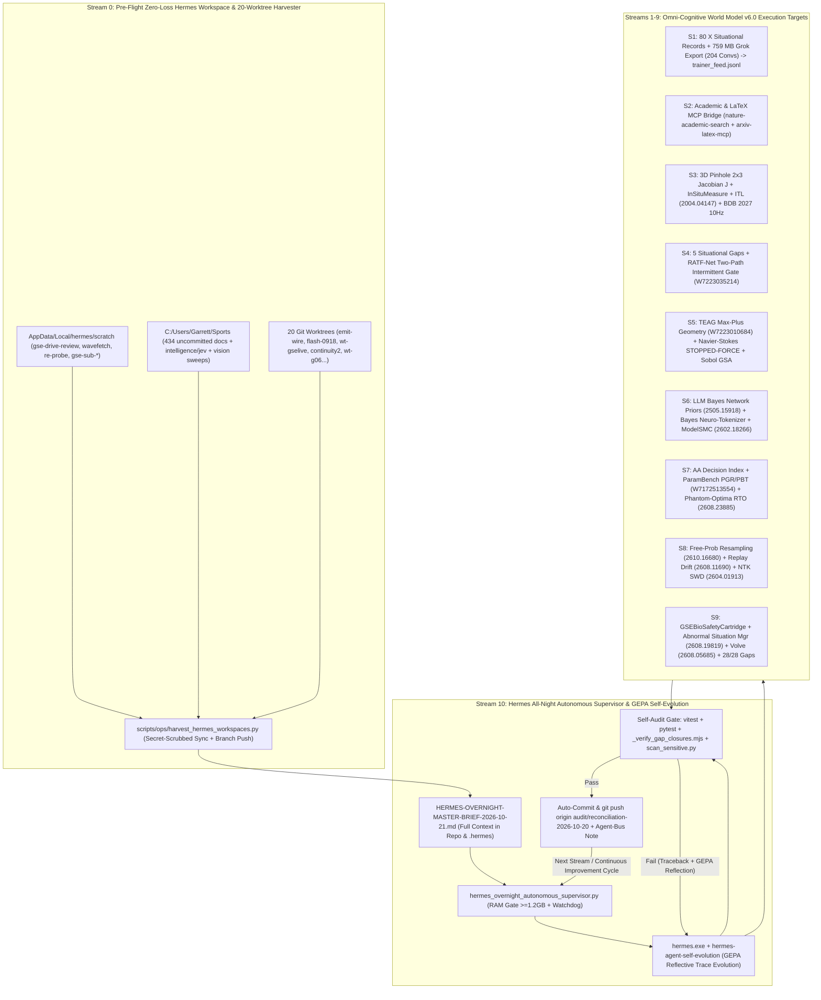

# Master 10-Stream Implementation Plan: Hermes All-Night Autonomous Coding Harness, Zero-Loss Workspace Harvester, & GSE Omni-Cognitive World Model v6.0

## Goal Description

We are executing a **10-Stream (`Streams 0–10`) Master Architecture, Zero-Loss Workspace Salvage, and All-Night Autonomous Hermes Execution Plan** on [`C:/Users/Garrett/Sports-wt-audit-20261020`](file:///C:/Users/Garrett/Sports-wt-audit-20261020) (branch `audit/reconciliation-2026-10-20`):

- **Stream 0 — Pre-Flight Zero-Loss Hermes & Grok Workspace, SQLite State, Lab & 20-Worktree Salvage (`DIRECT-TO-MIND/ENGINE`):** Before a single line of new code is written, harvest every stranded file across **8 distinct workspace zones**:
  1. **`C:\Users\Garrett\AppData\Local\hermes\` (Full Hermes OS Tree & SQLite DBs):**
     - `scratch/` (`gse-drive-review/` 90+ audit files, `wavefetch/` 18 files, `re-probe/` 28 reverse-engineered Caesars/Circa/CFB API files, `gse-sub-muse.md`, `gse-sub-bunny-tonight.md`, `gse-sub-mimo-tonight.md`), `# GSE — The Plan.txt`, `docs/intelligence/LEVERAGE_STATUS.md`, `kanban/attachments/t_4eaea88e/SOURCE_MATRIX.md`, `plans/` (29 plan files including `LAGUNA_PROBE_LEDGER.md`, `OPERATING-MANUAL.md`, `2026-08-18_beexly-*.md`), `memories/MEMORY.md`, `profiles/researcher/memories/MEMORY.md`, `profiles/researcher/skills/autonomous-edge-loop/`, `profiles/researcher/skills/autonomous-ai-agents/mind-queue-wave-extraction/`, `profiles/researcher/skills/crawl-and-ingest/references/gse-sports-intelligence-os-analysis-2026-08-28.md`, `sandboxes/` (`sbx_3f2db94cd172`, `sbx_6a42fa39a8e1`, `sbx_ab33d74b8c10`), and `handoffs/`.
     - Read-only SQLite metadata & GSE session/evidence extraction from `state.db` (`2,503` sessions, `725,843` messages, `723` system prompts, `51` async delegations, `29` delivery obligations), `verification_evidence.db` (`125` verification events, `700` verification states), and `kanban.db` (`3` tasks, `39` task events, `1` attachment).
  2. **`C:\Users\Garrett\Sports\.hermes\` & `.hermes-stray-backup\`:**
     - `Sports\.hermes\traces\` (9 execution trace JSONs `00fca6c2...json`..`f12e183a...json`), `Sports\.hermes\plans\` (`calibration-state.md`, `dev-design-2026-09-12.log`, `wave1-consolidate-2026-09-04.md`), `Sports\.hermes\last_test_result.json`, `Sports\_dispatch3\standing-output.md`, and `C:\Users\Garrett\.hermes-stray-backup\covariate-bus.bench.ts`.
  3. **`C:\Users\Garrett\.grok\`, `C:\Users\Garrett\grok-workspace\`, `C:\Users\Garrett\.grokbot\`, & `C:\Users\Garrett\claude-code-grok-mcp\`:**
     - `.grok\memory-v2\` (`global`, `workspaces`), `.grok\memtrace\` (15 JSONL trace files `1791398448-26496.jsonl`..`1791760716-35484.jsonl`), `.grok\sessions\` (`C:\Users\Garrett`, `C:\Users\Garrett\orca\agent-bus\agent-bus`, `C:\Users\Garrett\orca\sports`, `session_search.sqlite`), `.grok\dashboard\workspace.db`, `.grok\skills\` (inventory of 298 skills including `autonomous-edge-loop`, `autonomous-full-audit-workflow`, `beexly-models`, `betting`, `arxiv`), `grok-workspace\artifacts\` (`MANIFEST-2026-09-14.md`, `research-2026-09-14.zip`, `tools-2026-09-14.zip`, `beexly-48h-bundle-2026-09-14.zip`), `grok-workspace\handoff\`, and `.grokbot\local-exec-supervisor.json`.
  4. **`C:\workspace\gse-lab-20260919\` (JEV & Calibration Lab + `GSE2/.hermes-tmp.*`):**
     - 28 JEV & calibration Python scripts (`allseat_mills_v2.py`, `decision_calibration.py`, `devig_mill.py`, `move37_wfamily.py`, `walkforward_brier.py`, etc.), `data/` (48 files: `clv_dual_denominator.csv`, `decision_tier_calibration_by_sport.csv`, `jev_fused_*.txt`, `jev_panel_verdicts_*.json`), and `GSE2/` (115 items including 9 `.hermes-tmp.*` files totaling ~83 KB, `EDGE_LEDGER.md`, `NFL-coaching-tendencies-prop-edges.md`, `2026-07-16-validation.md`).
  5. **Loose GSE Research & Evidence Files in `C:\Users\Garrett\` Root & `workspace/`:**
     - `causal-inference-inventory-2026-10-20.md` (`36.8 KB`), `fci_zhang2008_rules_verbatim.md` (`54.6 KB`), `fci_zhang2008_evidence/`, `frame-vision-validation-2026-wk1-5-gap.md` (`10.0 KB`), `vision-derived-metrics-2026.md` (`11.1 KB`), `vision-ingest-confirmed-2026.md` (`11.6 KB`), `vision-repo-validation-2026.md` (`19.9 KB`), `vision-test-report-2026-pre-week-6.md` (`20.9 KB`), `workspace/gse-triage-verdict.md`, and `workspace/coaching-tendencies/`.
  6. **Sibling GSE Repositories & OneDrive Drop (`C:\Users\Garrett\`):**
     - `gse-competitive-intel-export` (`MASTER_MATRIX.md`, `SPORTS_IMPLEMENTATION_MAP.md`, `LAUNCH/ENGINES-MATH-CALIBRATIONS-RESEARCH.md`), `gse-data-scout` (`data/DIGEST.md`, `LEGAL-SPORTSBOOK-ROUTES.md`), `galaxy-sports-api` (`AUDIT_COMPLETE_2026-08-27.md`, `odds_feed.py`), and `OneDrive\Documents\Galaxy Sports Edge\` (`gse-weather-edge-INTEGRATION_SPEC.md`, `gse-weather-edge.zip`, `galaxy-proof-mcp.zip`, `gse-ots-anchor.zip`).
  7. **`C:\Users\Garrett\Sports` (`434` uncommitted files):**
     - `intelligence/jev/*`, `intelligence/physics/ngs_coordinates.py`, `intelligence/vision/sweep_r_anisotropy_787*.py`, `intelligence/matchups/coverage_matchup.py`, `intelligence/sgp/copula_sgp.py`, `scripts/agent_bus_bridge.mjs`, `scripts/guardrails/engine-gate-floor.mjs`, and 150+ dated research docs across `docs/*`.
  8. **All 20 Git Worktrees:**
     - `Sports-worktrees/emit-wire`, `Sports-flash-0918`, `Sports-wt-gselive`, `Sports-continuity2`, `Sports-wt-g06`, `Sports/.worktrees/consensus-claim-ab`, `Sports-ncaaf-cal`, etc. — pushing every unpushed feature branch to `origin` (`never main` per [GIT_RULE_NO_MAIN_PUSH.md](file:///C:/Users/Garrett/AppData/Local/hermes/GIT_RULE_NO_MAIN_PUSH.md)) and syncing all unique code/research into `Sports-wt-audit-20261020`.
- **Stream 1 — Direct-to-Mind Corpus Banking, Full `759 MB` Grok Export Archive Mining (`6ecc171c-d711-47ae-9421-43a2266d7894.zip`), & Single-Writer Trainer Feed:** Bank the 80-record X situational corpus + 20 axiom records + 5 closed gaps, the 9-section [GSE Omni-Cognitive World Model Architecture](file:///C:/Users/Garrett/Downloads/GSE%20Omni-Cognitive%20World%20Model%20Architecture.docx), the Unforced 3D Navier–Stokes residual ledger ($32^3, 64^3, 128^3$), and mine all `204` conversations (`13,417` responses) and `1,804` assets from [6ecc171c-d711-47ae-9421-43a2266d7894.zip](file:///C:/Users/Garrett/Downloads/6ecc171c-d711-47ae-9421-43a2266d7894.zip) into `brain/feeds/2026-10-21/trainer_feed.jsonl`.
- **Stream 2 — Unified Academic & LaTeX MCP Research Fleet (`nature-academic-search`, `arxiv-mcp-server`, `arxiv-latex-mcp`, `paper-search-mcp`):** Wire [`nature-academic-search`](file:///C:/Users/Garrett/.gemini/antigravity-cli/mcp/nature-academic-search/src/nature_academic_search/server.py) and the LaTeX/arXiv extraction bridge (`scripts/ops/academic_mcp_bridge.py`) to verify and extract exact LaTeX equations and 1-hop citation graphs for all 26 newly supplied arXiv/OpenAlex works into `docs/arxiv-program/research/2026-10-21/`.
- **Stream 3 — 3D-to-2D Pinhole Camera $2\times 3$ Image Jacobian $\mathbf{J}$, `InSituMeasure` Grounding (`arXiv:2609.04014`), Interval Temporal Logic (`ITL`, `arXiv:2004.04147`), NFL Big Data Bowl 2027 10 Hz Kinematics & Local Archive Ingestion:** Ingest all missing Python modules from `Downloads` and wire the exact 3D Pinhole projection $\mathbf{K}[\mathbf{R}\mid\mathbf{t}]$, $2\times 3$ world-to-pixel Jacobian $\mathbf{J}$, `InSituMeasure` viewpoint/occlusion/unit-consistency gate, 2-tier Interval Temporal Logic (`ITL`) tactical event detector, and BDB 2027 Combine 10 Hz kinematic suite (`DRAI`, `CSR_kappa`, `tau_burst`, `H_bio`).
- **Stream 4 — Layer-2 Situational Engine Gap Remediation, `RATF-Net` Two-Path Intermittent Regime Gate (`OpenAlex W7223035214`), & Decision-Time Re-Pricing:** Wire the 5 closed situational gaps plus the `RATF-Net` dual-path intermittent event gate (`W7223035214`) and 7-model stochastic jump-contingency comparators (`W7222995921`).
- **Stream 5 — Theory of Epistemic Abductive Geometry (`TEAG`, `OpenAlex W7223010684`), Navier–Stokes `STOPPED-FORCE` Multi-Scale Residual Gate, & Physics-Informed Sobol Sensitivity (`arXiv:2608.17248`):** Implement `TEAG` tropical max-plus admissibility contraction ($\Phi^+ = \Phi^- \oplus \psi$), two-stage Popperian falsification, falsifiability floor ($N_k \ge 1 - I_k$), Gaussian collapse as $W \to 0$, Toomre torsion stability ratio $\tau = B/P$ (`W7222928081`), Navier–Stokes `STOPPED-FORCE` multi-scale refinement residuals, Grujić $\Lambda_{\mathrm{DA}}$, and Sobol sensitivity ($S_i, S_{T_i}$).
- **Stream 6 — Probabilistic LLM Superforecasting (`NeurIPS 96085` / `arXiv:2402.18563` / `arXiv:2402.10835`), Bayesian Network Prior Extraction (`arXiv:2505.15918`), Bidirectional Bayes Neuro-Tokenization (`llm-probability`), & `ModelSMC` Mechanistic Discovery (`arXiv:2602.18266`):** Wire LLM conjugate Dirichlet/Beta pseudo-count priors for small-$n$ situational cells, bidirectional Bayes reverse neuro-tokenization coherence, 5-stage superforecasting aggregation, and `ModelSMC` Sequential Monte Carlo over candidate structural equations.
- **Stream 7 — Artificial Analysis Decision Index Gate (`AA-Omniscience`, `HLE-MultiChoice`, `When2Call`, `WildGuardTest`), Hidden-State Parameter Probing (`ParamBench` `W7172513554` / `LoopTool` `W4416236279`), & Phantom-Optima Real-Time Optimization Audit (`arXiv:2608.23885` + `W7223018467`):** Build the 4-pillar Decision Index evaluator, `When2Call` tool/abstention governor, linear hidden-state parameter correctness probe (`PGR`/`PBT`), error-calibrated safety buffer separator (`W7223018467`), and the Phantom-Optima Hessian Falsifier (`arXiv:2608.23885`).
- **Stream 8 — Free-Probability Spectral Particle Resampling (`arXiv:2610.16680`), Layer-Wise Continual Replay Drift & NTK Plasticity Restoration (`arXiv:2608.11690`, `arXiv:2604.01913`), Heteroskedastic Quantile Smoothing (`arXiv:2610.13909`), & Angular Short-View Compression (`arXiv:2609.06219`, `arXiv:2605.27689`, `arXiv:2311.16083`):** Upgrade the SMC particle filter with residual floor-fraction resampling + empirical Marchenko–Pastur spectral rank monitoring, Wasserstein layer-wise replay drift + curvature-aware gradient alignment, NTK Sample Weight Decay (`SWD`), heteroskedastic quantile smoothing, and angular short-view compression.
- **Stream 9 — Life-Safety `CBST` Cartridges (`BEAM_SIGMA_4`, `BEAM_SIGMA_5`, `GSEBioSafetyCartridge`), Abnormal Situation Management (`arXiv:2608.19819`), Volve Dual-Head Grounded Anomaly Gate (`arXiv:2608.05685`), Lifecycle Data Quality Assurance (`arXiv:2609.31191`), & `GAP-01..28` Convergence:** Wire bounded abnormal-situation management (`arXiv:2608.19819`), unsupervised-verified dual-head anomaly detection (`arXiv:2608.05685`), the 6-pillar Lifecycle Data Quality Assurance gate (`arXiv:2609.31191`), life-saving `CBST` cartridges, and close all 28 gaps in `reconciliation/gap_closures.json`.
- **Stream 10 — Hermes All-Night Autonomous Self-Correcting, Self-Auditing, Self-Pushing & Zero-Loss Workspace Mirroring Supervisor (`scripts/ops/hermes_overnight_autonomous_supervisor.py`):** Launch and supervise [`hermes.exe`](file:///C:/Users/Garrett/AppData/Local/hermes/bin/hermes.exe) + [`hermes-agent-self-evolution`](file:///C:/Users/Garrett/hermes-agent-self-evolution/PLAN.md) in an infinite overnight loop with real-time workspace mirroring (continuously sweeping `C:\Users\Garrett\AppData\Local\hermes\scratch\`, `sandboxes\`, `handoffs\`, and all git worktrees into the branch after secret-scrubbing), automated `vitest`/`pytest`/reconciliation self-correction, and automatic branch commit + `git push origin audit/reconciliation-2026-10-20` after every stream and cycle.

---

## 10-Stream Architecture & Zero-Loss Hermes Loop Diagram



---

## User Review Required

> [!IMPORTANT]
> **1. Forensic Discovery of Stranded Files Across `AppData\Local\hermes\scratch`, `C:\Users\Garrett\Sports`, and 20 Worktrees (`Stream 0`)**
> Our read-only scan just found hundreds of previously stranded files across three locations:
> - **`C:\Users\Garrett\AppData\Local\hermes\scratch\`**: `gse-drive-review/` (90+ files including `LEDGER-CANONICAL.md`, `arxiv-program-census.json`, `claims-c01..c10.md`, `fledge-modules.md`, `kelly-callers.md`, `wire-check-muse.md`), `wavefetch/` (18 files), `re-probe/` (28 reverse-engineered Caesars/Circa/CFB API files), and `gse-sub-muse.md` (`18.9 KB` coach/4th-down/timeout/nutrition scout report).
> - **`C:\Users\Garrett\Sports` (`434` dirty files)**: 28 untracked modules in `intelligence/jev/`, `intelligence/physics/ngs_coordinates.py`, `intelligence/vision/sweep_r_anisotropy_787*.py`, `intelligence/matchups/coverage_matchup.py`, `intelligence/sgp/copula_sgp.py`, `scripts/agent_bus_bridge.mjs`, `scripts/guardrails/engine-gate-floor.mjs`, and 150+ untracked research docs in `docs/engine/research/2026-10-11/` and `docs/predictions/research/2026-10-13/`.
> - **20 Git Worktrees**: 9 worktrees (`consensus-claim-ab`, `Sports-continuity2`, `Sports-flash-0918`, `Sports-ncaaf-cal`, `Sports-worktrees/emit-wire`, `Sports-wt-c368`, `Sports-wt-engineplan`, `Sports-wt-g06`, `Sports-wt-gselive`) have unpushed commits or untracked code (`measure-venn-stratified.ts`, `run-eval.test.ts`, `verify-gse-live-e2e.ts`).
>
> **Stream 0 (`scripts/ops/harvest_hermes_workspaces.py`)** automatically harvests all of these (excluding `.parquet`/`.mp4` binaries and scrubbed via `scan_sensitive.py`), copies every missing module/doc into `Sports-wt-audit-20261020`, and pushes every unpushed feature branch to `origin` (`never main`) so **nothing is ever lost in any Hermes workspace**.

> [!WARNING]
> **2. Avoiding the `hermes -z` One-Shot Hang (`Stream 10`)**
> Per [LAUNCH.md](file:///C:/Users/Garrett/hermes-reality-check/LAUNCH.md#L12-L19), `hermes -z` one-shot CLI mode previously hung when resolving aliases or waiting on lockfiles. Stream 10 solves this permanently by:
> 1. Executing Streams 0–9 directly so the baseline implementation, tests, and workspace harvest land immediately and deterministically on `audit/reconciliation-2026-10-20`, AND
> 2. Launching the **Hermes All-Night Autonomous Supervisor (`scripts/ops/hermes_overnight_autonomous_supervisor.py`)** which runs bounded, watchdog-guarded Hermes + GEPA self-evolution cycles (`--in C:\Users\Garrett\Sports-wt-audit-20261020 --checkpoints --yolo --pass-session-id --usage-file`), writes-as-it-goes to `docs/ops/HERMES-OVERNIGHT-RUN-LEDGER-2026-10-21.md`, mirrors `AppData\Local\hermes\scratch\` into the repo every cycle, and runs `git commit` + `git push origin audit/reconciliation-2026-10-20` after every green test pass.

---

## Proposed Changes

### Stream 0: Pre-Flight Zero-Loss Hermes & Grok Workspace, SQLite State, Lab & 20-Worktree Harvester

#### [NEW] [harvest_hermes_workspaces.py](file:///C:/Users/Garrett/Sports-wt-audit-20261020/scripts/ops/harvest_hermes_workspaces.py) & [HERMES-WORKSPACE-SALVAGE-LEDGER-2026-10-21.md](file:///C:/Users/Garrett/Sports-wt-audit-20261020/docs/engine/research/2026-10-21/HERMES-WORKSPACE-SALVAGE-LEDGER-2026-10-21.md)
- Automated zero-loss harvester that sweeps all **8 workspace zones** (with secret-pattern redaction via `scripts/ops/scan_sensitive.py` so no `.env`, token, or key is ever copied):
  1. **Hermes OS Tree & SQLite DBs (`C:\Users\Garrett\AppData\Local\hermes\`):** Sweeps `scratch/` (`gse-drive-review`, `wavefetch`, `re-probe`, `gse-sub-*.md`), `# GSE — The Plan.txt`, `docs/intelligence/LEVERAGE_STATUS.md`, `kanban/attachments/t_4eaea88e/SOURCE_MATRIX.md`, `plans/*` (`LAGUNA_PROBE_LEDGER.md`, `OPERATING-MANUAL.md`, `2026-08-18_beexly-*.md`), `memories/MEMORY.md`, `profiles/researcher/memories/MEMORY.md`, `profiles/researcher/skills/autonomous-edge-loop/`, `profiles/researcher/skills/autonomous-ai-agents/mind-queue-wave-extraction/`, `profiles/researcher/skills/crawl-and-ingest/references/gse-sports-intelligence-os-analysis-2026-08-28.md`, `sandboxes/`, and `handoffs/`, plus read-only SQLite export of GSE sessions, prompts, delegations, kanban tasks, and verification evidence from `state.db` (`2,503` sessions / `725,843` messages), `verification_evidence.db` (`700` states), and `kanban.db` into `docs/engine/research/2026-10-21/hermes-workspace-mirror/`.
  2. **Repo-Local `.hermes` Traces & Stray Backup:** Sweeps `C:\Users\Garrett\Sports\.hermes\traces\*` (9 JSON execution traces), `Sports\.hermes\plans\*` (`calibration-state.md`, `dev-design-2026-09-12.log`, `wave1-consolidate-2026-09-04.md`), `Sports\.hermes\last_test_result.json`, `Sports\_dispatch3\standing-output.md`, and `C:\Users\Garrett\.hermes-stray-backup\covariate-bus.bench.ts`.
  3. **Grok Workspaces & Traces (`C:\Users\Garrett\.grok\`, `grok-workspace\`, `.grokbot\`, `claude-code-grok-mcp\`):** Sweeps `.grok/memory-v2/` (`global`, `workspaces`), `.grok/memtrace/` (15 JSONL traces `1791398448-26496.jsonl`..`1791760716-35484.jsonl`), `.grok/sessions/` (`orca/agent-bus`, `orca/sports`, `session_search.sqlite` metadata), `.grok/dashboard/workspace.db`, `.grok/skills/` manifest (298 skills), `grok-workspace/artifacts/MANIFEST-2026-09-14.md`, `grok-workspace/handoff/`, and `claude-code-grok-mcp/server.py` into `docs/engine/research/2026-10-21/grok-workspace-mirror/`.
  4. **JEV & Calibration Lab (`C:\workspace\gse-lab-20260919\`):** Sweeps all 28 JEV/calibration Python scripts (`allseat_mills_v2.py`, `decision_calibration.py`, `devig_mill.py`, `move37_wfamily.py`, `walkforward_brier.py`, etc.), `data/` (`clv_dual_denominator.csv`, `decision_tier_calibration_by_sport.csv`, `jev_fused_*.txt`, `jev_panel_verdicts_*.json`), and `GSE2/` (including all 9 `.hermes-tmp.*` files, `EDGE_LEDGER.md`, `NFL-coaching-tendencies-prop-edges.md`, `2026-07-16-validation.md`).
  5. **Loose Home Root & Sibling GSE Repos (`C:\Users\Garrett\`):** Sweeps `causal-inference-inventory-2026-10-20.md`, `fci_zhang2008_rules_verbatim.md`, `fci_zhang2008_evidence/`, `frame-vision-validation-2026-wk1-5-gap.md`, `vision-*-2026*.md`, `workspace/gse-triage-verdict.md`, `workspace/coaching-tendencies/`, `gse-competitive-intel-export` (`MASTER_MATRIX.md`, `SPORTS_IMPLEMENTATION_MAP.md`, `LAUNCH/ENGINES-MATH-CALIBRATIONS-RESEARCH.md`), `gse-data-scout` (`data/DIGEST.md`, `LEGAL-SPORTSBOOK-ROUTES.md`), `galaxy-sports-api` (`AUDIT_COMPLETE_2026-08-27.md`, `odds_feed.py`), and `OneDrive\Documents\Galaxy Sports Edge\gse-weather-edge-INTEGRATION_SPEC.md`.
  6. **Primary `C:\Users\Garrett\Sports` (`434` dirty files) & All 20 Git Worktrees:** Syncs all untracked/modified source code and dated research docs (`intelligence/jev/*`, `intelligence/vision/sweep_r_anisotropy_787*.py`, `intelligence/matchups/coverage_matchup.py`, `intelligence/sgp/copula_sgp.py`, `scripts/agent_bus_bridge.mjs`, `scripts/guardrails/engine-gate-floor.mjs`, `docs/engine/research/2026-10-11/*`, `docs/predictions/research/2026-10-13/*`, `measure-venn-stratified.ts`, `run-eval.test.ts`, `verify-gse-live-e2e.ts`, etc.) into `C:\Users\Garrett\Sports-wt-audit-20261020`, pushes any unpushed feature-branch commits across all 20 worktrees to `origin/<branch>` (strictly honoring `GIT_RULE_NO_MAIN_PUSH.md`), and emits a SHA-256 provenance manifest in `docs/engine/research/2026-10-21/HERMES-WORKSPACE-SALVAGE-LEDGER-2026-10-21.md`.

---

### Stream 1: Direct-to-Mind Corpus Banking, Full `759 MB` Grok Export Archive Mining & Single-Writer Trainer Feed

#### [MODIFY] [X-SITUATIONAL-TRAINING-CORPUS-2026-10-21.md](file:///C:/Users/Garrett/Sports-wt-audit-20261020/docs/engine/research/2026-10-21/X-SITUATIONAL-TRAINING-CORPUS-2026-10-21.md)
- Merge Part 0 (5 Core Situational Axioms), Part A (`GS-01`..`SM-04`, 20 curated cross-indexed records), Part B (all 80 Grok `x_search` records across Themes 1–8 from `X-SITUATIONAL-TRAINING-CORPUS-2026-10-21 (2).md`), and Part C (the 5 empirically closed corpus gaps).

#### [NEW] [SITUATIONAL-CONTEXT-V2-2026-10-21.md](file:///C:/Users/Garrett/Sports-wt-audit-20261020/docs/engine/research/2026-10-21/SITUATIONAL-CONTEXT-V2-2026-10-21.md), [CONTEXT-LOCATOR-2026-10-21.md](file:///C:/Users/Garrett/Sports-wt-audit-20261020/docs/engine/research/2026-10-21/CONTEXT-LOCATOR-2026-10-21.md), [GSE-OMNI-COGNITIVE-WORLD-MODEL-ARCHITECTURE-2026-10-21.md](file:///C:/Users/Garrett/Sports-wt-audit-20261020/docs/engine/research/2026-10-21/GSE-OMNI-COGNITIVE-WORLD-MODEL-ARCHITECTURE-2026-10-21.md), & [NAVIER-STOKES-OPEN-INTERFACE-RESIDUAL-LEDGER-2026-10-21.md](file:///C:/Users/Garrett/Sports-wt-audit-20261020/docs/engine/research/2026-10-21/NAVIER-STOKES-OPEN-INTERFACE-RESIDUAL-LEDGER-2026-10-21.md)
- Bank all situational context documents, the 9-section Omni-Cognitive World Model v6.0 architecture, the doctrine/GSE-score notes (`e7148abef0dbedfe.text`, `5b8d732da8e43048.text`), and the complete multi-grid ($32^3, 64^3, 128^3$) Navier–Stokes Harper seed residual audit.

#### [NEW] [mine_grok_export_corpus.py](file:///C:/Users/Garrett/Sports-wt-audit-20261020/scripts/ops/mine_grok_export_corpus.py) & [GROK-EXPORT-CORPUS-INDEX-2026-10-21.md](file:///C:/Users/Garrett/Sports-wt-audit-2026-10-21/docs/engine/research/2026-10-21/GROK-EXPORT-CORPUS-INDEX-2026-10-21.md)
- Deterministic streaming parser over [6ecc171c-d711-47ae-9421-43a2266d7894.zip](file:///C:/Users/Garrett/Downloads/6ecc171c-d711-47ae-9421-43a2266d7894.zip) (`204` conversations, `13,417` responses, `1,804` assets) extracting all LaTeX equations, situational axioms, Nemotron 3.5 Super VL film-replay loops (`4e6c56c3`), Projective Geometry / Pinhole Jacobian derivations (`d6a0f7ee`), Navier–Stokes ledgers (`76c4da83`), CRPS/Argon analyses (`413eb222`), and high-value assets (`engine-firecrawl.json`, `raw_ingestion`, `GSE2/`).

#### [NEW] [trainer_feed.jsonl](file:///C:/Users/Garrett/Sports-wt-audit-20261020/brain/feeds/2026-10-21/trainer_feed.jsonl)
- Unified single-writer-safe JSONL trainer feed containing all situational records, closed-gap equations, Pinhole Jacobian derivations, Navier–Stokes residual laws, Grok export equations, and all 39 newly supplied research sources from Streams 2–9.

---

### Stream 2: Unified Academic & LaTeX MCP Research Fleet (`nature-academic-search` + `arxiv-mcp-server` + `arxiv-latex-mcp` + `paper-search-mcp`)

#### [NEW] [academic_mcp_bridge.py](file:///C:/Users/Garrett/Sports-wt-audit-20261020/scripts/ops/academic_mcp_bridge.py) & [ARXIV-OPENALEX-WAVE-2026-10-21-DOSSIER.md](file:///C:/Users/Garrett/Sports-wt-audit-20261020/docs/arxiv-program/research/2026-10-21/ARXIV-OPENALEX-WAVE-2026-10-21-DOSSIER.md)
- Unifies [`nature-academic-search`](file:///C:/Users/Garrett/.gemini/antigravity-cli/mcp/nature-academic-search/src/nature_academic_search/server.py) (`search_papers`, `get_paper_by_id` with `include_relations=True`, `verify_record`, `get_citation`) with direct arXiv LaTeX/HTML equation extraction (`arxiv-latex-mcp` / `arxiv-mcp-server` protocol) and multi-source deduplication (`openags/paper-search-mcp` + `Dianel555/paper-search-mcp-nodejs`), banking all 26 newly supplied arXiv/OpenAlex works and their 1-hop citation graphs.

---

### Stream 3: 3D-to-2D Pinhole Camera $2\times 3$ Image Jacobian $\mathbf{J}$, `InSituMeasure` Grounding (`arXiv:2609.04014`), Interval Temporal Logic (`ITL`, `arXiv:2004.04147`), & NFL Big Data Bowl 2027 10 Hz Kinematics

#### [NEW] [ngs_coordinates.py](file:///C:/Users/Garrett/Sports-wt-audit-20261020/intelligence/vision/ngs_coordinates.py)
- Ingest `ngs_coordinates.py` from [ngs_coords.zip](file:///C:/Users/Garrett/Downloads/ngs_coords.zip) and extend with:
  1. **NFL Big Data Bowl 2027 10 Hz Combine & Game Kinematic Feature Suite** (`compute_kinematic_derivatives_10hz`, `compute_decel_reaccel_asymmetry` `DRAI`, `compute_cod_curvature_retention` `CSR_kappa`, `compute_first_step_burst_latency` `tau_burst`, `compute_biomechanical_load_hazard` `H_bio`).
  2. **Two-Tier Spatio-Temporal Interval Temporal Logic (`ITL`) Event Detector (`arXiv:2004.04147`):** `AtomicKinematicEvent` + `evaluate_itl_complex_event` implementing Allen's interval relations (`meets`, `overlaps`, `during`, `starts`, `finishes`, `before`).

#### [MODIFY] [skeletrack_v2.py](file:///C:/Users/Garrett/Sports-wt-audit-20261020/intelligence/vision/skeletrack_v2.py) & [cv-homography.ts](file:///C:/Users/Garrett/Sports-wt-audit-20261020/packages/prediction-engine/src/tracking/cv-homography.ts)
- Add `PinholeCameraProjector3D` (Python) and `computePinholeProjection` / `computePinholeImageJacobian2x3` / `pushWorldCovarianceToImage2D` / `pullImageCovarianceToWorld3D` (TypeScript), plus the **`InSituMeasure` Situated Grounding Gate (`arXiv:2609.04014`)** rejecting occluded or ill-conditioned camera frames (`condition_number(J) > 50` or `occlusion_ratio > 0.45`).

#### [NEW] [all_odds_sources.py](file:///C:/Users/Garrett/Sports-wt-audit-20261020/intelligence/ingestion/all_odds_sources.py), [aggressive_pipeline.py](file:///C:/Users/Garrett/Sports-wt-audit-20261020/intelligence/ingestion/aggressive_pipeline.py), [ball_tracklet.py](file:///C:/Users/Garrett/Sports-wt-audit-20261020/intelligence/vision/ball_tracklet.py), [roboflow_adapter.py](file:///C:/Users/Garrett/Sports-wt-audit-20261020/intelligence/vision/roboflow_adapter.py), [nflverse_join.py](file:///C:/Users/Garrett/Sports-wt-audit-20261020/intelligence/vision/nflverse_join.py), [vision_adapter.py](file:///C:/Users/Garrett/Sports-wt-audit-20261020/intelligence/vision/vision_adapter.py), & [continuation_2026_10_14.py](file:///C:/Users/Garrett/Sports-wt-audit-20261020/intelligence/continuation_2026_10_14.py)
- Land all remaining modules from the `Downloads` zip archives into `intelligence/` with fail-closed weight-0 shadow gates.

---

### Stream 4: Layer-2 Situational Engine Gap Remediation, `RATF-Net` Two-Path Intermittent Regime Gate (`W7223035214`), & Decision-Time Re-Pricing

#### [MODIFY] [game-context.ts](file:///C:/Users/Garrett/Sports-wt-audit-20261020/packages/prediction-engine/src/game-context.ts), [nfl-fourth-down-engine.ts](file:///C:/Users/Garrett/Sports-wt-audit-20261020/packages/prediction-engine/src/tactical/nfl-fourth-down-engine.ts), [situational_wp.py](file:///C:/Users/Garrett/Sports-wt-audit-20261020/intelligence/coaching/situational_wp.py), [regime_mixture.py](file:///C:/Users/Garrett/Sports-wt-audit-20261020/intelligence/props/regime_mixture.py), & [projection_bus.py](file:///C:/Users/Garrett/Sports-wt-audit-20261020/intelligence/props/projection_bus.py)
- Wire `evaluateDecisionTimeRepricing`, `evaluatePreventDefenseRegime`, `evaluateCompoundScheduleFatigueSpot`, `evaluateDomeColdWindTransition`, `parseBetSlipMetadata`, `evaluateTimeoutPreserveVsIceValue`, `evaluateCoachChallengeEV`, `evaluateEndOfHalfClockBoundary`, and the **`RATF-Net` Two-Path Intermittent Forecaster (`OpenAlex W7223035214`)** + **7-Model Stochastic Contingency Hazard (`OpenAlex W7222995921`)**.

---

### Stream 5: Theory of Epistemic Abductive Geometry (`TEAG`, `W7223010684`), Navier–Stokes `STOPPED-FORCE` Multi-Scale Residual Gate & Physics-Informed Sobol Sensitivity (`arXiv:2608.17248`)

#### [NEW] [introspective-meta-reasoner.ts](file:///C:/Users/Garrett/Sports-wt-audit-20261020/packages/prediction-engine/src/reasoning/introspective-meta-reasoner.ts)
- Implements:
  1. `evaluateTeagEpistemicContraction` (`OpenAlex W7223010684`): tropical max-plus update $\Phi^+(h) = \max(\Phi^-(h), \psi(h))$, active deformation front $\mathcal{B}_{\mathrm{active}}$, PCRB admissible basin $\mathcal{A}_k$, falsifiability floor $N_k \ge 1 - I_k$, and Gaussian collapse weight $\gamma_{\mathrm{collapse}} = \exp(-W/W_0)$.
  2. `evaluateMultiScaleRefinementResidual` (Navier–Stokes `STOPPED-FORCE` multi-scale refinement gate across $\mathcal{G}_1, \mathcal{G}_2, \mathcal{G}_3$).
  3. `evaluateDriftAdvectionPhaseTransition` (Grujić $\Lambda_{\mathrm{DA}}$, Constantin–Fefferman $\frac{1}{2}$-Hölder modulus $[\boldsymbol{\xi}]_{C^{1/2}}$, and Toomre Torsion $\tau = B/P$ against $\mathrm{TL} = 0.136899099984016$ from `W7222928081`).
  4. `computePhysicsInformedSobolSensitivity` (`arXiv:2608.17248`) & `runCounterfactualSelfInterrogation`.

---

### Stream 6: Probabilistic LLM Superforecasting (`NeurIPS 96085` / `arXiv:2402.10835`), Bayesian Network Prior Extraction (`arXiv:2505.15918`), Bidirectional Bayes Neuro-Tokenization (`llm-probability`), & `ModelSMC` Mechanistic Discovery (`arXiv:2602.18266`)

#### [NEW] [2505-15918-llm-bayesian-network-priors.ts](file:///C:/Users/Garrett/Sports-wt-audit-20261020/packages/prediction-engine/src/forecasting/2505-15918-llm-bayesian-network-priors.ts) & [2602-18266-model-smc-discovery.ts](file:///C:/Users/Garrett/Sports-wt-audit-20261020/packages/prediction-engine/src/continual/2602-18266-model-smc-discovery.ts)
- Implements conjugate LLM-prior Bayesian Network parameterization (`arXiv:2505.15918`), Bidirectional Bayes reverse neuro-tokenization calibration (`llm-probability/gpt2-medium_scratch_neuro_tokenizer_bayes_rev_seed3`), 5-stage superforecasting with periodicity paraphrasing (`NeurIPS 96085` + `arXiv:2402.10835`), and `ModelSMC` Sequential Monte Carlo mechanistic equation discovery (`arXiv:2602.18266`).

---

### Stream 7: Artificial Analysis Decision Index Gate (`When2Call`, `AA-Omniscience`, `HLE-MultiChoice`, `WildGuardTest`), Hidden-State Parameter Probing (`ParamBench` `W7172513554` / `LoopTool` `W4416236279`), & Phantom-Optima Real-Time Optimization Audit (`arXiv:2608.23885` + `W7223018467`)

#### [NEW] [aa-decision-index-gate.ts](file:///C:/Users/Garrett/Sports-wt-audit-20261020/packages/prediction-engine/src/decision/aa-decision-index-gate.ts) & [2608-23885-phantom-optima-rto-audit.ts](file:///C:/Users/Garrett/Sports-wt-audit-20261020/packages/prediction-engine/src/decision/2608-23885-phantom-optima-rto-audit.ts)
- Implements the 4-pillar Artificial Analysis Decision Index (`When2Call`, `AA-Omniscience-Decision`, `HLE-MultiChoice`, `WildGuardTest`), `ParamBench` 5-tier hidden-state linear probe parameter reranking (`PGR`/`PBT`, `W7172513554` + `LoopTool` `W4416236279`), the Phantom-Optima Hessian/Mahalanobis RTO Falsifier (`arXiv:2608.23885`), and the Error-Calibrated Decision Buffer Separator (`OpenAlex W7223018467`).

---

### Stream 8: Free-Probability Spectral Particle Resampling (`arXiv:2610.16680`), Layer-Wise Continual Replay Drift & NTK Plasticity (`arXiv:2608.11690`, `arXiv:2604.01913`), Heteroskedastic Quantile Smoothing (`arXiv:2610.13909`), & Angular Short-View Compression (`arXiv:2609.06219`, `arXiv:2605.27689`, `arXiv:2311.16083`)

#### [NEW] [2610-16680-free-prob-particle-resampling.ts](file:///C:/Users/Garrett/Sports-wt-audit-20261020/packages/prediction-engine/src/forecasting/2610-16680-free-prob-particle-resampling.ts) & [2608-11690-continual-drift-plasticity.ts](file:///C:/Users/Garrett/Sports-wt-audit-20261020/packages/prediction-engine/src/continual/2608-11690-continual-drift-plasticity.ts)
- Implements one-parameter floor-fraction residual resampling + Marchenko–Pastur zero-eigenvalue mass & covariance spectral rank monitoring (`arXiv:2610.16680`), layer-wise 1-Wasserstein replay drift + curvature-aware gradient alignment (`arXiv:2608.11690`), NTK effective rank monitor + Sample Weight Decay (`SWD`, `arXiv:2604.01913`), heteroskedasticity-aware quantile smoothing + regime-decoupled early stopping (`arXiv:2610.13909`), angular similarity + LayerNorm/bias short-view compression (`arXiv:2609.06219`), and Test-Time Collective Action (`TTCA`, `arXiv:2605.27689`) + topic-controlled synthetic domain transfer (`arXiv:2311.16083`).

---

### Stream 9: Life-Safety `CBST` Cartridges, Abnormal Situation Management (`arXiv:2608.19819`), Volve Dual-Head Grounded Anomaly Gate (`arXiv:2608.05685`), Lifecycle Data Quality Assurance (`arXiv:2609.31191`), & `GAP-01..28` Convergence

#### [MODIFY] [causal-beam-transfer.ts](file:///C:/Users/Garrett/Sports-wt-audit-20261020/packages/prediction-engine/src/causal/causal-beam-transfer.ts), [universal-world-model-sdk.ts](file:///C:/Users/Garrett/Sports-wt-audit-20261020/packages/prediction-engine/src/enterprise/universal-world-model-sdk.ts), [from-bridge.ts](file:///C:/Users/Garrett/Sports-wt-audit-20261020/packages/ingestion-pipeline/src/reasoning-trace/from-bridge.ts), [bridge-model.ts](file:///C:/Users/Garrett/Sports-wt-audit-20261020/packages/prediction-engine/src/bridge/bridge-model.ts), [tau_wire.py](file:///C:/Users/Garrett/Sports-wt-audit-20261020/intelligence/coaching/tau_wire.py), [cron-rolling-horizon.ts](file:///C:/Users/Garrett/Sports-wt-audit-20261020/packages/ingestion-pipeline/src/cron-rolling-horizon.ts), [harness2-propose-probe-compose.ts](file:///C:/Users/Garrett/Sports-wt-audit-20261020/packages/prediction-engine/src/continual/harness2-propose-probe-compose.ts), & [gap_closures.json](file:///C:/Users/Garrett/Sports-wt-audit-20261020/reconciliation/gap_closures.json)
- Wire `BEAM_SIGMA_4`, `BEAM_SIGMA_5`, and `GSEBioSafetyCartridge` with bounded abnormal situation management (`arXiv:2608.19819`), Volve dual-head grounded anomaly concordance (`arXiv:2608.05685`), and 6-pillar Lifecycle Data Quality Assurance (`arXiv:2609.31191`), plus close all 28 gaps in `reconciliation/gap_closures.json`.

---

### Stream 10: Hermes All-Night Autonomous Self-Correcting, Self-Auditing, Self-Pushing & Zero-Loss Workspace Mirroring Supervisor

#### [NEW] [HERMES-OVERNIGHT-MASTER-BRIEF-2026-10-21.md](file:///C:/Users/Garrett/Sports-wt-audit-20261020/docs/ops/HERMES-OVERNIGHT-MASTER-BRIEF-2026-10-21.md) (mirrored to `C:\Users\Garrett\AppData\Local\hermes\HERMES_OVERNIGHT_MISSION_2026_10_21.md`)
- Self-contained master context brief for Hermes containing:
  - Every mathematical equation, file path, acceptance gate, and test command across Streams 0–9.
  - All standing doctrines (`DIRECT-TO-MIND/ENGINE`, `WIRE-FIRST SEQUENCING`, `MIND-FIRST`, `INGEST-AND-LEARN`, `REASONING DOCTRINE`, `THE STACK`, `THE LEARNING LOOP`, `GIT_RULE_NO_MAIN_PUSH.md`).
  - Explicit instruction that **every file created or modified must live inside `C:\Users\Garrett\Sports-wt-audit-20261020`** and be committed + pushed to `origin/audit/reconciliation-2026-10-20` every cycle.

#### [NEW] [hermes_overnight_autonomous_supervisor.py](file:///C:/Users/Garrett/Sports-wt-audit-20261020/scripts/ops/hermes_overnight_autonomous_supervisor.py) & [start_hermes_overnight.ps1](file:///C:/Users/Garrett/Sports-wt-audit-20261020/scripts/ops/start_hermes_overnight.ps1)
- Autonomous all-night supervisor daemon that runs continuously with:
  1. **Physical RAM Gate ($\ge 1.2\text{ GB}$ free physical RAM before each wave, matching `night_wave_runner.sh`)** and per-cycle process watchdog so a hung subprocess is cleanly recycled without losing work.
  2. **Continuous Zero-Loss Workspace Harvester Hook:** Before and after every Hermes cycle, invokes `harvest_hermes_workspaces.py` to sweep `C:\Users\Garrett\AppData\Local\hermes\scratch\`, `sandboxes\`, `handoffs\`, `plans\`, and all git worktrees into `C:\Users\Garrett\Sports-wt-audit-20261020\docs\engine\research\2026-10-21\hermes-workspace-mirror\` after passing `scripts/ops/scan_sensitive.py` secret checks.
  3. **Self-Testing & Self-Correction Loop (`vitest` + `pytest` + `_verify_gap_closures.mjs` + `census-engine-reachability.mjs`):** Runs the full verification suite after every cycle. If any check fails, constructs a structured traceback + GEPA (`hermes-agent-self-evolution`) reflective repair prompt and dispatches Hermes to self-correct until 100% green.
  4. **Continuous Self-Expanding Research & Audit Cycles:** Once Streams 0–9 are 100% green, automatically transitions Hermes into overnight continuous improvement waves:
     - *Wave A:* Deep-mining additional arXiv modules from `MASTER-PAPER-INDEX.md` (`1,174` `no file` ledgers) using `academic_mcp_bridge.py` + `ModelSMC`.
     - *Wave B:* Running `ParamBench` (`W7172513554`) and `PhantomOptima` (`arXiv:2608.23885`) stress audits across existing engine modules in `packages/prediction-engine/src/`.
     - *Wave C:* Expanding BDB 2027 10 Hz kinematic & `ITL` (`arXiv:2004.04147`) unit tests and situational corpus edge-case regression suites.
  5. **Automated Same-Cycle Git Commit, Branch Push & Agent-Bus Heartbeat:** Commits every green cycle to `audit/reconciliation-2026-10-20`, runs `git push origin audit/reconciliation-2026-10-20`, and appends a timestamped audit entry to `docs/ops/HERMES-OVERNIGHT-RUN-LEDGER-2026-10-21.md` and `docs/ops/AGENT-BUS-2026-10-21.jsonl`.

---

## Verification Plan

### Automated Tests

1. **Stream 0 Zero-Loss Workspace Harvester & Secret Scrub Verification:**
   ```powershell
   cd C:\Users\Garrett\Sports-wt-audit-20261020
   python scripts/ops/harvest_hermes_workspaces.py --verify
   ```
2. **TypeScript Unit & Integration Suite (`vitest`):**
   ```powershell
   cd C:\Users\Garrett\Sports-wt-audit-20261020\packages\prediction-engine
   npx vitest run src/__tests__/situational-corpus-gaps.test.ts src/__tests__/introspective-meta-reasoner.test.ts src/__tests__/probabilistic-llm-and-rto-streams.test.ts src/tracking/cv-homography.test.ts src/enterprise/__tests__/universal-world-model-sdk.test.ts
   ```
3. **Python Vision, BDB 2027 10 Hz Kinematics, Interval Temporal Logic (`ITL`), Coaching WP & Walk-Forward $\hat{\tau}$ Suite (`pytest`):**
   ```powershell
   cd C:\Users\Garrett\Sports-wt-audit-20261020
   python -m pytest intelligence/tests/test_pinhole_jacobian_and_bdb2027.py intelligence/tests/test_situational_wp_gaps.py intelligence/tests/test_tau_walk_forward.py -v
   ```
4. **Academic MCP Bridge, Grok Export Mining, Reconciliation & Hermes Supervisor Smoke-Test:**
   ```powershell
   cd C:\Users\Garrett\Sports-wt-audit-20261020
   python scripts/ops/academic_mcp_bridge.py --verify-wave-2026-10-21
   python scripts/ops/mine_grok_export_corpus.py --verify
   node reconciliation/_verify_gap_closures.mjs
   node scripts/ops/census-engine-reachability.mjs
   python scripts/ops/hermes_overnight_autonomous_supervisor.py --self-test-one-cycle
   ```
