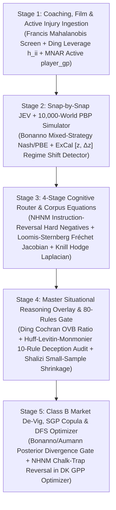

# GSE Engine & DFS Optimizer Mathematical Wiring Specification: `ExCal` Anomaly Calibration, `NHNM` Reversal Mining, Peng Ding `FWL`/`LOO`/`EHW`, Bonanno Game Theory & The Huff-Levitin-Monmonier Audit Gate

**Date:** `2026-11-02`  
**Bucket:** `docs/engine/research/2026-11-02/`  
**Doctrines Enforced:** `MIND-FIRST` · `DIRECT-TO-MIND/ENGINE` · `WIRE-FIRST SEQUENCING` · `REASONING DOCTRINE` · `THE STACK` · `5-STAGE ENGINE GATE`  
**Companion Corpus Dossier:** [`2026-11-02-BATCH5-EXCAL-NHNM-DING-BONANNO-STATISTICAL-FALLACIES-CORPUS-DOSSIER.md`](file:///C:/Users/Garrett/Sports/docs/arxiv-program/research/2026-11-02/2026-11-02-BATCH5-EXCAL-NHNM-DING-BONANNO-STATISTICAL-FALLACIES-CORPUS-DOSSIER.md)

---

## 1. Architecture Overview: How Batch 5 Wires Across All 5 Stages of the GSE Engine

---

## 2. Stage-by-Stage Mathematical Equations & Engine Targets

### 2.1 Stage 1 & Stage 4 Telemetry / Rule Calibration: `ExCal` Excess Calibration & Prevalence Damping (`arXiv:2610.35568v1`)
**Target Modules:**
- `packages/prediction-engine/src/nfl/master-situational-reasoning-aggregator.ts`
- `intelligence/coaching/compute_tendencies.py` & live odds/telemetry monitors

**Problem Solved:**
Previously, heterogeneous situational signals (trench pressure rate, pace/PROE shift, snap-share velocity, and market steam) operated on incompatible raw scales, and broadly firing rules could over-trigger across an entire slate.

**Exact `ExCal` Equations Wired into GSE:**
1. **Signal + First-Difference Phase-Space Subspace Residual (Eqs. 6–7):**
   For any player or team weekly telemetry vector $\mathbf{z}_t \in \mathbb{R}^C$ (standardized on historical normal prefix $1:L_{\mathrm{tr}}$) and week-over-week velocity $\Delta\mathbf{z}_t = \mathbf{z}_t - \mathbf{z}_{t-1}$:
   $$\mathbf{a}_t = [\mathbf{z}_t, \Delta\mathbf{z}_t] \in \mathbb{R}^{2C}, \qquad \mathbf{r}_t = \left|(\mathbf{a}_t - \bm{\mu}_a) - \mathbf{V}_s\mathbf{V}_s^{\mathsf{T}}(\mathbf{a}_t - \bm{\mu}_a)\right|$$
   Standardizing each coordinate $c$ by its prefix median and IQR $\tilde{r}_{t,c} = \frac{|r_{t,c} - q_{r,c,0.5}|}{\max(\text{IQR}(r_c), 0.05)}$ and taking the **top-3 coordinate mean**:
   $$m_{\mathrm{sub}}(t) = \frac{1}{3}\sum_{k=1}^3 \tilde{r}_{t,(k)}$$
   instantly detects sudden role breakouts or hidden injury snap-share collapses without dilution from unchanged stats.
2. **Multi-Scale Log-Volatility & Mean Shift (Eqs. 8–9):**
   Across rolling windows $s \in \{1\text{ drive}, 4\text{ drives}, 1\text{ game}, 4\text{ games}\}$:
   $$d_{\mathrm{scale},c}^{(s)}(t) = \frac{\left|\log(\sigma_{t,c}^{(s)} + 10^{-3}) - q_{\log\sigma,c,0.5}^{(s)}\right|}{\max\left(q_{\log\sigma,c,0.75}^{(s)} - q_{\log\sigma,c,0.25}^{(s)}, 0.05\right)}$$
   captures both **variance explosions** (boom/bust deep-shot volatility) and **variance collapses** (ultra-condensed checkdown usage).
3. **High-Floor Excess Calibration & Square-Root Prevalence Damping (Eqs. 10–12):**
   Every situational detector or anomaly map $m_i(t)$ is calibrated against its prefix median $q_{i,0.5}$ and $99.5\text{th}$ percentile floor $q_{i,0.995}$, with broad-firing slate attenuation $h_i$:
   $$e_i(t) = \left[\frac{m_i(t) - q_{i,0.995}}{\max(q_{i,0.995} - q_{i,0.5}, 10^{-6})}\right]_+, \qquad h_i = \sqrt{\frac{\rho}{\max(f_i, \rho)}} \quad (\rho = 0.10)$$
   $$s_{\mathrm{ExCal}}(t) = \sum_{i=1}^M \left[h_i e_i(t) + \tau\,\operatorname{rank01}(m_i(t))\right], \qquad \tau = 0.02$$
   **Guardrail:** If any situational rule fires on $f_i = 40\%$ of the Week's slate (compared to target sparsity $\rho = 10\%$), $h_i = \sqrt{0.10 / 0.40} = 0.50$ automatically cuts its excess weight in half!

---

### 2.2 Stage 3 Cognitive Router & DFS Chalk-Trap Reversal: `NHNM` Natural Hard-Negative Mining (`arXiv:2610.36900v1`)
**Target Modules:**
- `packages/mcp-equations-server/src/mcp-cognitive-router.ts`
- `scripts/ops/run_dk_classic_gpp.py` (DFS Optimizer Candidate Pool & Anti-Fragile Leverage)

**Problem Solved (Directly Diagnosed in Week 8 DFS Autopsy):**
In Week 8, our DFS optimizer and prop rankers were anchored to **unconditioned query-positives ($d^+$)** — players with strong season-long baseline volume (`Breece Hall`, `Garrett Wilson`, `C.J. Stroud`, `Ja'Tavion Sanders`) — even when the **instance-specific situational instruction $I_j$** (e.g., *OL decimation + Cover-1 blitz mismatch + negative script / backup-TE route cannibalization*) turned those season-long positives into **Natural Instruction Hard Negatives ($d_0^-$)**!

**Exact `NHNM` Mathematical Pipeline Wired into GSE:**
1. **Situational Reversal Tuple Construction (Eq. 3):**
   Given a position/matchup query $q$ (e.g., *"Week $t$ DK Main Slate RB1 ceiling play"*) and situational instruction $I_j$ (encoding the active 288-bit context mask: trench pressure delta, weather, coverage shell, injury replacements):
   - Identify the **Convertible Negative (`CN`)** $d_j^-$: a lower-owned player whose specific skill profile (`YPRR vs Man`, `Pressure Answer hot-route target share`, `Red-Zone IZR share`) satisfies $I_j$.
   - Promote $d^+ \leftarrow d_j^-$ and relabel the chalk season-long positive $d_{\text{chalk}}^+$ that violates $I_j$ as the **first instruction-conditioned hard negative $d_0^-$**:
     $$\mathcal{D}_{I_j, q}^- = \{d_0^-\} \cup \bigl(\widetilde{\mathcal{D}}_q^- \setminus \{d_j^-\} \setminus \mathcal{E}_{I_j}\bigr)$$
2. **Pretrained Geometry Filtering & Contrastive Margin Gate (Eqs. 4–5):**
   Compute the instruction-induced similarity shift in the router embedding space $f_\theta$:
   $$\Delta^+(I_j, q, d) = \operatorname{sim}\!\bigl(f_\theta(I_j \oplus q), f_\theta(d)\bigr) - \operatorname{sim}\!\bigl(f_\theta(q), f_\theta(d)\bigr)$$
   Require **double-sign reversal verification** before promoting a DFS pivot $d_j^-$ over chalk $d_0^-$:
   $$\Delta^+(I_j, q, d_j^-) > \gamma_+ \quad \text{AND} \quad \Delta^+(I_j, q, d_0^-) < -\gamma_- \qquad (\gamma_+, \gamma_- \ge 0)$$

---

### 2.3 Stage 4 `x-situational-80-rules.ts` Mathematical Upgrade: Peng Ding `FWL`/`OVB`/`LOO` + Huff-Levitin-Monmonier Audit
**Target Module:** `packages/prediction-engine/src/nfl/x-situational-80-rules.ts` (`validateFeatureAgainstMisleadingStats`)

We upgrade `validateFeatureAgainstMisleadingStats` from qualitative heuristic checks to four exact closed-form econometric & statistical-deception gates derived from **Peng Ding (`arXiv:2401.00649v2`)**, **Cosma Shalizi (`Plate 0`)**, **Louise Francis (`Slide 31`)**, **Darrell Huff**, **Daniel Levitin**, and **Mark Monmonier**:

1. **Gate A — Cochran Omitted-Variable Bias (`OVB`) & Frisch-Waugh-Lovell (`FWL`) Partial Regression Gate (Ding Theorems 7.1 & 9.1; Huff Ch. 7–8):**
   Never allow a raw covariate $\mathbf{X}_2$ (e.g., team pass attempts, RB carries, raw defensive yards allowed) into the model without partialling out the confounding regime matrix $\mathbf{X}_1$ (game-script score margin, garbage-time indicator, opponent injury/strength-of-schedule):
   $$\tilde{\mathbf{X}}_2 = (\mathbf{I}_n - \mathbf{H}_1)\mathbf{X}_2, \qquad \mathbf{H}_1 = \mathbf{X}_1(\mathbf{X}_1^{\mathsf{T}}\mathbf{X}_1)^{-1}\mathbf{X}_1^{\mathsf{T}}$$
   $$\hat{\beta}_2^{\text{FWL}} = (\tilde{\mathbf{X}}_2^{\mathsf{T}}\tilde{\mathbf{X}}_2)^{-1}\tilde{\mathbf{X}}_2^{\mathsf{T}}(\mathbf{I}_n - \mathbf{H}_1)Y, \qquad \tilde{\beta}_2^{\text{short}} = \hat{\beta}_2^{\text{FWL}} + \hat{\bm{\delta}}\hat{\beta}_1$$
   **Rejection / Shrinkage Rule:** Compute the Cochran OVB share:
   $$\rho_{\text{OVB}} = \frac{\|\hat{\bm{\delta}}\hat{\beta}_1\|_2}{\|\tilde{\beta}_2^{\text{short}}\|_2 + 10^{-8}}$$
   If $\rho_{\text{OVB}} > 0.50$ (or $\operatorname{sign}(\hat{\beta}_2^{\text{FWL}}) \ne \operatorname{sign}(\tilde{\beta}_2^{\text{short}})$, i.e., **Simpson's Paradox**), reject $\tilde{\beta}_2^{\text{short}}$ as a **Huff Semiattached / Post-Hoc Fallacy** and use only $\hat{\beta}_2^{\text{FWL}}$.

2. **Gate B — Mahalanobis-Leverage $h_{ii}$ & Sherman-Morrison Leave-One-Out (`LOO`) Stability Gate (Ding Theorems 11.1–11.2; Francis Slide 31):**
   For any player or team rolling window of $n$ active games (`player_gp` $= n$), compute each game's covariate Mahalanobis distance $D_i^2$ and exact leverage $h_{ii}$:
   $$D_i^2 = (\mathbf{x}_{i2} - \bar{\mathbf{x}}_2)^{\mathsf{T}}\mathbf{S}^{-1}(\mathbf{x}_{i2} - \bar{\mathbf{x}}_2), \qquad h_{ii} = \frac{1}{n} + \frac{D_i^2}{n - 1}$$
   Compute the single-pass Sherman-Morrison LOO parameter shift and `HC3` Eicker-Huber-White sandwich standard error:
   $$\Delta\hat{\beta}_{[-i]} = \hat{\beta} - \hat{\beta}_{[-i]} = \frac{(\mathbf{X}^{\mathsf{T}}\mathbf{X})^{-1}\mathbf{x}_i\hat{\varepsilon}_i}{1 - h_{ii}}, \qquad \hat{\mathbf{V}}_{\text{HC3}} = (\mathbf{X}^{\mathsf{T}}\mathbf{X})^{-1}\left(\sum_{i=1}^n \frac{\hat{\varepsilon}_i^2}{(1 - h_{ii})^2}\mathbf{x}_i\mathbf{x}_i^{\mathsf{T}}\right)(\mathbf{X}^{\mathsf{T}}\mathbf{X})^{-1}$$
   **Rejection / Down-Weighting Rule:** If $\max_{1 \le i \le n} h_{ii} > \min\left(0.50, \frac{2p}{n}\right)$ or $\max_i \frac{\|\Delta\hat{\beta}_{[-i]}\|_2}{\|\hat{\beta}\|_2} > 0.35$, a single outlier game (e.g., an overtime shootout or 50-mph wind game) is dictating the trend (`Huff Ch. 1 & 2`). Replace $\hat{\beta}$ with the leverage-trimmed / Huber-weighted estimator.

3. **Gate C — Shalizi Small-Sample Signal-to-Noise (`SNR`) Bias-Variance Gate (Shalizi *ADAfaEPoV* p. 28, Plate `0`; Huff Ch. 3–4):**
   When estimating a situational adjustment $\hat{\Delta}(x)$ of amplitude $A$ over $n$ observations with residual standard deviation $\hat{\sigma}$:
   $$\text{SNR}_{\text{eff}}(n) = \frac{n \cdot A^2}{p \cdot \hat{\sigma}^2}$$
   By Shalizi's `ugly.func` demonstration ($n=20, A=0.01, \sigma=0.5 \implies \text{RMSE}_{\text{mean}} = 0.54 < \text{RMSE}_{\text{true form}} = 0.55$), whenever $\text{SNR}_{\text{eff}}(n) < 1$, estimating the complex functional form adds more estimation variance than it removes in bias. Apply optimal empirical-Bayes shrinkage toward the Layer-1 prior:
   $$\hat{\Delta}_{\text{shrunk}}(x) = \left(1 - \frac{1}{\max(1, \text{SNR}_{\text{eff}}(n))}\right) \hat{\Delta}(x)$$

4. **Gate D — Monmonier Cartographic / Ecological Fallacy (`MAUP`) & Levitin Base-Rate Gate:**
   - **Monmonier `MAUP` Rule:** Ban coarse team-level defensive rank overlays (`"Defense is #3 vs WRs"`) unless decomposed by alignment (`Slot / Wide`) and coverage shell (`Man / Zone` weighted by receiver's `YPRR vs Man` and `YPRR vs Zone`).
   - **Levitin Bayesian Base-Rate Rule:** Any narrative/trend hit-rate $P(\text{Signal} \mid \text{Win})$ must be converted via Bayes' rule using the true unconditional base rate $\pi_0 = p_{\text{mkt}}^{\text{de-vig}}$ before entering Stage 4.

---

### 2.4 Stage 2 Coach-Mind & Stage 5 Conjunction Gate: Giacomo Bonanno & Christopher Griffin Game Theory
**Target Modules:**
- `scripts/ops/gse_coach_mind_simulator.py` (Stage 2 Snap-by-Snap JEV Simulator)
- `packages/prediction-engine/src/nfl/no-bet-gate.ts` (Stage 5 Conjunction Gate)

1. **Quantal / Mixed-Strategy Nash Equilibrium in Snap-by-Snap Play Calling (`gse_coach_mind_simulator.py`):**
   On every snap state $s = (\text{qtr}, \text{clock}, \text{down}, \text{ydstogo}, \text{yardline\_100}, \text{score\_diff})$, the Offensive Coordinator (`OC`, action $a \in \mathcal{A}_{\text{off}}$) and Defensive Coordinator (`DC`, shell/blitz $b \in \mathcal{B}_{\text{def}}$) play a finite zero-sum / bimatrix game with JEV-evaluated payoff matrix $\mathbf{U}(s) = [u_{ab}(s)]$.
   Instead of assuming static historical frequencies when an opponent has an extreme mismatch, blend the empirical coaching tendency $\pi_{\text{emp}}(a \mid s)$ with the **Logit Quantal Response / Mixed-Strategy Nash Equilibrium** $\pi_{\text{QRE}}^*(a \mid s)$:
   $$\pi_{\text{QRE}}^*(a \mid s) = \frac{\exp\left(\lambda_{\text{OC}} \sum_{b \in \mathcal{B}_{\text{def}}} u_{ab}(s)\,\sigma_{\text{QRE}}^*(b \mid s)\right)}{\sum_{a' \in \mathcal{A}_{\text{off}}} \exp\left(\lambda_{\text{OC}} \sum_{b \in \mathcal{B}_{\text{def}}} u_{a'b}(s)\,\sigma_{\text{QRE}}^*(b \mid s)\right)}$$
2. **Harsanyi Bayesian Signaling for Questionable Injuries (Bonanno Ch. 13–16):**
   Model late-week `Questionable` injury reports (`LP/LP/FP` vs `DNP/DNP/LP`) as a **Dynamic Signaling Game (Perfect Bayesian Equilibrium)** where the coaching staff's private type $\theta \in \{\text{Full-Go}, \text{Snap-Capped Decoy}, \text{Inactive}\}$ updates via Bayesian consistency $\mu(\theta \mid \text{PracticeSeq}, \text{BeatDesk}, \text{MarketSteam})$.
3. **Aumann's Agreement Theorem Gate in `no-bet-gate.ts` (Bonanno Ch. 9.6–9.7):**
   By Aumann (1976), if $p_{\text{GSE}} \ne p_{\text{mkt}}^{\text{de-vig}}$ under a shared prior, the edge $\Delta p = p_{\text{GSE}} - p_{\text{mkt}}^{\text{de-vig}}$ is valid **if and only if** GSE possesses a measurable information-partition advantage $\mathcal{I}_{\text{asym}} > 0$ (quantified by non-zero Stage 4 orthogonalized situational delta $|\Delta\text{log-odds}_{\text{Stage4}}| > 0$ or verified timing/injury delta). If $|\Delta\text{log-odds}_{\text{Stage4}}| \approx 0$ and the pick comes solely from a solo historical stat model disagreeing with the closing market, Aumann's theorem classifies the discrepancy as **prior misspecification**, triggering an automatic **`PASS` (`publishAllowed: false`)**!

---

### 2.5 Stage 3 Exterior Calculus, Hodge Decomposition & Kinematics: Loomis-Sternberg, Knill & Physics Plates
1. **Discrete Exterior Calculus & Hodge Decomposition on SGP Correlation Graphs (Oliver Knill `Math 22B` Units 33–38 & Loomis-Sternberg `Advanced Calculus`):**
   On a multi-leg SGP or matchup interaction graph $G = (V, E)$, define 0-cochains (node potentials $\phi \in \Omega^0(G)$), 1-cochains (pairwise edge flows $\omega \in \Omega^1(G)$), coboundary gradient $(d_0\phi)_{ij} = \phi_j - \phi_i$, and curl $(d_1\omega)_{ijk} = \omega_{ij} + \omega_{jk} + \omega_{ki}$ around 3-cycles. By the **Discrete Helmholtz-Hodge Decomposition**:
   $$\Omega^1(G) = \operatorname{im}(d_0) \oplus \operatorname{im}(d_1^*) \oplus \ker(L_1), \qquad L_1 = d_0 d_0^* + d_1^* d_1$$
   - $\operatorname{im}(d_0)$ captures **transitive rating differences** (already priced into main spreads/totals).
   - $\operatorname{im}(d_1^*)$ captures **non-transitive rock-paper-scissors matchup curls** (e.g., `2-High Shell` beats `Deep Play-Action`, `Heavy 12-Personnel Duo Run` beats `2-High Shell`, `Base Bear Front` beats `12-Personnel Run`) — where **Layer-2 situational edge and SGP mispricing live!**
2. **NGS Player-Tracking Kinematics & Rotational Torque Features (`uploaded_media_5, 7, 13, 14, 15`):**
   - Deep-ball completion probability uses exact projectile flight time $T_{\text{flight}} = \frac{2v_0\sin\theta_0}{g}$ vs safety closing radius $r_{\text{close}} = v_{\text{safety}} T_{\text{flight}} + \frac{1}{2}a_{\text{safety}} T_{\text{flight}}^2$.
   - Tackle-breaking / yards-after-contact (`YAC/att`) models carrier linear momentum $p = mv$, kinetic energy $K = \frac{1}{2}mv^2$, centripetal cutback acceleration $a_c = v^2/r = \omega^2 r$, and off-center contact torque $\tau = r_\perp F = I\alpha$.
