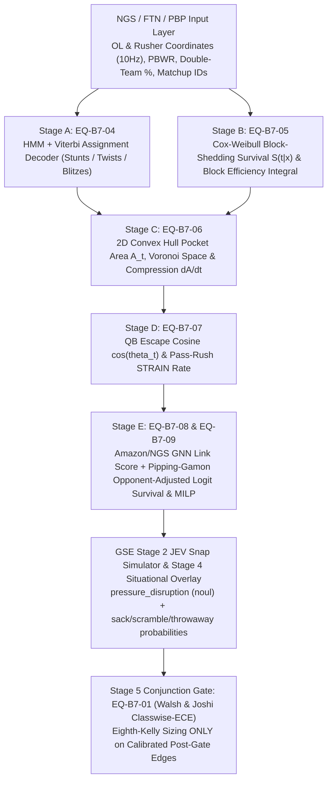

# Batch 7 Engine Mapping: Spatiotemporal Trench Physics (HMM Viterbi, Cox-Weibull Survival, Convex Hull Pocket Decay, QB Escape Cosine, STRAIN, Pipping-Gamón MILP), Walsh-Joshi Calibration Gate, & Ultrametric Coaching Kernels

**Date:** `2026-11-02`  
**Bucket:** `docs/engine/research/2026-11-02/`  
**Doctrines Enforced:** `WIRE-FIRST SEQUENCING` · `DIRECT-TO-MIND/ENGINE` · `MIND-FIRST` · `THE STACK` · `FULL-GAME SNAP-BY-SNAP JEV + 5-STAGE ENGINE GATE`

---

## 1. Architecture Overview: From Coarse Binary Counting Stats to Continuous Spatiotemporal Physics

---

## 2. Formal Equations (`EQ-B7-01` through `EQ-B7-10`)

### `EQ-B7-01`: Walsh & Joshi (2024) Classwise-ECE Calibration Gate & Eighth-Kelly Bankroll Theorem
Given $K$ classes and $M$ equal-width bins $B_{j,k} = [\frac{j-1}{M}, \frac{j}{M})$, define the **Dispersion-Constrained Classwise Expected Calibration Error**:
$$\text{Classwise-ECE}(f) = \begin{cases} \displaystyle\frac{1}{K}\sum_{k=1}^K \sum_{j=1}^M \frac{|B_{j,k}|}{N}\Bigl|\operatorname{acc}(B_{j,k}) - \operatorname{conf}(B_{j,k})\Bigr|, & \text{if } \frac{1}{KM}\sum_{k,j}\mathbb{I}(|B_{j,k}| > 0) \ge 0.80, \\[8pt] 1.0, & \text{otherwise (bin-clumping penalty).} \end{cases}$$
Under **Eighth-Kelly staking** ($f^*_{1/8} = \frac{1}{8}\frac{p_{\text{cal}} b - (1 - p_{\text{cal}})}{b}$ where $b = \text{decimal\_odds} - 1$), model selection by $\min \text{Classwise-ECE}$ yields $+36.93\%$ ROI vs. $-75.90\%$ under $\max \text{Accuracy}$.
- **Engine Target:** `packages/prediction-engine/src/nfl/calibration-map.ts` & `no-bet-gate.ts`.

---

### `EQ-B7-02`: Ruscio & Brady (2021) Modified PFR Gaussian Win Probability with Stretched Regulation Floor & Overtime Scaling
Let $\Delta S = \text{pts}_{\text{off}} - \text{pts}_{\text{def}}$, $\text{EP} \in [-2.49, 6.971]$ be current-drive expected points, $L_{\text{off}}$ be the pregame Vegas spread in favor of the offense, and $s_{\text{rem}} \in [0, 3600]$ be regulation seconds remaining:
$$\tau_{\text{eff}}(s_{\text{rem}}, \text{is\_OT}) = \begin{cases} 0.25, & \text{if } \text{is\_OT} = \text{True}, \\[4pt] \dfrac{450 + \frac{3150}{3600}\,s_{\text{rem}}}{3600} \cdot \left(1 - 0.35\,\mathbb{I}(s_{\text{rem}} < 120)\frac{120 - s_{\text{rem}}}{120}\right), & \text{if } \text{is\_OT} = \text{False}. \end{cases}$$
$$\mu_{\text{WP}} = \Delta S + \text{EP} + L_{\text{off}}\left(\frac{s_{\text{rem}}}{3600}\right)\mathbb{I}(\neg\text{is\_OT}), \qquad \sigma_{\text{WP}} = 13.40022\,\sqrt{\tau_{\text{eff}}(s_{\text{rem}}, \text{is\_OT})}$$
$$\text{WP}_{\text{off}} = 1 - \Phi\left(\frac{0.5 - \mu_{\text{WP}}}{\sigma_{\text{WP}}}\right) + \frac{1}{2}\left[\Phi\left(\frac{0.5 - \mu_{\text{WP}}}{\sigma_{\text{WP}}}\right) - \Phi\left(\frac{-0.5 - \mu_{\text{WP}}}{\sigma_{\text{WP}}}\right)\right]$$
- **Engine Target:** `intelligence/coaching/trench_pocket_physics.py` (`ruscio_brady_modified_pfr_wp`).

---

### `EQ-B7-03`: Atluri (2021) Skellam Point-Differential Distribution & Weirich et al. (2025) Pythagorean-ML Residual
For offensive/defensive scoring intensities $\lambda_{\text{home}}, \lambda_{\text{away}} > 0$, the exact discrete probability of point differential $D = X_{\text{home}} - X_{\text{away}} = k \in \mathbb{Z}$ follows the **Skellam distribution**:
$$P(D = k \mid \lambda_{\text{home}}, \lambda_{\text{away}}) = \exp\bigl(-(\lambda_{\text{home}} + \lambda_{\text{away}})\bigr)\left(\frac{\lambda_{\text{home}}}{\lambda_{\text{away}}}\right)^{k/2} I_{|k|}\!\left(2\sqrt{\lambda_{\text{home}}\lambda_{\text{away}}}\right)$$
where $I_{|k|}(\cdot)$ is the modified Bessel function of the first kind. Furthermore, the **Generalized Pythagorean Win Expectation** ($\alpha = 2.37$ for NFL) serves as the orthogonal baseline prior before ML residual estimation:
$$W_{\text{Pyth}} = \frac{\text{PF}^{2.37}}{\text{PF}^{2.37} + \text{PA}^{2.37}}, \qquad \hat{W}_{\text{final}} = W_{\text{Pyth}} + f_{\text{NN}}\bigl(\mathbf{x}_{\text{situational}} - \mathcal{P}_{\text{Pyth}}\mathbf{x}_{\text{situational}}\bigr)$$

---

### `EQ-B7-04`: Discrete-Time Hidden Markov Model (HMM) & Viterbi Decoding for Dynamic Pass-Blocking Assignments (`Stunts / Twists`)
For offensive lineman $L_j$ across frames $t = 1, \dots, T$ ($10\text{ Hz}$) and $N$ candidate pass rushers $\{R_1, \dots, R_N\}$:
- **State Transition Matrix $A^{(t)} \in \mathbb{R}^{N \times N}$ (Assignment Inertia vs. Stunt Switch):**
  $$A^{(t)}_{l,k} = P(S_t = k \mid S_{t-1} = l) = \begin{cases} 1 - \gamma_t, & \text{if } l = k \text{ (maintain block)}, \\[4pt] \dfrac{\gamma_t}{N - 1}, & \text{if } l \neq k \text{ (handoff / stunt switch)}, \end{cases}$$
  where $\gamma_t = \gamma_0 \exp(-\eta t)$ is the stunt-window switching rate (peaking in the first $1.5\text{ s}$ after snap).
- **Spatial-Angular Emission Likelihood $B_k(\mathbf{O}_t)$:**
  $$B_k(\mathbf{O}_t) = P(\mathbf{O}_t \mid S_t = k) = \frac{\exp\bigl(-\beta_1 \, d(L_{j,t}, R_{k,t}) - \beta_2 \, \theta(L_{j,t}, R_{k,t}, \text{QB}_t)\bigr)}{\sum_{m=1}^N \exp\bigl(-\beta_1 \, d(L_{j,t}, R_{m,t}) - \beta_2 \, \theta(L_{j,t}, R_{m,t}, \text{QB}_t)\bigr)}$$
- **Log-Space Viterbi Recursion:**
  $$V_{t,k} = \log B_k(\mathbf{O}_t) + \max_{l \in \{1,\dots,N\}}\bigl(V_{t-1,l} + \log A^{(t)}_{l,k}\bigr), \qquad S^*_T = \arg\max_k V_{T,k}$$
- **Engine Target:** `intelligence/coaching/trench_pocket_physics.py` (`hmm_viterbi_pass_block_assignments`).

---

### `EQ-B7-05`: Cox Proportional Hazards with Weibull Baseline & Continuous Block-Shedding Survival Integral
Let $\mathbf{x}_{j,t} = [\Delta v_{\text{rel}}, \text{leverage\_angle}, \text{rusher\_pass\_rush\_grade}, \mathbb{I}(\text{stunt\_active})]^T$ be the covariate vector for blocker $j$ at time $t$:
$$h_j(t \mid \mathbf{x}_j) = h_0(t)\exp\bigl(\boldsymbol{\beta}^T \mathbf{x}_j\bigr), \qquad h_0(t) = \frac{k}{\lambda}\left(\frac{t}{\lambda}\right)^{k-1} \quad (\lambda = 2.85\text{ s}, \; k = 2.60)$$
The cumulative hazard and **Block Survival Probability** through time $t$ are:
$$H_j(t \mid \mathbf{x}_j) = \int_0^t h_j(u \mid \mathbf{x}_j)\,du = \left(\frac{t}{\lambda}\right)^k \exp(\boldsymbol{\beta}^T \mathbf{x}_j), \qquad S_j(t \mid \mathbf{x}_j) = \exp\bigl(-H_j(t \mid \mathbf{x}_j)\bigr)$$
And the **Continuous Block Efficiency Score** over dropback duration $T_{\text{pass}}$ is:
$$\text{Block Efficiency}_j(T_{\text{pass}}) = \int_0^{T_{\text{pass}}} S_j(t \mid \mathbf{x}_j)\,dt, \qquad \text{Normalized Efficiency}_j = \frac{1}{T_{\text{pass}}}\int_0^{T_{\text{pass}}} S_j(t \mid \mathbf{x}_j)\,dt \in (0, 1]$$
- **Engine Target:** `intelligence/coaching/trench_pocket_physics.py` (`cox_weibull_block_survival`).

---

### `EQ-B7-06`: 2D Convex Hull Pocket Area ($A_t$) & Instantaneous Pocket Compression Derivative ($\frac{dA}{dt}$)
Let $\mathcal{P}_t = \{(x_{i,t}, y_{i,t})\}_{i=1}^5$ be the 2D coordinates of the five offensive linemen (`LT, LG, C, RG, RT`) at frame $t$, and let $(x_{(1)}, y_{(1)}), \dots, (x_{(m)}, y_{(m)})$ be the counterclockwise vertices of their 2D Convex Hull $\operatorname{Conv}(\mathcal{P}_t)$:
$$A_t = \operatorname{Area}\bigl(\operatorname{Conv}(\mathcal{P}_t)\bigr) = \frac{1}{2}\left|\sum_{r=1}^m \bigl(x_{(r)} y_{(r+1)} - x_{(r+1)} y_{(r)}\bigr)\right| \quad (\text{yd}^2)$$
The **Instantaneous Pocket Compression Rate** at sampling interval $\Delta t = 0.1\text{ s}$ ($10\text{ Hz}$) is:
$$\frac{dA}{dt}\bigg|_t = \frac{A_t - A_{t-1}}{\Delta t}, \qquad \text{Critical Collapse Indicator: } \mathbb{I}_{\text{collapse}}(t) = \mathbb{I}\!\left(\frac{dA}{dt}\bigg|_t < -15.0\text{ yd}^2/\text{s}\right)$$
- **Engine Target:** `intelligence/coaching/trench_pocket_physics.py` (`calculate_pocket_compression_series`).

---

### `EQ-B7-07`: QB Escape Vector Alignment Cosine ($\cos\theta_t$) & Pass-Rush `STRAIN` Rate
Let $\mathbf{v}_{\text{QB},t} = \frac{\mathbf{p}_{\text{QB},t} - \mathbf{p}_{\text{QB},t-1}}{\Delta t}$ be the quarterback's velocity vector, and let $\mathbf{u}_{\text{failure},t} = \mathbf{p}_{\text{rusher}^*,t} - \mathbf{p}_{\text{QB},t}$ be the vector pointing from the quarterback toward the primary collapsing pocket breach:
$$\cos(\theta_t) = \frac{\mathbf{v}_{\text{QB},t} \cdot \mathbf{u}_{\text{failure},t}}{\|\mathbf{v}_{\text{QB},t}\|_2 \, \|\mathbf{u}_{\text{failure},t}\|_2 + \epsilon}$$
- **Attribution Rule:**
  - $\cos(\theta_t) \ge +0.40$: **QB Drift Into Pressure (`QB_FAULT`)** — quarterback drifted or stepped directly into the collapsing breach.
  - $\cos(\theta_t) \le -0.40$: **Active QB Evasion (`EVADING_PRESSURE`)** — quarterback climbed or escaped away from the breach.
  - $|\cos(\theta_t)| < 0.40$: **Lateral / Neutral Pocket Movement (`NEUTRAL_POCKET`)**.
- **Pass-Rush `STRAIN` Rate (Nguyen, Yurko, & Matthews, 2024):**
  $$\text{STRAIN}_{i,t} = \frac{v_{\text{close},i,t}}{d_{i,t}} = -\frac{d_{i,t} - d_{i,t-1}}{\Delta t \cdot d_{i,t}} \quad (\text{s}^{-1})$$
- **Engine Target:** `intelligence/coaching/trench_pocket_physics.py` (`analyze_qb_escape_vectors`, `compute_strain_rate`).

---

### `EQ-B7-08`: Amazon/NGS Unified Graph Neural Network (GNN) Joint Node-Edge Loss (`Feeling the Pressure`, MIT Sloan #193952)
Representing the 22 on-field players as nodes $V$ and the $11 \times 11 = 121$ offense-defense pairs as bipartite candidate links $E$:
$$\mathcal{L}_{\text{GNN}} = \mathcal{L}_{\text{BCE}}^{\text{nodes}} + \lambda_{\text{link}}\,\mathcal{L}_{\text{BCE}}^{\text{links}} = -\frac{1}{|V|}\sum_{v \in V} w_v\bigl[y_v \log \hat{p}_v + (1-y_v)\log(1-\hat{p}_v)\bigr] - \frac{\lambda_{\text{link}}}{|E|}\sum_{e \in E} w_e\bigl[y_e \log \hat{p}_e + (1-y_e)\log(1-\hat{p}_e)\bigr]$$
with $\lambda_{\text{link}} > 1$ compensating for link sparsity (`0.99` node role accuracy, `0.97` link average precision, `0.56%` pressure probability ECE).

---

### `EQ-B7-09`: Pipping-Gamón et al. (2026) Opponent-Adjusted Logit Survival Score & 5-Man MILP Lineup Optimization
For offensive lineman $i$ matched against primary defensive rusher $d(i)$ in week $w$ with double-team assistance rate $\delta_i \in [0, 1]$:
$$\operatorname{logit}\bigl(\tilde{S}_{i,w}\bigr) = \mu + \beta_i - \alpha_{d(i)} - \gamma \cdot \delta_i \implies \tilde{S}_{i,w} = \frac{1}{1 + \exp\bigl(-(\mu + \beta_i - \alpha_{d(i)} - \gamma \cdot \delta_i)\bigr)}$$
where:
- $\mu = \operatorname{logit}(\bar{S}_{\text{league}}) \approx \operatorname{logit}(0.82) = 1.5163$ is the league baseline pass-block survival log-odds,
- $\beta_i = \operatorname{logit}(\text{PBWR}_i) - \mu$ is lineman $i$'s raw skill log-odds,
- $\alpha_{d(i)} \ge 0$ is opposing pass-rusher $d(i)$'s lethality log-odds penalty (e.g., `Myles Garrett`, `Maxx Crosby`, `Nick Bosa`, `T.J. Watt`, `Micah Parsons`, `Dexter Lawrence`, `Chris Jones`: $\alpha_{d} \in [0.65, 1.15]$),
- $\gamma \cdot \delta_i$ ($\gamma \approx 0.85$) strips out the artificial inflation from double-team help $\delta_i$ when projecting true 1-on-1 island survival!

For a candidate pool of linemen $i \in \{1, \dots, M\}$ across the 5 positions $p \in \{\text{LT, LG, C, RG, RT}\}$ with positional importance weights $w_p$ ($w_{\text{LT}} = 0.26, w_{\text{RT}} = 0.22, w_{\text{LG}} = 0.18, w_{\text{RG}} = 0.18, w_{\text{C}} = 0.16$) and interior-tackle communication synergy $C_{i,j}$:
$$\max_{x_{i,p} \in \{0,1\}} \sum_{p=1}^5 \sum_{i=1}^M w_p \, \tilde{S}_{i,p,w} \, x_{i,p} + \sum_{(p,p') \in \mathcal{E}_{\text{adj}}} \sum_{i,j} C_{i,j}\, x_{i,p}\, x_{j,p'}$$
subject to $\sum_{i=1}^M x_{i,p} = 1 \; (\forall p)$, $\sum_{p=1}^5 x_{i,p} \le 1 \; (\forall i)$, and salary/availability constraints $\sum_{i,p} c_i x_{i,p} \le B$.
- **Engine Target:** `intelligence/coaching/trench_pocket_physics.py` (`compute_matchup_adjusted_ol_logit_survival`, `solve_ol_unit_protection_score`).

---

### `EQ-B7-10`: Toni (2025) & Fast-Jensen $p$-Adic Ultrametric Coaching Tree Kernel
For any two NFL head coaches or coordinators $c_1, c_2$ in the Fast & Jensen (`1,840`-node) coaching genealogy tree $\mathcal{T}$, let $k(c_1, c_2) \in \mathbb{N}_0$ be the tree depth of their lowest common coaching mentor (with $k=0$ if disjoint trees). The **$p$-adic ultrametric distance** ($p=2$ or $p=3$) is:
$$d_p(c_1, c_2) = \begin{cases} 0, & \text{if } c_1 = c_2, \\ p^{-k(c_1, c_2)}, & \text{if } c_1 \neq c_2, \end{cases} \qquad K_p(c_1, c_2) = 1 - d_p(c_1, c_2) = 1 - p^{-k(c_1, c_2)}$$
which strictly obeys the strong ultrametric inequality $d_p(c_1, c_3) \le \max(d_p(c_1, c_2), d_p(c_2, c_3))$ and serves as a positive-definite similarity kernel for shrinking low-sample rookie coordinator tendencies toward their mentor branch (`Shanahan/McVay`, `Reid`, `Belichick`, `Macdonald/Minter`).
