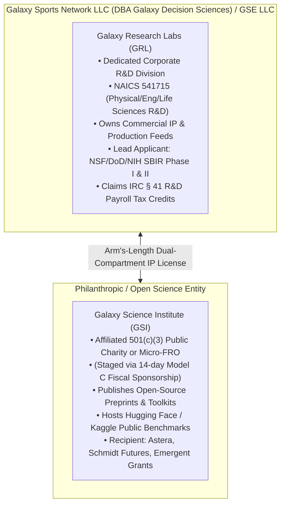
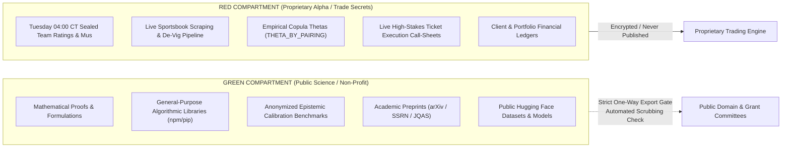

# GSE Scientific Research Institute Charter & Governance Blueprint
**Document ID:** `GSE-CHARTER-2026-01`  
**Classification:** Foundational Institutional Document  
**Date:** 2026-11-03  
**Filing Location:** `docs/engine/research/2026-11-03/GSE-SCIENTIFIC-RESEARCH-INSTITUTE-CHARTER.md`  

---

## 1. Executive Mandate & Institutional Mission

### 1.1 The Institutional Reframe
Galaxy Sports Edge (GSE) hereby establishes **Galaxy Research Labs (GRL)** as its formal scientific research division and authorizes the chartering of the **Galaxy Science Institute (GSI)** as an affiliated non-profit scientific research organization (Focused Research Organization / Micro-FRO).

GSE is not a wagering or handicapping syndicate. GSE is a **Computational Decision Intelligence, Stochastic Control & High-Dimensional Epistemic Calibration Research Organization**. 

Sports competition and prediction markets serve as our primary **Zero-Lookahead Empirical Sandbox**: a dense, verifiable, high-frequency dynamical environment where mathematical models are subjected to immediate, unsparing out-of-sample empirical testing under strict resource and clock constraints. The underlying mathematics—spanning entropic optimal transport, spectral cluster orthogonalization, conformalized quantile regression, and causal graph discovery—are foundational technologies directly transferable to autonomous robotics, defense decision-support, financial risk engineering, and musculoskeletal digital twins.

### 1.2 Core Research Pillars
1. **Pillar I: High-Dimensional Epistemic Probability Calibration:** Finite-sample conformal prediction, asymmetric conformity scores, and distribution-shift detection.
2. **Pillar II: Entropic Optimal Transport in Multi-Agent Dynamical Systems:** Sinkhorn-Knopp divergence and Wasserstein barycenters for resource reallocation under acute agent failure.
3. **Pillar III: High-Dimensional Covariance Shrinkage & Spectral Decoupling:** Positive-part James-Stein estimators, Cholesky whitening, and spectral graph partitioning for multi-factor decision routing.
4. **Pillar IV: Non-Stationary Causal Discovery:** Continuous DAG optimization (NO TEARS), PCMCI+ Markov blanket pruning, and regime-dependent structural equation modeling.
5. **Pillar V: Biomechanical Kinematics & Kinetic Workload Hazards:** Distributed-lag fatigue modeling, trench pocket physics, and injury hazard curves.

---

## 2. Dual-Track Legal Architecture: Labs & Institute

To optimize for both **Federal Small Business Innovation Research (SBIR/STTR) eligibility** (which requires a for-profit entity) and **philanthropic/academic foundation grants** (which require non-profit / 501(c)(3) tax exemption), GSE operates a phased dual-entity model:

### 2.1 Entity A: Galaxy Research Labs (For-Profit R&D Division)
- **Role:** Houses full-time research staff, code infrastructure, production pipelines, commercial trade secrets, and federal SBIR/STTR grant prime contracts.
- **Ownership:** 100% retained by parent company.
- **Target Capital:** Federal SBIR/STTR Phase I ($275K), Phase II ($1M–$1.5M), DoD/ONR research contracts, B2B data licensing, and IRC § 41 tax offsets.

### 2.2 Entity B: Galaxy Science Institute (Nonprofit / Micro-FRO)
- **Role:** Public-good research vehicle dedicated to eliminating scientific bottlenecks in decision systems, publishing open datasets, and sponsoring academic postdocs.
- **Staging Mechanism:**
  - *Phase 1 (Immediate / Days 1–14):* Enter into a **Model C Fiscal Sponsorship Agreement** with an established 501(c)(3) partner (e.g., Open Collective Foundation, Hack Club Bank, or Center for Open Science affiliate). This enables immediate receipt of tax-deductible philanthropic donations (e.g., Emergent Ventures, Astera Foundation) within 2 weeks while paying a standard 5–8% administrative fee.
  - *Phase 2 (Months 2–6):* File **IRS Form 1023** (Long Form) for independent 501(c)(3) recognition under Internal Revenue Code Sections 501(c)(3) and 509(a)(1).

---

## 3. Legal, Statutory & Corporate Filings

### 3.1 Corporate Purpose Clause Amendment
Amend Articles of Organization/Incorporation with the Secretary of State to incorporate explicit scientific research and development scope:
> *"The purpose of the Corporation is to conduct fundamental and applied scientific research, mathematical modeling, and engineering development in computational statistics, artificial intelligence, multi-agent stochastic simulation, biomechanical kinematics, and predictive decision architectures; to develop, license, and commercialize algorithmic software systems; and to engage in any lawful act or activity for which corporations may be organized under the General Corporation Law."*

### 3.2 NAICS Code Classifications
The entity's official industry classification filings must be updated to:
- **Primary: NAICS 541715** — *Research and Development in the Physical, Engineering, and Life Sciences (except Nanotechnology and Biotechnology)* [Crucial gate for SBIR/STTR qualification].
- **Secondary: NAICS 541720** — *Research and Development in the Social Sciences and Humanities* (Covers behavioral economics, game theory, and market microstructure).
- **Secondary: NAICS 541511** — *Custom Computer Programming Services*.
- **Secondary: NAICS 541990** — *All Other Professional, Scientific, and Technical Services*.

### 3.3 Federal Research Registry Checklist
To submit federal grants (NSF, DARPA, ONR, NIH), the following 5-point registration ladder must be completed:
1. [ ] **SAM.gov (System for Award Management):** Obtain Unique Entity Identifier (UEI) and CAGE (Commercial and Government Entity) Code.
2. [ ] **SBA Company Registry (SBIR.gov):** Register small business profile and obtain SBC Control Number.
3. [ ] **Research.gov (NSF Grants Portal):** Create organization account linked to SAM.gov UEI.
4. [ ] **Grants.gov:** Link Authorized Organization Representative (AOR) credentials.
5. [ ] **NIH eRA Commons / eBRAP:** Register for NIH STTR and DoD medical research opportunities.

---

## 4. IRC § 41 Federal & State R&D Tax Credit Program

Under Internal Revenue Code Section 41 (and Section 3111(f)), a "Qualified Small Business" (gross receipts < $5M and no gross receipts prior to the 5-tax-year period) can elect to apply up to **$500,000 annually** of the Research and Development Tax Credit against employer payroll/FICA taxes.

### 4.1 The IRS Four-Part Test Mapped to GSE Artifacts
To claim the credit on **IRS Form 6765**, all R&D activities must satisfy the statutory Four-Part Test:

| Statutory Test (IRC § 41(d)) | IRS Legal Requirement | GSE Contemporaneous Repository Proof |
| :--- | :--- | :--- |
| **1. Permitted Purpose** | Must intend to develop a new or improved business component (functionality, performance, reliability, quality). | Creation of the 4-Stage Cognitive Router ([mcp-cognitive-router.ts](file:///c:/Users/Garrett/Sports/packages/mcp-equations-server/src/mcp-cognitive-router.ts)) and 175-snap Monte Carlo simulator ([gse_coach_mind_simulator.py](file:///c:/Users/Garrett/Sports/scripts/ops/gse_coach_mind_simulator.py)). |
| **2. Technological in Nature** | The process of experimentation must fundamentally rely on principles of engineering, computer science, or mathematics. | Direct implementation of 308 arXiv mathematical papers ([MASTER-PAPER-INDEX.md](file:///c:/Users/Garrett/Sports/docs/arxiv-program/research/MASTER-PAPER-INDEX.md)), Sinkhorn-Knopp entropic regularization, and Cholesky whitening. |
| **3. Elimination of Uncertainty** | Must aim to eliminate uncertainty regarding the capability, method, or optimal design of the system. | Resolving epistemic uncertainty under non-stationary regime shifts; testing whether spectral orthogonalization eliminates cross-factor variance inflation. |
| **4. Process of Experimentation** | Must evaluate one or more alternatives through modeling, simulation, systematic trial and error, or hypothesis testing. | The 600-Test Conformal Invariant Matrix ([conformal-copula-kelly.ts](file:///c:/Users/Garrett/Sports/packages/prediction-engine/src/calibration/conformal-copula-kelly.ts)), out-of-sample backtest birth certificates, and Tuesday 04:00 CT cryptographic seal enforcement. |

---

## 5. Two-Compartment Red / Green IP Firewall Protocol

To participate fully in the scientific community (publishing on arXiv, releasing Hugging Face datasets, and partnering with university PIs) while maintaining a fortress around commercial trading alpha, GSE mandates a strict **Two-Compartment Information Firewall**:

### 5.1 Green Compartment Rules
- **Permitted for Public Release:** Pure mathematical logic, non-identifiable normalized feature arrays, statistical tests, synthetic trajectory distributions, and methodological papers.
- **License:** Open-source under Apache-2.0 or MIT for code; CC-BY-4.0 for datasets and whitepapers.

### 5.2 Red Compartment Rules
- **Strictly Quarantined:** Any file containing live sportsbook identifiers, live market lines, team-specific proprietary prior ratings (`DEFAULT_SEALED_BASELINE["teamRatings"]`), specific calibrated SGP thetas (`THETA_BY_PAIRING`), or bet-sizing capital allocations.
- **Leak Gate Enforcement:** Any script exporting public datasets or documentation must pass the automated `FORBIDDEN_RED_COMPARTMENT_KEYS` sanitizer in `scripts/ops/research_org/export_green_compartment_benchmarks.py`.

---

## 6. Scientific Governance & Advisory Board (SAB)

Following Peter Williams' doctrine (*"A research group is an organization with boundaries, collective goals, and performance control"*), GSE institutes formal scientific governance:

### 6.1 Scientific Leadership Roles
- **Director of Research / Principal Investigator (PI):** Oversees experimental design, ensures mathematical integrity, and acts as Lead PI on federal SBIR submissions.
- **Head of Mathematical Engineering:** Manages the algorithmic translation of arXiv literature into production code modules.
- **Scientific Advisory Board (SAB):** A panel of 3 external university researchers/professors providing bi-annual methodology peer reviews.

### 6.2 Scientific Advisory Board Focus Areas
1. **Seat 1 (Stochastic Systems & Conformal Statistics):** Advises on distribution-free uncertainty quantification, coverage guarantees, and martingale testing.
2. **Seat 2 (Multi-Agent Dynamics & Optimal Transport):** Advises on high-dimensional discrete reallocation, game theory, and computational optimal transport.
3. **Seat 3 (Kinematic Telemetry & Sports Biomechanics):** Advises on spatio-temporal tracking, musculoskeletal fatigue modeling, and clinical injury risks.

### 6.3 Operational Scientific Cadence
- **Weekly Literature Colloquium (Tuesdays 10:00 CT):** Review of newly indexed arXiv preprints and discussion of potential module candidates.
- **Monthly Metric Birth-Certificate Review:** Review of backtested modules seeking elevation from `GATED_EXPERIMENT_CANDIDATE` to `HIGH_PRIORITY_PRODUCTION_TARGET`.
- **Bi-Annual Research Symposium:** Release of GSE technical preprints and update of the Master Paper Index.

---
**Approved & Adopted:** 2026-11-03  
**Galaxy Research Labs & Galaxy Science Institute Operating Committee**
