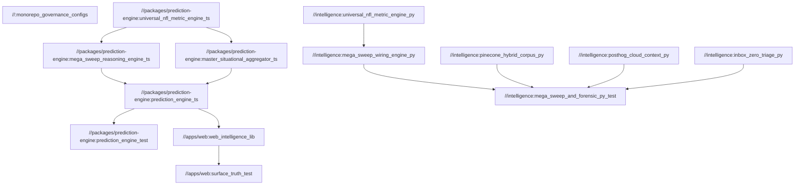

# Bazel Monorepo Build Optimization Architecture (`galaxy_sports_edge`)

- **Date:** `2026-11-06`
- **Skill Applied:** `bazel-build-optimization`
- **Workspace Name:** `galaxy_sports_edge`
- **Toolchains:** `Node.js 20.11.0` (`aspect_rules_js` `1.34.0`, `aspect_rules_ts` `2.1.0`) + `Python 3.13` (`rules_python` `0.27.0`)
- **Hardware Profile:** `12th Gen Intel Core i7-1255U` (`10C/12T`) + `Intel Iris Xe` + `32GB RAM` (`HOST_CPUS*.75`, `HOST_RAM*.75`)

---

## 1. Monorepo Target Graph & Package Topology



---

## 2. Caching & Execution Profiles (`.bazelrc`)

| Profile / Flag | Configuration | Purpose |
|---|---|---|
| **Local Resource Governor** | `--jobs=auto --local_cpu_resources=HOST_CPUS*.75 --local_ram_resources=HOST_RAM*.75` | Caps Bazel workers at 75% of the `i7-1255U` 12 threads and 24GB of the 32GB RAM so interactive IDE/simulator processes never starve |
| **Local Action & Repo Cache** | `--disk_cache=~/.cache/bazel-disk --repository_cache=~/.cache/bazel-repo` | Content-addressed SHA256 action cache eliminating redundant TypeScript/Python rebuilds |
| **Remote Cache (`--config=remote-cache`)** | `--remote_cache=grpcs://cache.galaxysportsedge.internal --remote_upload_local_results=true` | Shares compiled artifacts across local worktrees (`C:\c\wt-*`) and CI runners |
| **Remote Execution (`--config=remote-exec`)** | `--remote_executor=grpcs://remote.galaxysportsedge.internal --jobs=500` | Offloads Tier C / Tier D massive simulation sweeps and multi-GPU workloads |
| **CI Profile (`--config=ci`)** | `--config=remote-cache --build_metadata=ROLE=CI` | Deterministic CI verification with Build Event Stream (BES) reporting |

---

## 3. Dependency Query & Incremental Verification Commands

```bash
# 1. Inspect all transitive dependencies of the storefront intelligence layer
bazel query "deps(//apps/web:web_intelligence_lib)"

# 2. Find reverse dependencies impacted by a change to the universal NFL metric engine
bazel query "rdeps(//..., //packages/prediction-engine:universal_nfl_metric_engine_ts)"

# 3. Enumerate all test targets across TypeScript and Python packages
bazel query "kind('.*_test', //...)"

# 4. Run incremental affected-target tests since HEAD~1
bazel query "rdeps(//..., set($(git diff --name-only HEAD~1)))"

# 5. Profile build execution and action cache hit rates
bazel build //... --profile=bazel_build_profile.json
bazel analyze-profile bazel_build_profile.json
```
