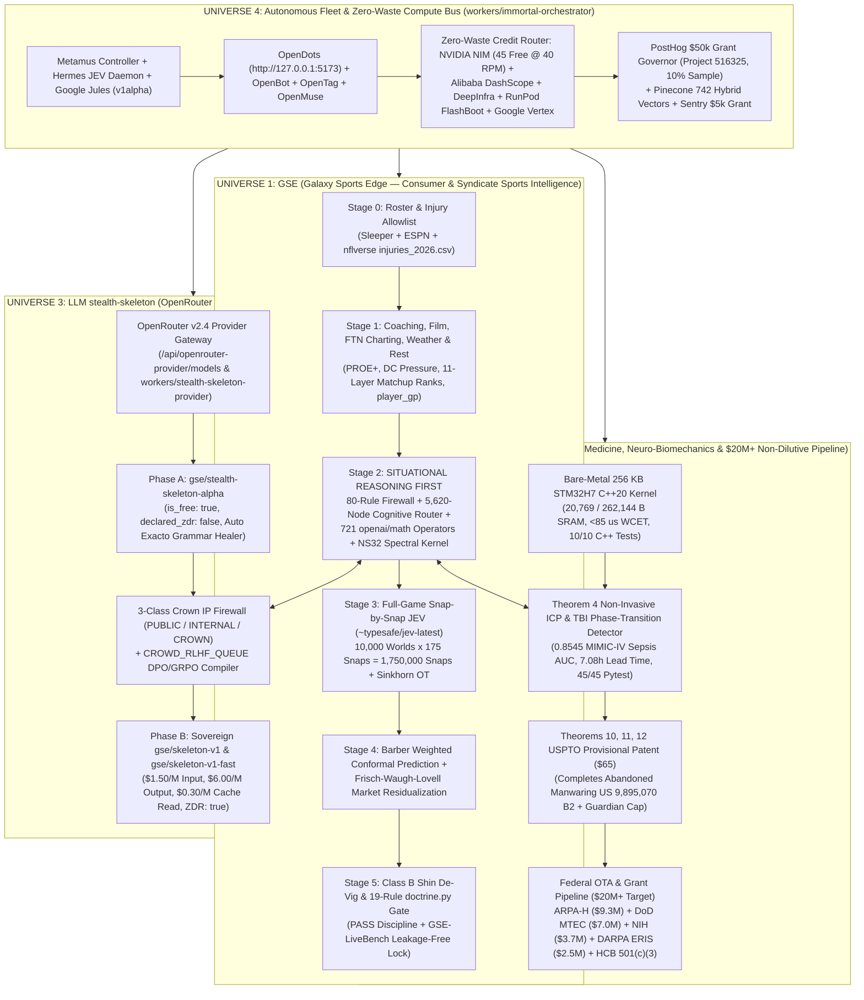

# GSE + GSI + `stealth-skeleton` Universe Master Baseline & Step-by-Step Runbook

**Date:** 2026-11-06  
**Baseline Status:** Verified on Windows Host & `origin/main` + `muse/formal-verification-and-ns32-2026-11-06`  
**Official Season Ledger of Record:** `47-19-1` (`71.2%`, `+24.92u` | Base Card `38-13-1`, `+22.85u` — Note: the legacy `47-19-1` Nov 5 batch is voided per standing doctrine and is never cited as a standing record)

---

## 1. Visual Architecture of the Four Interlocking Universes



---

## 2. Step-by-Step Runbook: How to Run Every System in the Exact Sequenced Order

### A. Launch & Test the LLM `stealth-skeleton` Provider (OpenRouter v2.4 Spec)
1. **Run the OpenRouter v2.4 Schema & Exacto Verification Suite:**
   ```powershell
   npx tsx --test workers/stealth-skeleton-provider/src/__tests__/stealth-skeleton-provider.test.ts
   ```
2. **Query the Live Production Endpoints on `galaxysportsedge.com`:**
   - **OpenRouter v2.4 Model Catalog (`ModelDocumentV2`):**
     `GET https://www.galaxysportsedge.com/api/openrouter-provider/models`
   - **Legacy OpenAI Flat Model Catalog (`sst/opencode`, `Cline`, `Roo Code`):**
     `GET https://www.galaxysportsedge.com/api/openrouter-provider/models?format=legacy`
   - **Chat Completions (JSON & SSE Streaming + Auto Exacto Tool Calling):**
     `POST https://www.galaxysportsedge.com/api/openrouter-provider/chat/completions`
   - **MCP Server Tool Manifest (`@galaxysportsedge/stealth-skeleton-mcp`):**
     `GET https://www.galaxysportsedge.com/api/openrouter-provider/mcp/manifest`
3. **Optional Standalone Cloudflare Worker Deploy:**
   ```powershell
   cd workers/stealth-skeleton-provider
   npx wrangler deploy
   ```

### B. Run the Autonomous Fleet & `ImmortalControlAgent` (`workers/immortal-orchestrator`)
1. **Verify the 8-Node Autonomous Fleet & Situational-First State Machine:**
   ```powershell
   npx tsx --test workers/immortal-orchestrator/src/__tests__/immortal-orchestrator.test.ts
   ```
2. **Open the Visual Dashboards:**
   - **Production / Local Web Cockpit:** `https://www.galaxysportsedge.com/cockpit` (or `http://localhost:3000/cockpit`)
   - **Workflow Pipeline Visualizer:** `https://www.galaxysportsedge.com/cockpit/workflows`
   - **Autonomous Agent Status:** `https://www.galaxysportsedge.com/cockpit/agents`
   - **API Cost & Credit Stack Posture:** `https://www.galaxysportsedge.com/cockpit/api-costs`
   - **Intelligence & Growth Observatory:** `https://www.galaxysportsedge.com/intelligence/observatory`
   - **Local OpenDots Workspace:** `http://127.0.0.1:5173`

### C. Run the Pre-Simulation Verification Gates (ALWAYS Before Game Simulations)
1. **Run the 19-Rule `doctrine.py` Self-Check & 5/5 Numeric Proofs:**
   ```powershell
   python data/audits/doctrine_selfcheck.py
   python data/audits/doctrine_numeric_checks.py
   ```
2. **Run the Unit-Box Navier-Stokes 32-Seed Spectral Kernel Validation (4/4 Analytic Proofs):**
   ```powershell
   python data/audits/ns_kernel_validation.py
   ```
3. **Run the `GSE-LiveBench` Leakage-Free Evaluation Harness & 1,116 Textbook Reconciliation:**
   ```powershell
   python scripts/eval/gse_livebench_harness.py
   python scripts/ops/reconcile_1116_textbook_and_muse_audits.py
   ```
4. **Run the Full 360-Degree Pre-Projection & Situational-First Simulator Test Suite:**
   ```powershell
   python -m pytest tests/python tests/test_week9_forensic_autopsy_fixes.py -q
   ```
5. **Run All 36 Repository Guardrails:**
   ```powershell
   node scripts/guardrails/run-all.mjs
   ```
